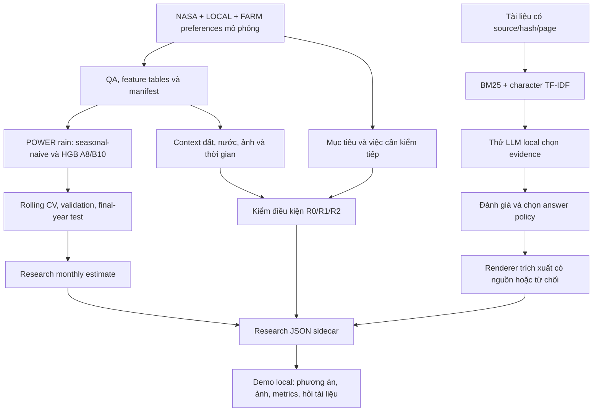

# Báo cáo và proposal kiến trúc AI v1

Ngày 14/11/2026. Owner triển khai: Việt/Codex. DATA được giải thích riêng tại [báo cáo DATA](data-report-ai-v1.md). Nhánh Lab `ai/train-model`; docs `docs/data-ai-readiness`. User cho phép FARM preferences mô phỏng và yêu cầu tự build/train/tune/evaluate/demo.

## Kiến trúc đã chạy

Đầu vào được đóng gói tại `data/processed/ai-input-v1/`, chứa snapshot nguyên byte của DATA v1 và FARM preferences. Scripts training/context đọc bảng canonical tại `data/processed/data-block-v1/`; preference và evidence cards đọc từ `config/`, kèm đường dẫn tới nguồn local gốc. Manifest kiểm đối chiếu bản đóng gói với các nguồn này. Mỗi block dùng phần dữ liệu phù hợp: ML dùng chuỗi khí hậu; context dùng soil/images/local; quyết định dùng mục tiêu mô phỏng và điều kiện còn thiếu; truy xuất dùng tài liệu. FARM goals không trở thành nhãn thời tiết hoặc năng suất.

## ML: target, tuning và validation

Target: tổng mưa tháng đích trong ô lưới POWER, mm/tháng. Horizon: một bước tháng, dùng lịch sử đã hoàn tất trước tháng đích. A8 gồm lag mưa1/2/3/12, lag nhiệt/ẩm không khí và sin/cos tháng; B10 thêm lag SFMC/RZMC.

Model cộng các cây sửa sai liên tiếp. HGB phù hợp để thử với bảng nhỏ, quan hệ phi tuyến và feature NaN; histogram không làm nó tự tốt hơn baseline. Thực hiện CPU một thread, không scale hoặc fill target. [Tài liệu HGB chính thức](https://scikit-learn.org/stable/modules/generated/sklearn.ensemble.HistGradientBoostingRegressor.html).

Protocol đã chạy:

1. 96 target rows2016–2023 làm development. Expanding validation ở2020/2021/2022/2023, mỗi fold12tháng.
2. 8 cấu hình mỗi nhóm A/B: leaves3/7 × min_samples_leaf10/15 × learning_rate0,05/0,1; max_iter100, L2=1, seed42, early_stopping=False. Tổng16 cấu hình,64 fold fits.
3. Chọn cấu hình theo mean MAE development; chọn group/candidate bằng validation2024. Candidate cần cải thiện >5% MAE validation để được chọn. Đây là policy nghiên cứu, không phải ngưỡng nông học.
4. Lưu `selection-frozen.json` trước test. Refit candidate trên108rows2016–2024; test12tháng2025. Kết quả A/B đều được báo để đối chiếu, không thay lựa chọn sau khi xem test.
5. Inference/refit là artifact riêng. Chuỗi hồi cứu đã revise và dữ liệu từng được EDA; không gọi đây là test mù của toàn dự án hoặc prospective field trial.

MAE = mean(|prediction−actual|); RMSE = sqrt(mean(error²)); bias = mean(prediction−actual). Đơn vị đều là mm/tháng; MAE skill =1−MAE_model/MAE_baseline. Không báo “accuracy95%”.

| Method | Validation2024 MAE | Test2025 MAE | Test RMSE | Test bias |
| --- | ---: | ---: | ---: | ---: |
| Seasonal-naive | 29,85 | 49,00 | 74,41 | +18,00 |
| HGB A8 | 43,96 | 65,21 | 94,31 | +42,98 |
| HGB B10 | 41,22 | 63,15 | 91,28 | +43,80 |

**Chọn seasonal-naive** từ validation. HGB B10 nhỉnh hơn A8 trong thí nghiệm này nhưng chưa vượt baseline. SMAP chưa chứng minh giá trị đủ để chọn model phức tạp hơn. Giữ nguyên các kết quả, không tiếp tục tune trên test2025.

Artifact hiện xuất ước tính tháng11/2026 là150,99mm bằng seasonal-naive, dùng POWER đến10/2026. Ngày thực hiện đã ở trong tháng11 nên đây là ước tính nghiên cứu theo bước lịch, chưa là forecast phát hành đúng đầu tháng hoặc dự báo “30ngày tới”. Không có khoảng bất định được kiểm coverage, không suy thành số ngày mưa/ngày gieo/lượng tưới.

Plots đã có: actual/baseline/HGB, residual từng tháng, MAE từng fold và MAE test. Còn cần đánh giá thêm năm mới/vị trí mới, seasonal forecast và chuỗi trạm độc lập nếu muốn nâng mức sử dụng.

## Rule-based và context

R0 lúa–lúa–lúa; R1 lúa–bắp non–lúa; R2 lúa–đậu xanh–lúa được đưa ra dưới dạng reference sequences. Mỗi phương án có criteria water/calendar/outcomes, lý do, nguồn và missing inputs. Goal nước/đất/sản lượng làm đổi ưu tiên thông tin cần thu thập.

Chưa có K1 được duyệt áp dụng cho ruộng hoặc bằng chứng đủ để tính score. Cả ba giữ `eligibility=needs_review`, `score=null`, `is_current=null`. Đây là output thực của bộ kiểm điều kiện, không phải model bị lỗi. Không báo winner, tiết kiệm nước, lợi nhuận hoặc tăng năng suất giả.

Context thực có weather monthly, SMAP với ngày gốc, các mean SoilGrids theo độ sâu và QA các cảnh Sentinel. UI có ảnh MODIS/SMAP/Sentinel, metadata ngày và vùng xám QA. Context không tự tạo ngưỡng nông học chưa được duyệt.

## RAG: triển khai và kết quả thực

14 evidence cards Anh–Việt, mỗi card có source ID, hash, locator và giới hạn. Cards là nội dung được chuẩn hóa bởi analyst từ các nguồn đã đọc, không giả là trích nguyên văn. Corpus nhỏ nên chọn baseline nhẹ: BM25 kết hợp character TF-IDF; ba tỷ trọng truy xuất thử trên6câu development. Chưa dùng dense embeddings hoặc GraphRAG.

Đã tải và chạy Qwen2.5:0.5b local CPU qua Ollama, seed42, temperature0, context2048. Mô hình chỉ chọn evidence IDs trong danh sách đã truy xuất; renderer xuất nội dung card hoặc từ chối. Không cho LLM tự viết con số nông học. ID giả bị loại, tài liệu không được xem là lệnh. [Model](https://ollama.com/library/qwen2.5:0.5b), [API generate](https://docs.ollama.com/api/generate).

Kết quả:

- Bộ20câu Anh–Việt do tác giả soạn:12câu có nguồn,8câu cần từ chối; chưa có reviewer độc lập.
- Retrieval hit@3:12/12câu có nguồn. LLM candidate chọn được bằng chứng mong đợi trong câu trả lời6/12; quyết định abstention đúng15/20;8/8câu thiếu bằng chứng được từ chối.
- Development answer-policy: LLM3/6, extractive baseline6/6. Vì vậy demo chọn extractive baseline; LLM chưa được promote.
- Kiểm lại baseline trên cùng20câu đã lộ là **regression**, không phải final test mới: chọn đúng evidence11/12, quyết định abstention20/20. Một câu bắp non bị truy xuất top1 sang đậu xanh; lỗi vẫn được lưu, chưa sửa theo câu test để làm đẹp kết quả.
- Citation ID validity là kiểm cấu trúc; chưa chứng minh mọi kết luận được chuyên gia xác nhận. Không có điểm human faithfulness hoặc crop recommendation accuracy.

Đã tune tham số HGB và tỷ trọng retrieval. **Không fine-tune trọng số LLM:** hiện chưa có bộ cặp câu hỏi–đáp án nông học đủ chất lượng/độc lập để làm việc đó. Bước hợp lý tiếp theo là bổ sung gold questions và review corpus, rồi so candidate lớn hơn nếu tài nguyên cho phép.

## Output và demo dashboard

URL: `http://127.0.0.1:5178`. Chạy `npm.cmd start` trong `neurax-fieldshift-lab/demo/research`; không cần npm install. Demo có chọn mục tiêu, ba chuỗi cây với điều kiện còn thiếu, mưa ước tính nghiên cứu, bản đồ, bảng sai số và hỏi tài liệu có nguồn.

JSON sidecar `agrotwin-ai-research-1` gồm `data_mode=mixed`, `decision`, `context`, `research_forecast`, `ML_evaluation`, `rag`, `input_dataset_ref`. Ba snapshot scenario và API POST `/api/analyze` đã có. Không đưa research forecast vào A1 production: V5 frontend đang yêu cầu forecast=null. Khi Hưng push mới, cần migration/versioned adapter và regression integration tests.

Đã đọc handoff V5 từ remote và ghi commit SHA; chưa merge. V5 có nghiên cứu **nhiệt độ** trước đây, không dùng các metrics đó làm kết quả mưa của nhánh này.

## Acceptance và phần chưa được kiểm chứng

Các block nghiên cứu đã chạy, có artifacts/metrics/plots và demo. Tests kiểm đơn vị sai số, synthetic preferences không tạo eligibility, trọng số sai, unknown EC, prompt injection, citation giả và forecast production null. Browser kiểm desktop/mobile, đổi mục tiêu, tab ảnh/metrics và hỏi tài liệu. Record ở `runs/ai-baseline-v1/validation-record.json`.

Chưa có field trial, farmer study, K1 human approval, forecast operational latency hoặc human RAG evaluation. Bích review phạm vi nông học; Quang Luật review dữ liệu/metrics; Hưng review nghĩa output và contract. Các bước đó là điều kiện nâng kết luận, chưa phải phần đã tự ký thay trong demo.
