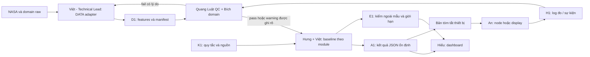

# Contract-first: DATA → AI → DEPLOY

> 2026-10-30 · Kiến trúc dự kiến; toàn bộ ví dụ trong tài liệu là minh họa, chưa là dữ liệu NASA hoặc kết quả model.
> Ba workflow: [Field Shift](workflows/field-shift.md), [Earth Analog](workflows/earth-analog.md), [MODIS/VIIRS](workflows/modis-viirs.md).
> Đây là tên file/format **sẽ dùng khi triển khai**, không phải các artifact đã được tạo trong repo docs.

## Quyết định kiến trúc

Chọn **batch dữ liệu nhỏ + schema ổn định + dashboard đọc kết quả** cho MVP. Không để Hiếu đọc NetCDF/HDF/raster gốc hoặc phải chạy notebook của người khác. Không cần API/live cloud ở mốc đầu; khi thêm API vẫn trả cùng result schema.

So với nối thẳng notebook vào UI, cách này cần thống nhất schema sớm nhưng giảm phụ thuộc R/MATLAB/Python và giảm sửa tích hợp. So với streaming/microservices, cách này đủ cho demo dữ liệu lịch sử và ít vận hành hơn. Nếu bài thật cần realtime, chỉ thêm luồng H1 riêng cho thiết bị.



## NASA chưa có gói data thì làm gì?

Chưa có Resources/sample đã audit không có nghĩa tất cả NASA data chưa tồn tại. Ví dụ [POWER Daily API](https://power.larc.nasa.gov/docs/services/api/temporal/daily/) mô tả chuỗi dữ liệu khí tượng; [FIRMS](https://firms.modaps.eosdis.nasa.gov/) cung cấp MODIS/VIIRS. Chưa xác nhận product/version/coverage cụ thể phù hợp team.

**Ngay bây giờ, trong docs:** chốt câu hỏi, row grain, schema, QA policy, baseline, expected cases, result payload và storyboard. Ví dụ synthetic chỉ kiểm hiểu contract, không dùng làm bằng chứng khoa học. Khi thi, xây fixture và adapter theo các đặc tả này; dữ liệu thật thay phần đọc nguồn, các block còn lại giữ giao diện.

**Khi nguồn xuất hiện:** Việt ánh xạ trường → Quang Luật kiểm số/đơn vị → Bích kiểm ý nghĩa → Việt chốt version → Hưng/Việt chạy lại baseline theo module → Hiếu thay data_mode. Nếu không thể tạo feature đã hứa, giảm scope hoặc trả unavailable; không lấp bằng số bịa.

## Quyền sở hữu kỹ thuật

Việt là **Technical Lead / DATA + AI**, chốt contract và kiến trúc, cùng Hưng làm model: Field Shift Việt phụ trách baseline forecast và EO, Hưng ranking; Earth Analog Việt triển khai similarity, Hưng dimensions/weights; MODIS/VIIRS Việt anomaly/data, Hưng harmonization. Forecast vẫn có gate dữ liệu; nếu không đạt, Việt tiếp tục phần AI analysis/inference integration thay vì bị xem là chỉ làm DATA.

A1 có nhiều producer nhưng một schema do Việt chịu trách nhiệm cùng Hiếu; mỗi run ghi model_owner, model_version và task. Hưng/Việt review chéo logic, Quang Luật kiểm E1 độc lập. Hiếu và An tự chủ triển khai trong contract đã thống nhất.

## D1 — gói DATA giao AI

| File dự kiến | Nội dung / contract | Owner |
| --- | --- | --- |
| manifest.json | schema_version, dataset_version, data_mode, generated_at UTC, area/period, source references, transforms, checksum khi có | Việt |
| features.csv | Một grain xác định theo workflow; khóa rõ, số thuần machine-readable; không trộn nhiều grain | Việt |
| dictionary.csv | column, dtype, unit, nullable, definition, aggregation, valid_range có nguồn | Bích định nghĩa, Việt ánh xạ |
| entities.geojson hoặc entities.csv | entity_id, body, CRS/coordinate convention, geometry hoặc tọa độ | Việt + Bích |
| provenance.csv | entity/record hoặc file partition → source_id, product/version, source location, processing version | Việt |
| qa-report.md + qa-summary.csv | missingness, duplicates, dropped records, phạm vi pass/warn/fail, phương pháp kiểm, reviewer | Quang Luật |
| splits.csv, nếu học/đánh giá model | key → train/validation/test; thời gian/vùng và version cố định | Hưng định protocol; Việt xuất; Quang Luật kiểm |

Khởi đầu bằng CSV UTF-8 cho R/MATLAB/Python cùng đọc; chỉ thêm Parquet khi volume thật cần. Không xuất .mat/.RData thành đầu vào bắt buộc của AI/DEPLOY.

Trong CSV, trường có nhiều ID như source_ids dùng chuỗi JSON array trong ô CSV được quote đúng chuẩn; hoặc chuyển quan hệ 1:N sang provenance.csv. Không nối ID bằng dấu phân cách tùy ý.

Quy ước: UTC dạng ISO 8601; số thập phân dùng dấu chấm; CSV thiếu là ô rỗng, JSON thiếu là null; 0 là giá trị có thật. Không đổi nodata thành 0. Metadata giữ unit và resolution gốc lẫn sau aggregate. Geographic coordinates Earth dùng lon/lat có CRS; Moon/Mars phải ghi body và convention riêng, không gắn EPSG:4326 của Earth cho mọi hành tinh.

## Q1 — khi nào AI được dùng dữ liệu?

- Khóa duy nhất đúng grain, unit/time/geometry hợp lệ; mỗi feature có provenance và dictionary.
- QA theo **feature + entity + period**, không gắn pass cho toàn bộ dataset chỉ vì vài cột hợp lệ.
- Missing/range/coverage threshold do workflow ghi trước; nếu chưa đủ căn cứ, đánh dấu unknown và không fit.
- Dữ liệu thưa được giữ warning với coverage, không tự nội suy rồi coi quan sát thật.
- Fit imputer/scaler/normalizer chỉ trên train nếu có model; split trước khi fit.
- Quang Luật kiểm mẫu độc lập, Bích rà phép aggregate có ý nghĩa khoa học. Hai kiểm tra khác nhau.
- AI nhận phần pass; warning phải theo đến UI. Fail chặn đúng tính năng phụ thuộc, không nhất thiết chặn cả dashboard.

## A1 — gói AI giao DEPLOY

Envelope chung có trường bắt buộc:

| Trường | Kiểu / ý nghĩa |
| --- | --- |
| schema_version | string; phiên bản contract, ví dụ 0.1 |
| run_id, input_dataset_version, model_version | string; nối đúng dữ liệu và phương pháp |
| model_owner | string; Hưng hoặc Việt theo module; ví dụ synthetic ghi example |
| generated_at, data_as_of | UTC; lúc tính khác lúc dữ liệu có hiệu lực |
| data_mode | synthetic / observed / mixed; replay ghi thêm delivery_mode |
| result_kind | analysis / forecast / scenario; tránh gọi mọi model output là forecast |
| status | ok / partial / unavailable |
| evidence_ids, warnings | arrays; warning chất lượng/giới hạn hiển thị được |
| results | array payload riêng mỗi idea, có ID và units trong dictionary |
| evaluation_ref | string hoặc null; chỉ trỏ báo cáo tồn tại |
| forecast | object hoặc null; target, horizon, train_end, method, interval nếu có căn cứ |

Ví dụ **synthetic**, chỉ kiểm cấu trúc, không phải kết quả chạy:

```json
{
  "schema_version": "0.1",
  "run_id": "example-001",
  "input_dataset_version": "synthetic-v0",
  "model_version": "baseline-spec-v0",
  "model_owner": "example",
  "generated_at": "2026-11-14T05:00:00Z",
  "data_as_of": null,
  "data_mode": "synthetic",
  "result_kind": "analysis",
  "status": "partial",
  "evidence_ids": ["synthetic-example"],
  "warnings": ["Ví dụ minh họa; chưa có dữ liệu thật"],
  "results": [],
  "evaluation_ref": null,
  "forecast": null
}
```

Payload ở từng workflow nằm trong results. Một diagram/CSV có kết quả nhưng thiếu provenance không được gọi là A1 hoàn chỉnh. Hiếu render empty/partial/unavailable ngay từ đầu; UI không tự tính lại ranking/metric.

## E1 — đánh giá để team biết có đáng nâng model không

E1 ghi task/target, baseline, candidate, split version, n/coverage, metric và đơn vị, kết quả từng fold hoặc vùng, limitations. Quang Luật tính lại một mẫu hoặc một metric bằng R/MATLAB; owner model (Hưng hoặc Việt) giải thích sai khác. Không dùng test để chọn model liên tục; chọn trên validation rồi đánh giá một lần trên heldout test.

Field Shift/Earth Analog không có nhãn “đúng” thì kiểm constraints, sensitivity và domain evidence; không tự tạo accuracy. MODIS/VIIRS có thể kiểm agreement giữa sensor trên overlap nhưng đó không phải ground truth cháy. Synthetic chỉ dùng kiểm plumbing và trường hợp biên, không báo metric khoa học trên nó như kết quả thật.

## H1 — thiết bị không chặn đường DATA chính

An xuất log: event_id, device_id, timestamp UTC, event_type, value nullable, unit, quality, calibration_id nullable, source_context, delivery_mode (live/replay). Sensor log gắn nơi đo thực; display log gắn result_id, không có “giá trị sensor” giả.

Quang Luật nhận CSV log để phân tích thời gian nhận, missingness, độ phân tán và sai lệch với tham chiếu khi có. An sở hữu sửa wiring/firmware; Hiếu sở hữu bridge/dashboard. Thiết bị chỉ nhận một bản tóm tắt A1 gồm run_id, label/value/unit, status, data_as_of, warning; không phải xử lý raster hay training model.

## Version và bàn giao

- Producer công bố package D1/A1 immutable; sửa data → dataset_version mới, sửa model → model_version mới.
- Thêm trường optional có thể giữ minor; đổi tên/grain/unit/ý nghĩa là breaking change, cần Việt–Hưng–Hiếu thống nhất trước.
- Quang Luật giữ QA/evaluation cùng version. Không dùng metrics của v1 để gắn lên UI đang chạy v2.
- Việt chốt contract kỹ thuật T+2 với Hưng về ý nghĩa bài toán; tới T+12 ưu tiên giữ contract, cắt feature thay vì đổi schema liên tục.
- Không cần online service cho baseline; Hiếu đọc snapshot local. Sản phẩm triển khai sau này ở nasasac26-neurax.

## Tối ưu theo thời gian còn lại

| Nút thắt | Cách xử lý trước | Owner / điều kiện bỏ |
| --- | --- | --- |
| Nguồn khó tải | Một AOI, một sample nhỏ, snapshot thật có nguồn | Việt; quá một phiên 60 phút không tiến triển thì báo Hưng để giảm nguồn/chuyển fallback |
| Quang Luật bị quá tải | QA trên mẫu + checklist tự động về sau; hardware test một phiên ngắn | Hưng ưu tiên DATA/E1; An tự chủ phần cơ khí |
| Model mất thời gian | Baseline trước; chỉ một candidate nếu data và evaluation đã có | Hưng; chưa có demo A1 thật ở T+12 thì bỏ candidate |
| Chuyển R/MATLAB/Python | CSV/JSON, dictionary và chart spec | Quang Luật/Việt; không port toàn notebook |
| Hardware trễ | Log replay có nhãn, thiết bị display đơn giản | An; không mua thêm subsystem giữa thi |
| Tích hợp sát hạn | Một demo path, cache, bỏ animation/layer phụ | Hiếu; D−8h khóa feature, D−4h rehearsal |
| Báo cáo quá cầu kỳ | Markdown + biểu đồ chính, PDF khi cần | Quang Luật; không để LaTeX định dạng chặn nộp |

Các ngưỡng là kế hoạch nội bộ, chưa là số đo thực tế. D là hạn sớm nhất cần có bản nộp/đánh giá, theo [lịch](event-timeline.md).
