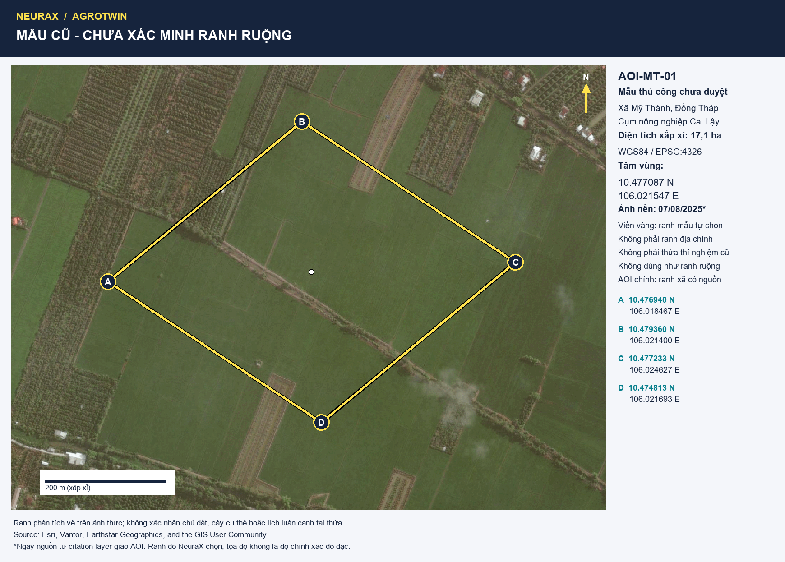
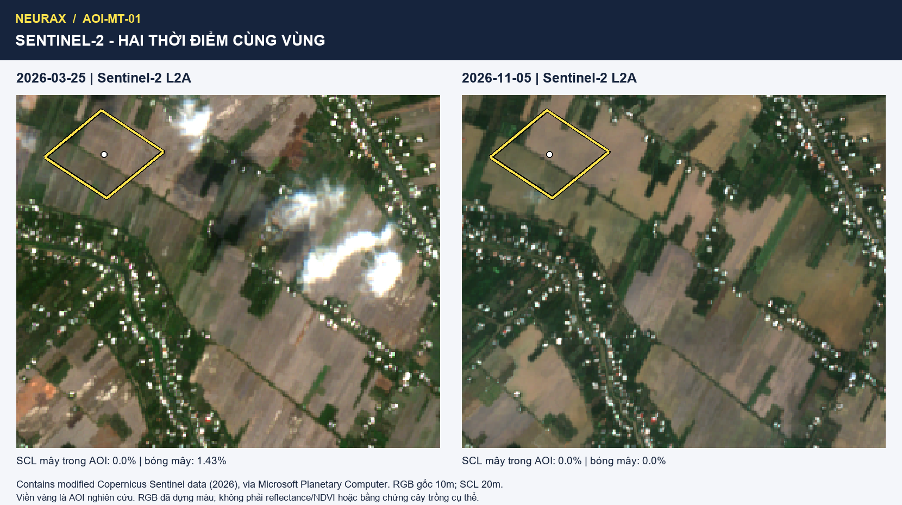

> SUPERSEDED: Bản trước audit ranh; polygon 17 ha không được xác minh là thửa ruộng. Xem README.md và site-sensor-enso-review-2026-11-12.md.

# AOI-MT-01 — Mỹ Thành, Cai Lậy: địa bàn cố định cho hackathon

> Chốt AOI nghiên cứu ngày 12/11/2026 theo yêu cầu chọn địa bàn để bắt đầu làm. Team xác nhận không thể khảo sát thực địa; scope được chốt là phân tích dữ liệu công khai và demo kịch bản. Không cần tìm hộ/đo đất tại ruộng để bắt đầu prototype này. Chưa sửa proposal/PDF hoặc push.

**Chọn AOI-MT-01 trong xã Mỹ Thành, tỉnh Đồng Tháp, thuộc cụm nông nghiệp phía bắc Cai Lậy cũ.** Có thể tiến hành dự án tại vùng này theo scope từ xa. Không tiếp tục đổi địa bàn chỉ để tìm “đất hoàn hảo”; một vùng có ảnh thực, ranh cố định và dữ liệu có provenance phù hợp hơn việc mở rộng search liên tục. Chưa có căn cứ gọi đây là đất phù hợp tuyệt đối để nông dân trồng cả hai cây, hoặc địa điểm tốt nhất toàn Việt Nam.

## 1. Vị trí đã cố định và file gửi Bích

- **Tâm:** 10.4770865 N, 106.02154675 E. [Mở điểm trên Google Maps](https://www.google.com/maps/search/?api=1&query=10.4770865,106.02154675).
- **Diện tích phân tích:** khoảng **17,1 ha**, tính xấp xỉ theo tọa độ; không là diện tích địa chính hoặc một nông hộ.
- **CRS:** WGS84 / EPSG:4326. GeoJSON/KML dùng **longitude, latitude**; CSV có tên cột rõ.
- [GeoJSON ranh](aoi.geojson): mở trực tiếp trong QGIS/geojson.io hoặc dùng làm input AOI.
- [KML ranh và tâm](aoi.kml): mở bằng Google Earth.
- [CSV tọa độ bốn góc và tâm](coordinates.csv); [manifest ranh, ảnh và QA](aoi-manifest.json).

| Điểm | Vĩ độ N | Kinh độ E |
| --- | ---: | ---: |
| A — phía tây | 10.476940 | 106.018467 |
| B — phía bắc | 10.479360 | 106.021400 |
| C — phía đông | 10.477233 | 106.024627 |
| D — phía nam | 10.474813 | 106.021693 |

Các góc là **ranh phân tích do NeuraX chọn trên ảnh**, không phải ranh hành chính, quyền sử dụng đất hoặc vị trí thí nghiệm CTU. Số chữ số tọa độ không phải độ chính xác đo đạc. Các đỉnh và 21 điểm trên mỗi cạnh đã kiểm nằm trong polygon Mỹ Thành tham khảo, mã 28456; geometry bên thứ ba có nguồn gốc bản đồ hành chính, không dùng làm tài liệu pháp lý.



[Ảnh tổng quan rộng hơn](maps/my-thanh-aoi-overview.png). Ảnh nền Esri World Imagery, citation layer giao AOI ghi nguồn **07/08/2025**, Vantor Vivid, nominal source resolution 0,34 m, source accuracy metadata 5 m. File xuất bản đồ đã resample theo kích thước trang; không gọi ảnh bản đồ là dữ liệu phân tích 0,34 m. Credit hiển thị ngay trên hình; không coi ảnh thương mại này là dữ liệu NASA hoặc dữ liệu tự do để phân phối lại hàng loạt.

## 2. Vì sao chuyển từ Long Khánh sang khối ruộng này?

Khuyến nghị trước đã ưu tiên nghiên cứu lịch sử Long Khánh. Kiểm hiện trạng bổ sung cho thấy **Long Khánh hiện chủ yếu cây ăn trái, nổi bật sầu riêng** theo [báo địa phương, 19/12/2023](https://baodongthap.vn/xa-long-khanh-tx-cai-lay-dat-chuan-xa-nong-thon-moi-kieu-mau-a100563.html). Vì vậy không khoanh điểm GeoNames Long Khánh rồi mặc định là ruộng lúa năm 2026.

Mỹ Thành được chọn làm AOI triển khai vì đồng thời có:

1. **Bối cảnh nông nghiệp hiện thời:** [nguồn 12/01/2026](https://daihoidangtoanquoc.vn/xa-my-thanh-vung-buoc-tren-duong-xay-dung-nong-thon-moi-post1507.html) xác nhận xã mới từ Mỹ Thành Nam, Mỹ Thành Bắc và Phú Nhuận; lúa và cây ăn trái là chủ lực. Nguồn cũng ghi chuyển đổi sang cây ăn trái, nên không coi cả xã là ruộng lúa.
2. **Khối ruộng nhìn được trên ảnh:** AOI ưu tiên các ô canh tác mở, hạn chế vùng nhà ở và vườn cây hàng cây rõ. Có bờ/kênh và dải cây ở rìa; khi xử lý raster phải mask phần không phải đối tượng cây hằng năm. Diễn giải thị giác chưa phải phân loại giống cây đã kiểm chứng.
3. **Ảnh mới có ngày và QA tại AOI:** Sentinel‑2 tháng 3 và tháng 11/2026, xem dưới; không chỉ dựa ảnh nền 2025.
4. **Nguồn dữ liệu thực sự đã tải:** POWER, SoilGrids và imagery/metadata nằm trong repo, không phụ thuộc tài khoản trả phí hay chờ NASA gửi riêng một dataset.

Nghiên cứu CTU ở Long Khánh/Cai Lậy giữ vai trò **evidence tham khảo cho thiết kế luân canh**, không chuyển thành kết quả tại Mỹ Thành. Đây là sửa phạm vi hiện trạng, không xóa hồ sơ lịch sử.

## 3. Ảnh vệ tinh hiện thời và điều ảnh chưa chứng minh



| Cảnh Sentinel-2 L2A | Pixel-center SCL trong AOI | Gắn cờ mây 8/9/10 | Bóng mây 3 | Nodata |
| --- | ---: | ---: | ---: | ---: |
| 25/03/2026 | 419 | 0% | 1,43% | 0 |
| 05/11/2026 | 419 | 0% | 0% | 0 |

Đây là tỷ lệ của mẫu raster SCL đã reproject nearest, **không phải kiểm chứng mây bằng thực địa**. Cloud cover toàn tile khoảng 8,7% không được dùng thay QA tại AOI. RGB là asset `visual` dựng màu, nguồn 10 m; SCL nguồn 20 m, output gần 20 m. Phóng to hình không tăng độ phân giải. Kết quả gợi vùng có canh tác/mặt đất trống/nước thay đổi theo thời điểm; không đủ suy cây cụ thể, số vụ, ngày gieo hoặc nhu cầu tưới. Không dùng TCI/RGB uint8 để tính NDVI.

Scene ID, baseline, UTC, URL asset và source hashes có trong [manifest](aoi-manifest.json) và [gói dữ liệu](../../../sources/data-audits/my-thanh-cai-lay-2026-11-12/README.md). Nguồn: Copernicus Sentinel‑2 qua Microsoft Planetary Computer; [ý nghĩa SCL](https://sentiwiki.copernicus.eu/web/s2-processing).

## 4. Đất–nước: đủ dữ liệu đầu vào để làm, không giả là đất đã đo

**Đất:** đã lấy 15 coverage SoilGrids nhỏ qua WCS tại vùng này. Tại ô trả về chứa tâm AOI:

| Biến mô hình | Mean | Q05–Q95 |
| --- | ---: | --- |
| pH H2O 0–5 cm | 6,3 | 4,5–8,3 |
| pH H2O 5–15 cm | 6,3 | 4,5–8,3 |
| pH H2O 15–30 cm | 6,4 | 4,5–8,3 |
| Cát 0–5 cm | 20,6% | 1,2–71,9% |
| Sét 0–5 cm | 37,1% | 0,4–94,2% |

Không thấy tín hiệu mô hình đủ để loại AOI ngay vì pH quá cực đoan, nhưng bất định lớn: **không dùng mean để chứng nhận đất thích hợp bắp non/đậu xanh**. Đây là mô hình gốc 250 m, ít ô so với AOI 17 ha; kết quả tại tâm không là trung bình mẫu đất cả vùng. Chưa có EC, tầng đế cày, drainage hoặc trữ nước hữu dụng. Không cộng các quantile texture; không điền pH thửa “đã đo = 6,3”.

**Khí tượng:** đã tải POWER daily UTC 2015–2025 tại đúng tâm AOI, 4.018 ngày/16.072 giá trị. Các mảng bốn biến trùng probe Long Khánh trước vì support khí tượng thô; đây **không phải hai bộ quan trắc độc lập**. QA tổng thể WARN do 14/06/2020 có mưa 488,17 mm/day cần review; giữ nguyên raw. Mưa không phải lượng tưới đến ruộng, không tính tiết kiệm nước từ phép so tổng mưa.

**Nước/đất chưa biết được đưa vào scenario có nhãn**: khả năng thoát nước, có tưới bổ sung và khoảng chuyển vụ. Với scope team đã chọn, những unknown này không chặn bắt đầu làm dashboard/mô phỏng; chúng chặn việc tuyên bố một khuyến cáo canh tác thực tế đã được xác thực. Không đặt thêm yêu cầu tìm hộ/đo đất mà team đã xác nhận không thể thực hiện.

## 5. Hai phương án và câu chuyện dùng trong dự án

| Mã cho prototype | Chuỗi tham chiếu | Nguồn/phạm vi |
| --- | --- | --- |
| MT-REF-R0 | Lúa → lúa → lúa | Đối chứng lịch sử, không là R0 đã quan sát ở AOI |
| MT-REF-A | Lúa → bắp non/bắp rau → lúa | Nghiệm thức công bố tại Long Khánh, tham khảo Cai Lậy |
| MT-REF-B | Lúa → đậu xanh → lúa | Nghiệm thức công bố tại Long Khánh, tham khảo Cai Lậy |

[Nghiên cứu CTU 2009 về đất vật lý](https://ctujsvn.ctu.edu.vn/index.php/ctujsvn/article/download/605/3214/3214) hỗ trợ cấu trúc phương án; [nghiên cứu dinh dưỡng/lịch mùa tại Cai Lậy](https://ctujsvn.ctu.edu.vn/index.php/ctujsvn/article/view/597) bố trí cây cạn Hè Thu. Chưa khẳng định đó là lịch đang áp dụng ở Mỹ Thành. Không tái dùng giống/duration bắp hạt CP888 hoặc đậu phộng GV10 cho hai cây này. Không huấn luyện/kiểm định ML bằng cách nhân bản bảng trung bình công bố thành nhiều nông hộ.

Thông điệp: **“Dùng khí tượng NASA, đất mô hình và bằng chứng luân canh để khám phá khi nào nên giữ lúa hoặc cân nhắc một vụ cây cạn; hiển thị rõ điều kiện nước/đất/lịch khiến kết quả thay đổi.”** Sensor thật là thí nghiệm tại bàn demo, tách khỏi quan trắc tại Mỹ Thành. Không hứa giảm nước/tăng năng suất/cải tạo đất đã đo. Kết quả độ bền đất tại Long Khánh không khác biệt có ý nghĩa trong bài S1, phải giữ giới hạn này khi kể chuyện.

## 6. Bích có thể bắt đầu từ đâu — hoàn toàn từ xa

1. Mở **aoi.kml** trong Google Earth hoặc **aoi.geojson** trong QGIS; dùng đúng AOI-MT-01, không dịch về điểm GeoNames Long Khánh. Xem ba hình PNG trước khi tìm nguồn.
2. Rà các dải cây lâu năm/bờ/kênh trong AOI để tạo mask khi phân tích cây hằng năm. Kiểm SCL từng cảnh; không chuyển cloud cover tile thành cloud fraction tại AOI.
3. Với NDVI/time series, dùng link B04/B08 và SCL trong STAC item; kiểm scale/offset/baseline và grid trước tính. Các asset đầy đủ **chưa được tải hoặc tính NDVI** trong lượt này; chỉ RGB/SCL đã kiểm.
4. Tìm rule có nguồn về **bắp non và đậu xanh trên chân đất lúa**: thời gian cây và chuyển vụ, điều kiện thoát nước, cách xử lý khi thiếu thông tin. Không cần đi đo ruộng; rule không có nguồn giữ unknown hoặc giả định scenario có nhãn.
5. Giữ bảng trạng thái ba lớp: ảnh/khí tượng quan sát hoặc tái phân tích; đất mô hình; giả định canh tác. Không gộp chúng thành ground truth.

**Quyết định vận hành:** cố định địa bàn này cho nghiên cứu và demo hackathon; từ đây tập trung triển khai. Chỉ sửa ranh nếu phát hiện lỗi tọa độ/nguồn hoặc brief chính thức bắt buộc khác. Phần khám phá thêm của Bích nhằm làm sâu case này, không mở lại cuộc tìm vùng khác.

## 7. Tái lập và kiểm

Native Windows, Python 3.12.14 + Pillow 13.0.0 có sẵn; không cài GIS stack mới. Script chỉ xử lý snapshot nhỏ và bản đồ, không là hệ thống sản phẩm. [prepare_my_thanh_sources.py](../../../../scripts/research/prepare_my_thanh_sources.py) mặc định đọc cache/hash; `--refresh` mới tải lại POWER/WCS. [build_my_thanh_aoi.py](../../../../scripts/research/build_my_thanh_aoi.py) dựng GeoJSON/KML/CSV/PNG và QA SCL từ cache, không mạng.

```powershell
& $taskPython scripts/research/prepare_my_thanh_sources.py
& $taskPython scripts/research/build_my_thanh_aoi.py
```

Đã kiểm CRS/extent, cạnh polygon trong ranh xã tham khảo, pixel-center mask SCL, unit/expected keys/fill/nhiệt/mưa NASA, thứ tự quantile đất; đã xem ảnh cuối cùng. Ranh/diện tích chưa là đo đạc pháp lý; QA kỹ thuật không là kiểm định nông học. Method guidance: GeoMaster/K-Dense, attribution và bản pin ở [catalog](../../../../governance/skills-catalog.md).
