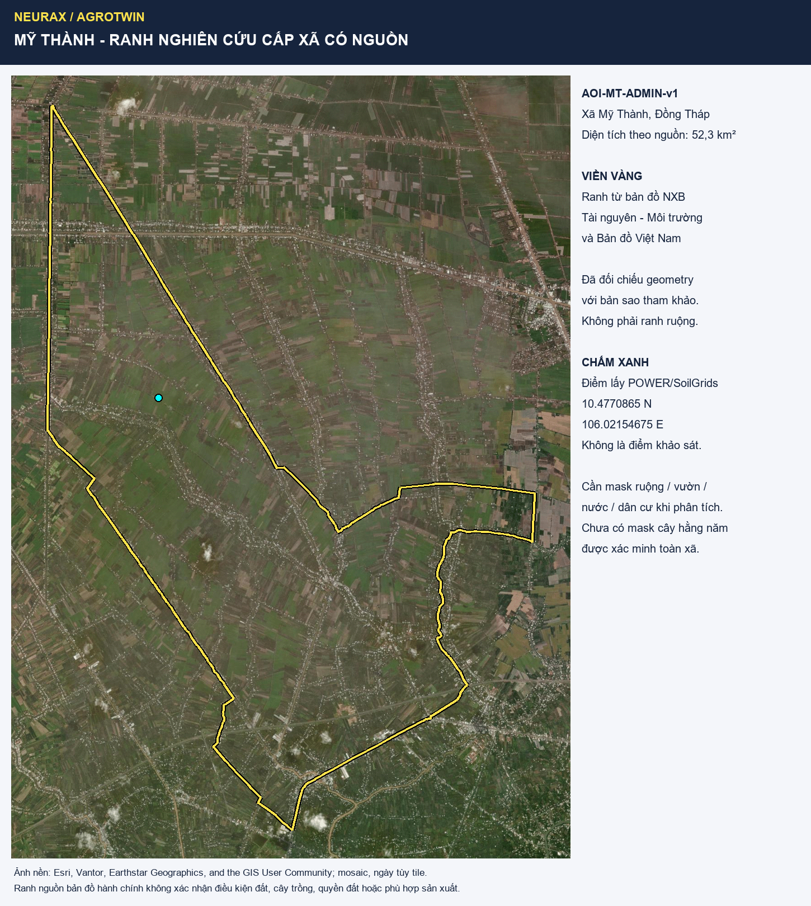

# Mỹ Thành — phạm vi nghiên cứu cấp xã, chưa phải ruộng đã xác minh

> Sửa ngày 12/11/2026 sau kiểm lại polygon. Chưa chứng minh địa điểm tối ưu; ranh 17 ha cũ là mẫu chọn thủ công và đã hạ trạng thái. Giữ Mỹ Thành làm phạm vi prototype từ dữ liệu công khai. Team không khảo sát; không có khuyến cáo sản xuất đã kiểm chứng. Theo yêu cầu mới đã xuất PDF nghiên cứu riêng gửi Bích; chưa sửa proposal tổng thể, commit hoặc push.

## Bàn giao mới nhất cho Bích

**Bản 1.3:** [bảng đất-nước-cây-mùa](rotation-evidence-for-bich.md) · [CSV 12 hàng review](rotation-evidence-review.csv) · [vai trò và job của team](../../my-thanh-team-roles-2026-11-12.md). Phân công mới: Hưng-Việt cùng core; Bích Data; Hiếu backend remote; An ESP demo; Luật QA từng block. Để trống quyết định review tới khi Bích đánh giá; không biến nghiên cứu vùng thành hiện trạng block.

[Hồ sơ nghiên cứu và demo](bich-site-and-demo-dossier.md) · [PDF 13 trang, có bìa](../../../../output/pdf/NeuraX-AgroTwin-Site-and-Demo-Dossier-Bich.pdf) · [ZIP gửi Bích](../../../../output/handoff/NeuraX-MyThanh-Bich-Research-Pack-2026-11-12.zip).

**MT-BLOCK-01** là khối canh tác minh họa mới, số hóa theo cạnh nhìn thấy trên ảnh, khoảng **2,00 ha**, tâm **10.4790981 N, 106.0216210 E**. [Ảnh chi tiết](maps/my-thanh-study-block-detail.png) · [Ảnh ngữ cảnh](maps/my-thanh-study-block-context.png) · [GeoJSON](study-block.geojson) · [KML](study-block.kml) · [tọa độ](study-block-coordinates.csv) · [manifest](study-block-manifest.json).

Khác ranh xã và hình thoi cũ: đây là khối nhỏ có mép canh tác đọc được trên ảnh 2025, có thể chứa nhiều ô; không là ranh thửa pháp lý hoặc đất đồng nhất đã kiểm. Cây/lịch luân canh hiện tại chưa biết. [SoilGrids tại tâm block mới](study-block-soil-model.json), [CSV](study-block-soil-model.csv), được sample riêng từ coverage cached; không lấy số điểm cũ dưới đây làm số đo của block. Không phải mẫu đất thật. Demo dùng đất/giá thể HCM có nguồn, không cần lấy đất Mỹ Thành và không đại diện đo ngoài đồng.

## Ranh có nguồn và gói gửi Bích

**AOI-MT-ADMIN-v1: xã Mỹ Thành, Đồng Tháp**, thuộc vùng Cai Lậy trước sắp xếp; từ Mỹ Thành Nam, Mỹ Thành Bắc và Phú Nhuận. Diện tích thuộc tính nguồn **52,3 km²**, không phải diện tích cây hằng năm hoặc một nông hộ.

- [GeoJSON](aoi.geojson), [KML](aoi.kml), [CSV tất cả đỉnh](coordinates.csv), [manifest truy xuất và SHA](aoi-manifest.json).
- Ranh từ [bản đồ NXB Tài nguyên–Môi trường và Bản đồ Việt Nam](https://sapnhap.bando.com.vn), object `diaphanhanhchinhcapxa_2025.464`, EPSG:4326; GeoJSON/KML dùng kinh độ trước vĩ độ.
- Giữ geometry nguồn, chỉ chuẩn hóa điểm đóng vòng lặp. Bản sao tham khảo khớp geometry nhưng có cùng nguồn gốc, không là kiểm chứng thực địa độc lập.
- Bounds: kinh độ 106.000558–106.092558 E, vĩ độ 10.395381–10.532335 N. Không dùng bbox chữ nhật làm ranh xã.
- Chấm xanh **10.4770865 N, 106.02154675 E** là điểm query NASA POWER/SoilGrids, không phải tâm hành chính, ruộng thí nghiệm hay vị trí cảm biến. [Mở điểm](https://www.google.com/maps/search/?api=1&query=10.4770865,106.02154675).



Ảnh nền Esri/Vantor/Earthstar Geographics/GIS User Community, mosaic có ngày khác nhau theo tile. Không tuyên bố toàn ảnh cùng ngày. Ranh hành chính không xác nhận ranh địa chính, quyền đất, đất đồng nhất hoặc cây trồng. Cần mask ruộng/vườn/nước/dân cư trước khi tổng hợp nông nghiệp; **chưa có mask cây hằng năm được kiểm toàn xã**.

## Có thể dùng đến đâu?

[Đọc phân tích địa bàn–cảm biến–ENSO và so sánh Cần Giờ](site-sensor-enso-review-2026-11-12.md).

Mỹ Thành phù hợp làm phạm vi nghiên cứu từ xa hiện tại vì có bối cảnh lúa/cây ăn trái và dữ liệu đã tải. [Nguồn địa phương 12/01/2026](https://daihoidangtoanquoc.vn/xa-my-thanh-vung-buoc-tren-duong-xay-dung-nong-thon-moi-post1507.html) cũng ghi chuyển đổi sang cây ăn trái: không mặc định cả xã trồng lúa. Nghiên cứu lịch sử Cai Lậy/Long Khánh chỉ hỗ trợ thiết kế so sánh **lúa–bắp non–lúa** và **lúa–đậu xanh–lúa**, không xác nhận hai lịch này đang có hoặc phù hợp tại từng ruộng Mỹ Thành.

Đầu ra prototype: so sánh kịch bản với điều kiện/giả định và phần chưa biết; có thể trả “chưa đủ thông tin”. Chưa có cơ sở công bố năng suất, thu nhập, tiết kiệm nước hoặc lịch gieo khuyến nghị tại ruộng thật. Cảm biến bàn tại HCM chỉ đại diện phép đo giá thể demo, không là telemetry ngoài đồng Mỹ Thành. El Niño dùng như outlook có ngày và kịch bản, chưa là hệ số tác động địa phương đã kiểm.

## Dữ liệu đã có và giới hạn

[Gói nguồn/QA](../../../sources/data-audits/my-thanh-cai-lay-2026-11-12/README.md): NASA POWER 2015–2025, 4.018 ngày/16.072 giá trị; 15 coverage SoilGrids; ảnh/metadata Sentinel-2 và ảnh nền. Query đất/thời tiết hiện có là **mẫu điểm**, chưa là tổng hợp cả xã.

| Mẫu SoilGrids | Mean | Q05–Q95 |
| --- | ---: | --- |
| pH H2O 0–5 cm | 6,3 | 4,5–8,3 |
| pH H2O 5–15 cm | 6,3 | 4,5–8,3 |
| pH H2O 15–30 cm | 6,4 | 4,5–8,3 |
| Cát 0–5 cm | 20,6% | 1,2–71,9% |
| Sét 0–5 cm | 37,1% | 0,4–94,2% |

Khoảng mô hình rộng, không dùng mean để chốt “đất tốt”. Không có EC, thoát nước, nguồn tưới hay đo đất đại diện. POWER có cờ WARN mưa 488,17 mm ngày 14/06/2020, chưa cross-check tại điểm này; giữ nguyên raw. Chuỗi giống probe Long Khánh do grid coarse, không coi là hai chuỗi độc lập.

## Hồ sơ cũ đã hạ trạng thái

[README phiên bản mẫu thủ công](README-v0-manual-aoi.md), [GeoJSON minh họa](illustrative-aoi.geojson), [manifest mẫu cũ](illustrative-aoi-manifest.json). Các hình `my-thanh-aoi-detail.png`, `my-thanh-aoi-overview.png`, `my-thanh-sentinel2-comparison.png` chỉ áp cho mẫu 17,1 ha, **không phải ranh ruộng được xác minh**. Thống kê SCL 419 pixel của mẫu cũ không áp cho xã 52,3 km². Không dùng RGB hiển thị để tính NDVI hoặc suy lịch luân canh từ hai ảnh.

## Tái lập và bước tiếp

Native Windows, bundled Python 3.12.14, Pillow 13.0.0; không cài dependency mới. Từ root repo:

```powershell
& $taskPython scripts/research/prepare_my_thanh_sources.py
& $taskPython scripts/research/build_my_thanh_aoi.py
& $taskPython scripts/research/build_my_thanh_commune_aoi.py
```

`$taskPython` trỏ Python đã xác minh; mặc định replay cache. Script thứ hai chỉ dựng mẫu cũ, thứ ba dựng AOI chính từ nguồn. Bích tiếp tục kiểm đất–nước–cây–mùa có địa danh/năm/phương pháp, cùng team xây mask và điều kiện loại trừ; chờ datasheet phần cứng để kiểm khả năng tích hợp. Không cần khảo sát để xây prototype, nhưng thiếu khảo sát vẫn giới hạn mọi kết luận về ruộng thật.
