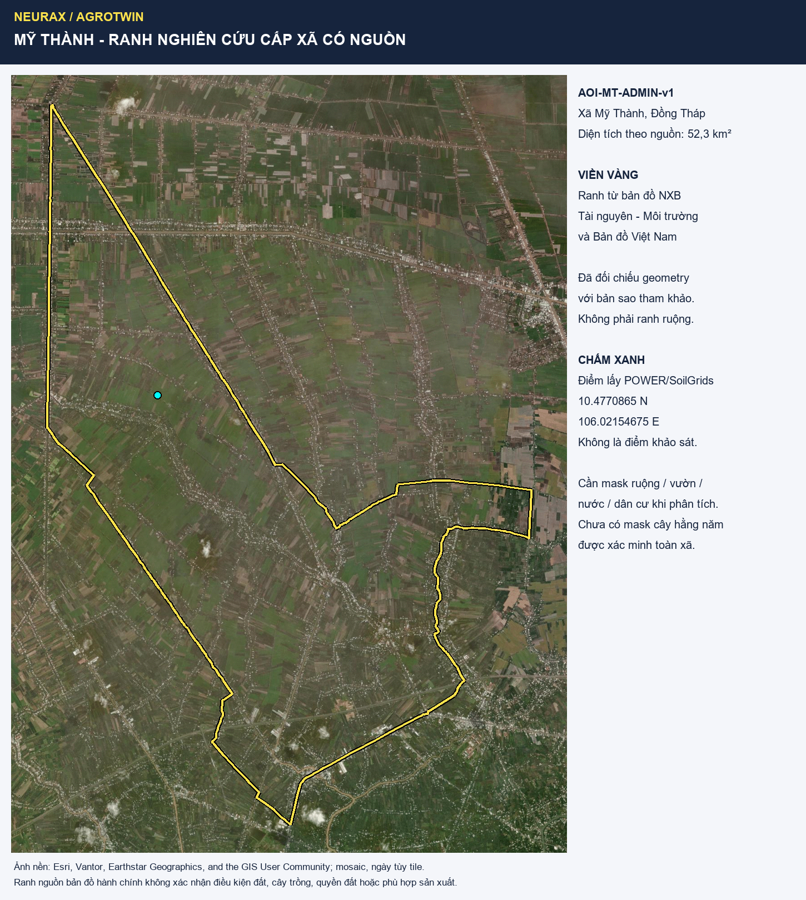
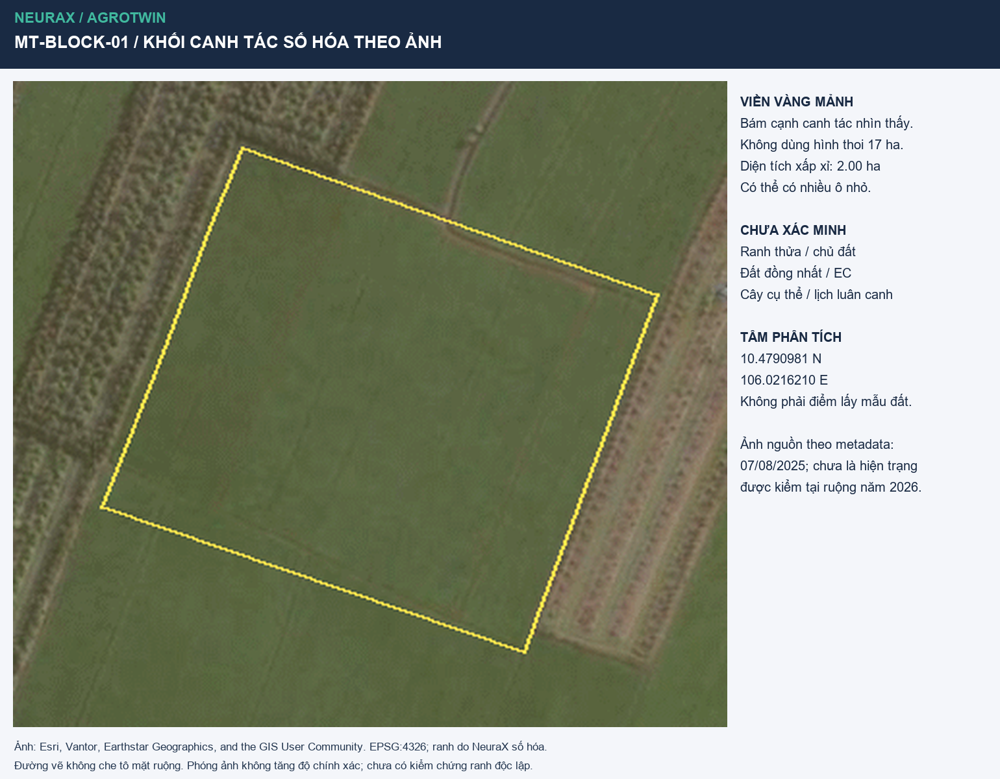

# AgroTwin - Hồ sơ địa bàn và demo gửi Bích

> Bản 1.3, 12/11/2026. Hồ sơ nghiên cứu và phương án demo; chưa là khảo sát thực địa hoặc khuyến cáo sản xuất. Thay thế cách diễn giải ranh 17 ha và mẫu đất địa phương trong các tài liệu/PDF trước lượt kiểm này. Không thay quyết định chọn challenge của team.

## 1. Chốt gì để bắt đầu làm?

**Giữ Mỹ Thành, Đồng Tháp, làm địa bàn nghiên cứu từ xa cho prototype Field Shift. Không cần lấy đất từ Mỹ Thành để làm demo.** Dùng một khối canh tác nhìn thấy trên ảnh làm vị trí minh họa, dữ liệu đất mô hình để đặt câu hỏi và cảm biến thật đo giá thể tại bàn HCM. Giữ nguồn gốc ba luồng này riêng trong giao diện và lời kể.

Đây là lựa chọn thực dụng để khóa nghiên cứu địa điểm; triển khai submission chỉ sau T0 được BTC cho phép, chưa chứng minh tối ưu toàn vùng hoặc đủ căn cứ trồng cả hai cây. Cả Mỹ Thành lẫn Cần Giờ chưa có ruộng được team xác minh. Khoảng cách đến HCM ít quyết định khi team không thể khảo sát.

| Thuật ngữ | Thực chất là gì? | Được dùng vào việc gì? |
| --- | --- | --- |
| Ranh canh tác trên ảnh | Cạnh của một khối nhìn thấy tại ngày ảnh | Định vị, đọc ảnh, chọn phạm vi minh họa |
| SoilGrids | Dự đoán tính chất đất trên grid, có bất định | Sàng lọc giả thuyết, ghi thiếu thông tin |
| Mẫu đất demo | Đất/giá thể thật được mua hoặc lấy có ghi nguồn tại HCM | Kiểm cảm biến, truyền dữ liệu và mô phỏng |

Ba thứ này không tự thay thế nhau. Vẽ một polygon không biến khu vực thành đất đồng nhất; cảm biến độ ẩm cũng không xác định được loại đất hoặc lịch luân canh.

**Câu chuyện đề xuất:** Một người trồng trọt cần cân nhắc phương án mùa vụ trước điều kiện khí hậu biến động. AgroTwin kết hợp dữ liệu NASA, thông tin đất có nguồn, yêu cầu cây và ưu tiên người dùng để so sánh lựa chọn, giải thích rủi ro và chỉ ra điều chưa biết. Node tại bàn được đề xuất để kiểm khả năng nhận dữ liệu tại chỗ, chưa có kết quả chạy được kiểm; chưa chứng minh năng suất hay tiết kiệm nước ngoài đồng.

## 2. Phạm vi xã và vị trí minh họa

**AOI-MT-ADMIN-v1:** ranh xã từ bản đồ NXB Tài nguyên - Môi trường và Bản đồ Việt Nam [S1], diện tích thuộc tính nguồn 52,3 km². Không phải toàn bộ diện tích trồng cây hằng năm. Giữ geometry nguồn, không dựng lại bằng bbox hoặc vài góc tự chọn. Nguồn ảnh nền là mosaic Esri và các nhà cung cấp ghi ngay trên hình.

Chấm xanh là query POWER/SoilGrids cũ, không phải điểm lấy mẫu. Khối minh họa mới MT-BLOCK-01 có tâm khác, xem trang tiếp theo. Không dùng dữ liệu tại một điểm làm trung bình cả xã.

## 3. Khoanh theo cạnh nhìn thấy, bỏ hình thoi cũ

**MT-BLOCK-01:** khoảng 2,00 ha; tâm 10.4790981 N, 106.0216210 E. Ranh vàng mảnh bám mép khối canh tác cạnh các dải cây và bờ nhìn được trên ảnh. Có thể chứa nhiều ô nhỏ; chưa là ranh địa chính hoặc một hộ. Ngày metadata ảnh nguồn 07/08/2025, chưa xác minh hiện trạng ruộng năm 2026. Các ảnh Sentinel-2 năm 2026 đã có ở hồ sơ vùng nhưng chưa được phân tích chuỗi thời gian riêng cho block mới.

| Đỉnh | Vĩ độ N | Kinh độ E | Đỉnh | Vĩ độ N | Kinh độ E |
| --- | --- | --- | --- | --- | --- |
| A | 10.479886 | 106.021194 | E | 10.478764 | 106.020756 |
| B | 10.479430 | 106.022478 | F | 10.478944 | 106.020828 |
| C | 10.478416 | 106.022100 | G | 10.479280 | 106.020960 |
| D | 10.478314 | 106.022064 | H | 10.479604 | 106.021080 |

Đi theo A-B-C-D-E-F-G-H-A. CSV giữ cả tọa độ pixel nguồn để kiểm cách số hóa. Chữ số tọa độ không phải sai số đo. Không có kiểm chứng ranh độc lập; diện tích là xấp xỉ, không phải diện tích quyền sử dụng đất.

## 4. SoilGrids có nói đất này đồng nhất không?

**Không.** SoilGrids là mô hình tính chất đất, native support khoảng 250 m [S2]. Block khoảng 2 ha nhỏ hơn diện tích một ô native danh nghĩa 250 x 250 m (6,25 ha). Raster xuất lại có pixel nhỏ hoặc nhiều chữ số cũng không tạo thêm thông tin đất thực. Hai điểm cùng một ô không chứng minh hai mẫu đất giống nhau; một polygon màu đơn trên bản đồ cũng vậy.

Đã lấy riêng giá trị ô mô hình chứa tâm MT-BLOCK-01 từ 15 coverage cached, thay vì chép mẫu điểm cũ sang block. Output EPSG:4326; thuật toán resample của dịch vụ chưa được xác minh. Đây là giá trị ô tại tâm, không phải trung bình block hoặc mẫu phân tích phòng thí nghiệm.

| Tính chất ở tâm block mới | Mean | Q05-Q95 |
| --- | --- | --- |
| pH H2O 0-5 cm | 6,3 | 4,5-8,3 |
| pH H2O 5-15 cm | 6,3 | 4,5-8,3 |
| pH H2O 15-30 cm | 6,3 | 4,5-8,3 |
| Cát 0-5 cm | 21,1% | 1,2-72,5% |
| Sét 0-5 cm | 35,3% | 0,4-93,2% |

Khoảng dự đoán rộng, không đủ chốt đất phù hợp cho bắp non hay đậu xanh. Không có EC, nguồn tưới, thoát nước, đế cày hoặc mẫu đất đại diện. Không chuyển các số này thành công thức pha chậu “đất Mỹ Thành”.

**Nhãn hiện hành:** ranh = số hóa theo ảnh; cây cụ thể = chưa biết; lịch luân canh = chưa biết; tính chất đất = mô hình; đất đồng nhất = chưa kiểm. Muốn khẳng định cùng loại đất cần bản đồ đất đủ chi tiết có phương pháp/niên đại hoặc lấy mẫu kiểm; không đáp ứng bằng khoanh tay. Với scope không thực địa, giữ giới hạn này và làm quyết định theo kịch bản.

## 5. Demo tại HCM: đất nào, đo gì, backup ra sao?

**Không yêu cầu lấy đất từ địa phương.** Chọn một lô đất/giá thể có nguồn và mô tả rõ tại HCM. Có thể chia cùng lô thành hai chậu/cốc để so phản ứng khô hơn - ướt hơn; chưa cần trồng cây để kiểm ingestion. Không dùng chậu làm thí nghiệm chứng minh lợi ích luân canh.

<!-- FLOW -->

1. An kiểm datasheet board/probe: nguồn cấp, mức tín hiệu, ADC/bus và SDK. Chip/board HTTPSLAB đã được đồng ý cho mượn theo team; thông số và module thực tế còn chờ.
2. Ghi nguồn giá thể, ngày chuẩn bị, lượng đất, chậu, cách cắm và ID probe. Đánh dấu độ sâu để đo lặp nhất quán; ghi thời điểm tác động nước. Không mặc định giá thể có cùng pH/EC/cấu trúc với Mỹ Thành.
3. Hiệu chuẩn theo nhà sản xuất. Nếu chỉ có hai mốc khô/ướt, hiển thị chỉ số độ ẩm tương đối; chưa ghi % VWC. Muốn VWC cần tham chiếu lượng nước theo thể tích và quy trình hiệu chuẩn phù hợp [S3].
4. Đo lặp trạng thái ổn định, lưu raw signal, timestamp, đơn vị và trạng thái hợp lệ. Quang Luật kiểm độ phân tán, missing/stale và khả năng phát hiện ngắt probe. Chưa có thông số nên chưa đặt ngưỡng chính xác hoặc tần số đo thay cho datasheet.
5. Dashboard hiển thị `HCM_tabletop` riêng với `MyThanh_scenario`. Cho phép dùng tín hiệu lab để tương tác mô phỏng, đồng thời giữ mưa/nhiệt NASA và giả định mùa vụ có nhãn riêng. Không biến một lần tưới chậu thành khuyến cáo đổi cây ngoài đồng.

**Backup:** board chưa tích hợp được thì replay log có nguồn, ghi rõ recorded; chưa có log thì dữ liệu synthetic gắn nhãn. Thiếu hiệu chuẩn thì dùng relative index. Thiếu EC/pH thì giữ unknown, không tự suy từ độ ẩm. Một nhánh gặp lỗi không làm mất phần so sánh luân canh.

## 6. Hai phương án luân canh và El Niño

Theo brief Field Shift người dùng cung cấp, trọng tâm là hỗ trợ khám phá luân canh bằng NASA EO, đất, yêu cầu cây và ưu tiên nông dân; hardware là phần bổ sung. Resources chính thức chưa được kiểm đầy đủ. Ba phương án bên dưới là tiêu chí MVP NeuraX chọn, không tuyên bố mọi mục đều bắt buộc bởi NASA.

| ID | Phương án tham khảo | Bằng chứng và trạng thái |
| --- | --- | --- |
| R0 | Lúa liên tục | Đối chứng nghiên cứu lịch sử, chưa xác nhận hiện trạng block |
| R1 | Lúa - bắp non - lúa | Nghiên cứu Cai Lậy/Long Khánh [S4, S5]; chưa xác minh tại Mỹ Thành |
| R2 | Lúa - đậu xanh - lúa | Nghiên cứu vùng [S4, S5]; cần rà điều kiện và lịch mùa cụ thể |

Không đổi bắp non thành bắp hạt CP888 hoặc đậu xanh thành đậu phộng GV10 từ hồ sơ Đức Lập. Chưa có giống/ngày gieo/thu/nguồn nước và hiệu quả đã kiểm tại block. Cần tách bằng chứng vùng khỏi thửa cụ thể; số trung bình công bố không phải raw training labels.

NASA POWER đã tải 4.018 ngày 2015-2025 tại điểm vùng gần block [S6], không phải số đo microclimate trong ruộng. Giữ cờ mưa 488,17 mm ngày 14/06/2020 để kiểm tiếp; không tự sửa. Sentinel-2 là Copernicus qua Planetary Computer, SoilGrids là ISRIC, ENSO là NOAA; không gộp tất cả thành dữ liệu NASA.

**El Niño có thể là input bối cảnh:** outlook có ngày nguồn -> khám phá bất thường mưa/nhiệt địa phương -> chạy kịch bản nóng/khô -> so độ nhạy lựa chọn. Trang NOAA đọc ngày 12/11 vẫn hiển thị bản 08/10/2026 [S7]. Chưa có quan hệ địa phương được kiểm nên không gắn hệ số giảm mưa hoặc xác suất hạn cho block. Slider là scenario, không phải forecast. Không dùng outlook hiện tại làm feature lịch sử đã biết trước.

**Liên hệ NASA -> so phương án còn thiếu:** hiện chưa có response rule đủ căn cứ để chuyển mưa/nhiệt thành utility hoặc thứ hạng cây. Chart khí hậu + ba thẻ tĩnh chưa chứng minh giải phần decision support. Cần Bích/Hưng/Việt review rule và Luật kiểm trước khi đưa vào phép so. Chưa đủ thì score=null/needs_review; R0 is_current=null, không tự nhận là hiện trạng block. AI ở đây có thể là baseline giải thích được, không bắt buộc ML hoặc forecast.

**Gate quyết định:** thiếu tiêu chí đất/nước quan trọng -> trả “chưa đủ thông tin”; có ràng buộc loại trừ có nguồn -> không xếp phương án đó là phù hợp; chỉ so sánh kịch bản khi giả định được hiển thị và người dùng xác nhận. Chưa chấm điểm tiết kiệm nước, năng suất hay lợi nhuận từ cảm tính.

**Bảng chi tiết để review:** [đất-nước-cây-mùa cho R0/R1/R2](rotation-evidence-for-bich.md) và [CSV 12 hàng để Bích ghi review](rotation-evidence-review.csv). Vai trò sáu thành viên nằm ở mục 11 của PDF.

<!-- INCLUDE:rotation-evidence-for-bich.md -->

<!-- INCLUDE:../../my-thanh-team-roles-2026-11-12.md -->

## 12. Nguồn, file và cách mở

- [S1] NXB Tài nguyên - Môi trường và Bản đồ Việt Nam: [bản đồ hành chính](https://sapnhap.bando.com.vn). Query và hash raw geometry ở `aoi-manifest.json`; nguồn này xác nhận phạm vi xã, không xác nhận đất/cây.
- [S2] ISRIC: [SoilGrids FAQ và đơn vị](https://docs.isric.org/globaldata/soilgrids/SoilGrids_faqs_01.html), [WCS](https://docs.isric.org/globaldata/soilgrids/wcs.html). Raw coverage, geotags và SHA được lưu; sample riêng tại tâm block ở `study-block-soil-model.json`.
- [S3] METER: [hướng dẫn hiệu chuẩn độ ẩm đất](https://publications.metergroup.com/Sales%20and%20Support/METER%20Environment/Website%20Articles/how-calibrate-soil-moisture-sensors.pdf). Nguyên lý tham khảo, không là đặc tính của probe chưa biết của team.
- [S4] Nguyễn Minh Phượng và cộng sự, CTU 2009, 11:194-199: [PDF](https://ctujsvn.ctu.edu.vn/index.php/ctujsvn/article/download/605/3214/3214). Nghiên cứu lịch sử; không tọa độ xác nhận ruộng Mỹ Thành.
- [S5] Nguyễn Minh Đông, Châu Minh Khôi, Võ Thị Gương, CTU 2009, 11a:262-269: [PDF](https://ctujsvn.ctu.edu.vn/index.php/ctujsvn/article/download/597/3222/3222). Bảng mùa vụ vùng; chưa chứng minh cùng thửa với S4.
- [S6] NASA: [POWER Daily API](https://power.larc.nasa.gov/docs/services/api/temporal/daily/). Chuỗi điểm có QA và cờ chất lượng; không là quan trắc ruộng.
- [S7] NOAA CPC: [bản ENSO tháng 10/2026](https://www.cpc.ncep.noaa.gov/products/analysis_monitoring/enso_disc_oct2026/ensodisc.shtml). Chỉ dùng outlook có ngày, kiểm bản mới trước pitching.
- [S8] Nguyễn Tân Xuân Tùng, IUH: [luận án 2025](https://ipe.iuh.edu.vn/uploads/2026/03/1.-LUAN-AN-TIEN-SI_NGUYEN-TAN-XUAN-TUNG.pdf), PDF trang 64-65 / trang in 47-48 cho phương pháp thí nghiệm lúa. Có record SHA của bản đã đọc.

**File mở trực tiếp:** `study-block.kml` trong Google Earth; `study-block.geojson` trong QGIS hoặc geojson.io; `study-block-coordinates.csv` trong Excel. `aoi.*` là xã, `study-block.*` là khối minh họa, `illustrative-*` là hình thoi cũ đã hạ trạng thái. Trong ZIP có bảng review 12 hàng `rotation-evidence-review.csv`, hồ sơ vai trò, bản đồ và file nguồn hình học; không gọi đó là dữ liệu địa chính hoặc raw field measurements.

**Lưu ý trước thi:** GO Team cho phép nghiên cứu trước giờ G; project work đợi giờ bắt đầu. Đây là hồ sơ nghiên cứu, không chứng minh sản phẩm đã chạy hoặc miễn quy định dùng artifact có sẵn.

**Tái lập:** native Windows, Python 3.12.14/Pillow 13.0.0, ReportLab và pypdf bundled. Chạy `build_my_thanh_study_block.py` để dựng ranh và sample mô hình từ cache, sau đó `build_bich_site_dossier.py` để xuất PDF. Metadata PDF chứa SHA của Markdown; manifest build ghi hash các input. Render bằng Poppler và kiểm hình trước bàn giao. Không tải lại API nếu snapshot không đổi. Chưa commit/push hoặc gửi tin cho người khác.
