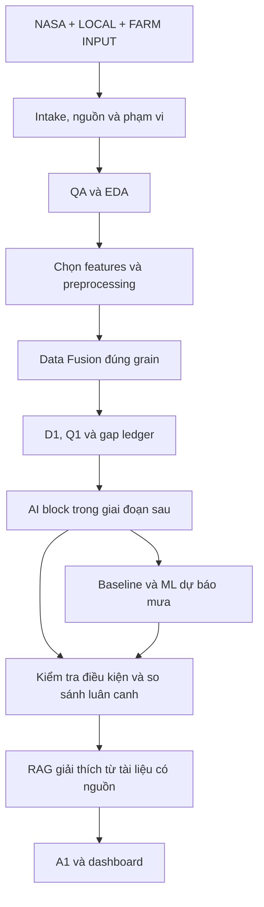

# Chốt workflow và bàn giao DATA v1

Ngày 14/11/2026. Căn cứ: người dùng đồng ý kiến trúc tổng thể đã đề xuất, giao Codex tìm thay Bích các khoảng dữ liệu còn thiếu và yêu cầu tập trung DATA trước. Chi tiết FARM INPUT sẽ cung cấp sau.

## Quyết định được xác nhận

Workflow được giữ làm hướng phát triển:

Chốt workflow không đồng nghĩa đã train, đánh giá hoặc triển khai AI. Hiện chỉ thực hiện đến DATA. Các phương pháp HGB, seasonal-naive, đánh giá theo thời gian, rule-based và RAG Anh–Việt được lưu để dùng sau tại [workflow ML/RAG trong Lab](../../../neurax-fieldshift-lab/docs/local-evidence-2026-11-14/ml-rag-workflow.md). Đường dẫn Lab từ tài liệu này cần mở ở workspace cha; repo riêng không tự đồng bộ.

Những ghi chú trước đây “chưa chọn feature/preprocessing/fusion” là trạng thái lịch sử. Quyết định mới chọn schema DATA v1 bên dưới; giá trị dự báo thực của từng feature còn phải đánh giá trong AI block.

## Nhánh và nơi mở dữ liệu

- Lab: `data/local-fusion`.
- Docs: `docs/data-workflow`.
- LOCAL tập trung: `neurax-fieldshift-lab/data/raw/local/my-thanh-v1/README.md`.
- DATA xử lý: `neurax-fieldshift-lab/data/processed/data-block-v1/README.md`.
- EDA mới: `notebooks/resources/14-local-fusion-data-block.ipynb` trong Lab.
- Thiết kế DATA: `docs/data-block-v1/features-fusion-preprocessing.md` trong Lab.

Không di chuyển/xóa raw cũ. Gói LOCAL có bản sao các nguồn liên quan, bảng chuẩn hóa, source register, nguồn gốc bản sao, manifest/hash và gap ledger. NASA giữ nơi đã tải, được tham chiếu bằng manifest; không tải lại chỉ để đổi thư mục. Raw và dữ liệu xử lý vẫn ngoài Git, không upload.

## Khoảng thiếu đã lấp bằng nguồn phù hợp

| Nhu cầu | Dữ liệu thực đã bổ sung | Giới hạn |
| --- | --- | --- |
| Mưa trạm địa phương | 72 ô tháng Mỹ Tho: năm 2015 và 2019–2023, trong đó 64 ô có số; 6 tổng năm | Nguồn thứ cấp EIA dẫn niên giám; dấu gạch giữ null; chưa có chuỗi đủ 2019–2025/QC/day boundary |
| Mưa quan trắc gần thời điểm hiện tại | SIWRP: 6 trạm × 7 ngày, 05–11/11/2026 | Giữ admin label gốc và flag lỗi ở Cao Lãnh; không gán cho ruộng |
| Bối cảnh nước | 5 trạm: Mỹ An, Cai Lậy, Long Định, Mỹ Tho, Cao Lãnh; kỳ đo và kỳ forecast riêng | Mực nước theo trạm, chưa là độ sâu ngập hoặc kết nối thủy lực tại ruộng |
| Bối cảnh mặn | SIWRR phát hành 22/05/2025, 12 upper bounds tại 6 trạm/2 mốc trong phụ lục forecast | Dấu `<` không thành số đo chính xác; không phải EC đất hoặc điều kiện mặn hiện tại của ruộng |
| Lịch và điều kiện đậu xanh | Quy trình IAS dành cho ĐBSCL, ban hành 2014 | Cửa sổ mùa vụ có điều kiện; pH không nêu phương pháp, chưa áp ngưỡng trực tiếp lên SoilGrids |
| Bắp non và giống | Hướng dẫn đại học về bắp non; thông tin giống đậu xanh 208 | Thời gian thu lần đầu khác thời gian chiếm ruộng; giống của ruộng chưa biết |
| Đối chứng | Gộp lại soil profile, trial outcomes, nguồn Anh–Việt và bảng đất từ đợt trước | Nghiên cứu ở site khác, không phải nhãn “cây tốt nhất” cho Mỹ Thành |

Đường dẫn EIA Tiền Giang cũ bị lỗi chứng chỉ; đã tải bản tài liệu có bảng tương ứng từ cổng tham vấn Bộ NN&MT, không bỏ xác thực TLS. Tệp niên giám .doc tại cơ quan thống kê được tải và trích text chỉ đọc; phần tải được là giới thiệu/mục lục, không được nhận là bảng khí hậu gốc. Niên giám quốc gia không có trạm phù hợp trong các bảng đã kiểm nên không được chọn để thay local rain. Các nguồn thất bại/không phù hợp được ghi lại.

Nguồn chính để team đối chiếu:

- [Quy trình đậu xanh ĐBSCL của IAS](https://harc-ias.vn/storage/uploads/files/QTKT%20SX%20dau%20xanh%20DBSCL_%20Final%281%29.pdf).
- [Bản tin nguồn nước SIWRP ngày 12/11/2026](https://siwrp.org.vn/admin/upload/20.BANTIN-TUAN20_DBNN%2020261112.pdf).
- [Bản tin mùa kiệt SIWRR ngày 22/05/2025](https://www.siwrr.org.vn/docs/2023/files/20250522-26-VKHTLMN-Bantintuan-DubaoNguonnuoc-22_5_2025.pdf).
- [EIA có bảng mưa Mỹ Tho, PDF97/Table2.7](https://thamvan.mae.gov.vn/Uploads/05062025/BV5.6.%20BC%20DTM%20DA%20NEO%20VET%20CAT%20MAN%20RB-VT.pdf).

## Features và Data Fusion đã chọn

Core A: `P_lag1`, `P_lag2`, `P_lag3`, `P_lag12`, `T2M_lag1`, `RH2M_lag1`, `month_sin`, `month_cos`.

Extension B: cùng 8 biến + `SFMC_lag1`, `RZMC_lag1`, để so sánh có/không SMAP trong AI block sau. T2M là nhiệt độ; RH2M là ẩm không khí. SFMC/RZMC là ẩm thể tích đất theo sản phẩm L4, không phải số đo đầu dò ruộng.

POWER là backbone theo tháng: 142 tháng từ 01/2015 đến 10/2026. SMAP ghép trái theo region/month, giữ nguyên backbone. Sau lag12 còn 120 target months 2016–2025; cả 120 hàng đủ core, 119 hàng đủ extension. Split dự trữ: 96 development, 12 validation, 12 final test; chưa fit hoặc xem metrics.

MODIS/Sentinel-2 là context theo composite/scene với ngày và coverage, chưa thêm vào 10 biến dự báo. Đất, nước, station, rules/reference giữ các bảng riêng theo đúng site/depth/method/period. Không flatten số liệu cấp tỉnh thành số đo ruộng hoặc inner join khiến mất lịch sử dài.

## Preprocessing đã thực hiện

- Chuẩn hóa đơn vị, decode fill/QA, kiểm duplicate keys và calendar coverage.
- Mưa POWER: tổng ngày thành tháng khi đủ ngày; nhiệt/RH: mean tháng đủ ngày. SMAP mean cũng yêu cầu đủ ngày calendar. Thống kê trên các ngày còn có chỉ phục vụ QA.
- Giữ null và lý do thiếu; không tự điền. Giữ cực trị hợp lý, chỉ flag; không cắt mưa lớn bằng percentile.
- Tạo lag chỉ từ tháng trước tháng đích. Không lấy tương lai để điền hoặc xáo trộn thời gian.
- Pixel scale/offset dùng đúng một lần từ EDA cũ. Context v1 yêu cầu ít nhất 80% pixel hợp lệ trong block Sentinel và 50% pixel vùng MODIS; đây là policy coverage, chưa phải ngưỡng được kiểm theo outcome.
- Giữ riêng pH nước/KCl, độ sâu, model/measurement, SOC/OM và total/available N. Giữ salinity upper bound cùng comparator và đơn vị gốc.
- Chưa fit scaler, imputer, PCA hoặc model. Historical `available_at` chưa xác lập đầy đủ; bảng hồi cứu chỉ hỗ trợ hindcast, không claim operational backtest.

## Phần chờ FARM INPUT và nguồn đo

Chưa có số đo EC, pH/method/depth tại ruộng; chưa có cây/giống hiện tại, ngày gieo–thu hoạch, nguồn tưới, khả năng thoát nước, đê bao và lịch vận hành cống kết nối đúng ruộng. Ranh mẫu vẫn từ pack, chưa được khảo sát độc lập. Giữ nhãn Mỹ Thành do user xác nhận, không tự đổi tọa độ theo tên địa danh trong tài liệu.

FARM INPUT hiện chỉ có CSV headers và schema-status provisional, 0 bản ghi. User sẽ đưa chi tiết sau. Khi có dữ liệu sẽ ghép theo region, hiệu lực thời gian và thời điểm thông tin thực sự có sẵn; không ghi đè dữ liệu NASA bằng giá trị nhập tay không rõ nguồn.

## Acceptance và bàn giao

Owner DATA: Việt/Codex thực hiện. Bích review nghĩa nông học; Quang Luật review numeric QA độc lập; Hưng cùng chốt output khi sang AI. Việc tìm nguồn thay Bích không tạo chữ ký review của Bích.

Đã thực hiện: source/hash audit, local bundle, feature tables, preprocessing/fusion, notebook14 (6 cell, 4 hình, 0 lỗi), 4 regression tests cho missing/calendar/leakage/duplicate keys và intake không auto-train. Kết quả cập nhật tại `runs/data-block-v1/validation-record.json`.

Trạng thái giao: **khung DATA v1 đã có thể đọc và tái tạo; phạm vi ruộng vẫn PARTIAL**. Fallback khi thiếu: hiển thị context/gap; không đưa score/recommendation chắc chắn. AI backlog được giữ nguyên, triển khai ở giai đoạn tiếp theo sau khi xử lý các input cần thiết cho từng output.
