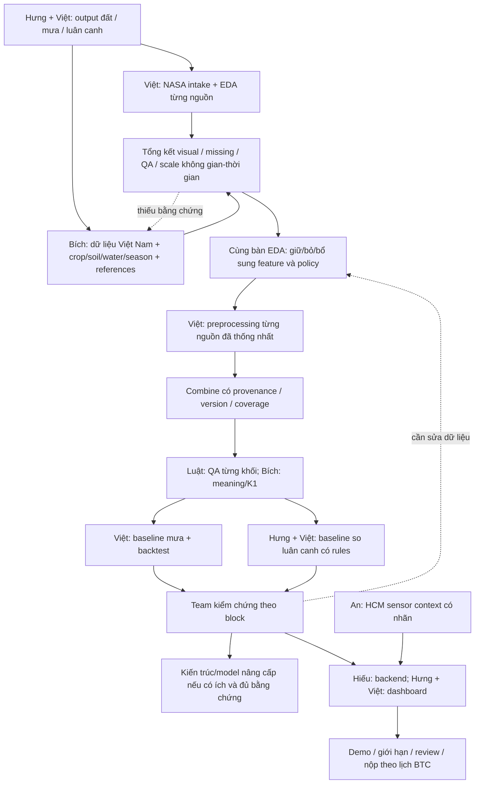

# Workflow và baseline thứ Bảy — cập nhật theo yêu cầu 14/11/2026

> Asia/Saigon. Hướng workflow được người dùng tạm đồng ý; chưa chốt dataset/features, preprocessing policy hoặc kiến trúc model. Đây là kế hoạch thực thi/điểm bàn giao, không phải bản xác nhận task của mọi thành viên đã hoàn thành.

## Điều đã xác nhận và điều còn mở

- Hưng đang làm lại dashboard. Ba đầu ra định hướng: soil information, rainfall forecast và hỗ trợ luân canh; layout/toàn bộ UI chưa chốt.
- Việt phụ trách NASA + external-data integration, sau đó preprocessing và AI architecture. Bích tìm/review Data Việt Nam và reference; Luật kiểm từng block. Hiếu backend theo availability, Hưng/Việt backup; An thiết bị và log context riêng.
- **Hoàn tất EDA và đọc từng bộ đang visual ra gì trước**, rồi mới cùng người dùng quyết định missing/outlier/scale/features và cách combine. Decode unit/QA để hiểu raw không là phê duyệt preprocessing production.
- Mỗi block có baseline/reference phù hợp. Mốc đích người dùng yêu cầu là **chiều–tối thứ Bảy 14/11/2026** để cả team kiểm chứng.
- Forecast horizon, danh sách feature, K1 thresholds/weights, source choice, model và deployment chưa chốt. Đề xuất mưa ở grain tháng/horizon 1 tháng để khớp workflow hiện có; không nhận là daily farm forecast.

## Luồng tổng thể và các nhánh làm song song

Hưng có thể thiết kế UI states và Hiếu có thể thống nhất API trước khi model hoàn chỉnh. Dữ liệu/rules thật chỉ đưa vào output đã review; partial/unknown phải là trạng thái sử dụng được. Không chờ phải có mọi nguồn NASA hoặc Hiếu online để hoàn tất review data.

## Đầu ra từng block, owner và điểm nhận

| Block | Input | Deliverable / done | Owner đề xuất | Reviewer / điểm nhận | Fallback |
| --- | --- | --- | --- | --- | --- |
| NASA EDA | Raw + metadata + AOI | Notebook từng nguồn, units/support/missing/QA, biểu đồ và gap matrix | Việt | Luật số; Bích ý nghĩa | Metadata-only nếu chưa có values, không giả plot |
| VN Data/reference | Requirement và 12 claims pack | Source register + raw/evidence + scoped rules/reference cases | Bích | Việt/Hưng; Luật units/method | Unknown/search-log, dùng reference đúng nhãn |
| EDA discussion | Tổng kết hai nhánh | Ghi quyết định feature, phương pháp và phần thiếu | Việt + Hưng, cùng Bích/Luật | Người dùng duyệt hướng; file versioned | Giảm scope, giữ các field chưa đủ là null |
| Preprocessing | Decisions đã thống nhất | Script tái lập từng source; preserve raw/QA; không leakage | Việt | Luật + Bích | Chỉ qualified subset; không lấp giả |
| Combine | Inputs cùng grain đủ metadata | D1 core + extensions riêng, key/version/source/coverage | Việt | Luật, Hiếu nhận contract | Không ghép nếu mismatch không giải thích được |
| Rain baseline | D1-Q1, task/horizon/split | Seasonal-naive; thêm climatology nếu có protocol; lỗi mm và source-as-of | Việt | Hưng/Luật | Mô tả lịch sử; forecast unavailable nếu chưa đủ gate |
| Rotation baseline | K1 + climate/soil + priorities | Lọc constraint/so reference scenarios + reasons/unknowns | Hưng–Việt thống nhất producer | Bích domain; Luật numeric | REFERENCE_ONLY / UNKNOWN_FOR_FIELD |
| Validation | Artifact/version + reference mỗi block | So sánh đúng outcome/support và giới hạn; test integration | Luật, Bích references | Cả team | Không có truth thì không báo field accuracy |
| Backend/dashboard | Versioned result + warnings | Soil/forecast/rotation panels đúng status, source và timing | Hiếu backend; Hưng dashboard; Việt hỗ trợ | Cả team | Snapshot/replay đúng nhãn, không giấu thiếu evidence |
| Hardware | Probe/datasheet/log | H1 có time/unit/calibration/live-replay | An | Luật; Hưng/Việt nhận | Recorded/synthetic có nhãn và tách HCM/MyThanh |

Owner/giờ trong bảng là đề xuất theo phân công hiện hành; không gửi assignment/invite hoặc tự xác nhận thành viên nhận task.

## Đường găng tối nay và giờ đề xuất

Ngày đích thứ Bảy là yêu cầu người dùng; giờ cụ thể là đề xuất để review, không phải deadline chính thức của cuộc thi.

| Giờ ICT 14/11 | Milestone đề xuất | Done có thể kiểm | Nếu chưa đạt |
| --- | --- | --- | --- |
| 12:30 | Bích batch đầu / NASA gap summary | Nguồn hoặc search blocker; không đợi đủ form | Ưu tiên crop rules, tưới/tiêu và reference dùng được |
| 14:00 | Review EDA + đóng phạm vi baseline | Có biên bản chọn nguồn/policy tối thiểu và unknown | Không bắt đầu impute/scale/fuse tự động; cắt extra layers |
| 16:00 | Rain baseline đầu tiên | Task/target/split/source version + seasonal-naive/evaluation thật, nếu Q1 đủ | Giữ climate history; forecast chưa đủ gate ghi unavailable |
| 18:00 | Comparison baseline | R0/R1/R2 đúng nhãn, rule/evidence và unknown; không bắt ép score | Reference comparison thay field recommendation |
| 20:00 | Cả team kiểm chứng | Mỗi block có artifact, người review, lỗi và việc tiếp theo | Ưu tiên correctness, explanation và demo path, hoãn model nâng cấp |

Các mốc 16:00/18:00 chưa phải kết quả đã có. Đợt làm việc hiện tại dừng ở EDA + requirement/workflow, đúng yêu cầu bàn preprocessing sau EDA. Không tự gọi train để “đạt milestone”. Nếu task/data không sẵn, báo blocker trước mốc và thu hẹp thay vì nhận hoàn thành.

## Baseline và validation theo từng phần

| Phần | Baseline/reference đề xuất | Cách đánh giá | Nguồn/công việc cần thêm |
| --- | --- | --- | --- |
| Raw → monthly data | Đối chiếu một tháng với raw + full-period counts | Units, duplicate, missing, coverage, recomputation; code tests không thay Q1 | Luật kiểm một mẫu độc lập |
| Soil | SoilGrids mean/Q05/Q95 và local sample/map nếu có | Cùng property/depth/method mới so được; MAE/bias chỉ khi có matched observations | Bích tìm local measurements, EC, drainage; thiếu giữ model context |
| Rain | Seasonal-naive (cùng tháng năm trước), optional historical month climatology | MAE/RMSE/bias mm trên chronological backtest; station comparison tách riêng | Chốt horizon; trạm Việt Nam và alignment ngày/tháng |
| Rotation | R0 reference + R1/R2, rule-based eligibility trước ranking | Zero verified hard-rule violations, traceability, unknown handling, sensitivity, reviewed cases | Bích crop rules/reference; chưa có “best rotation” labels |
| Integration | Versioned source → result → UI | Schema/units/status/as-of đúng; missing source không crash | Contract, backend/snapshot; chưa tích hợp trong nhánh EDA |

Protocol time-series **đề xuất** để bàn: train/reference history 2015–2023, validation 2024, holdout 2025; 2026 tới tháng 10 là operational-context candidate. Scaler/imputer/feature selection theo hiệu năng chỉ fit trong training folds. Đây chưa là split được approve, chưa có metric model được chạy. EDA toàn kỳ là mô tả dữ liệu, không được viện làm held-out accuracy.

Một tháng forecast không đủ chứng minh tối ưu luân canh cả năm. Giai đoạn đầu có thể dùng lịch sử khí hậu cho calendar reference và forecast cho risk context ngắn hạn; response rule cây/nước cần nguồn riêng. Forecast point/month và observed crop outcome là hai target khác nhau.

## Hợp đồng hiển thị dashboard tối thiểu để Hưng cân nhắc

- Soil: value, unit/method/depth, source, model/observed, uncertainty, date; không hiển thị điểm soil fertility do pH/texture tự suy.
- Rain: region/native support, target period, issued_at/data_as_of, horizon/method, evaluation_ref và status. Nếu dữ liệu cuối 31/10, target tổng tháng 11 phải ghi rõ origin; không gọi đó là dự báo tháng 12 hoặc dự báo ngày mai. Dữ liệu gần hiện tại có thể revision.
- Rotation: strategy/ordered seasons, reference/current-confirmed flag, eligibility, reasons, evidence_ids, risks/missing_inputs; score nullable. R0 chưa là current rotation của block.
- QA: coverage và source quality gần kết quả, trạng thái pending/partial/unavailable. Không gộp HCM tabletop probe thành Mỹ Thành field measurement.

## Theo dõi trong Notion

Người dùng yêu cầu workspace/home với task, task con và timeline. Plugin hiện được cài/bật nhưng phiên chưa expose write tools. CUA đã bị dừng do không xác định được browser URL để kiểm chính sách; **chưa có page/database/task nào được tạo hoặc sửa trong Notion**.

Bản import/preparation ở `neurax-fieldshift-lab/handoffs/notion-2026-11-14/`, gồm home, docs, tasks CSV có Parent/Dependency IDs, timeline và agenda review. Đây là draft tĩnh, không sync. Khi connector ghi khả dụng: kiểm project NeuraX hiện có, reuse private project home, tạo Tasks/Docs, resolve people, link parent/dependencies và tạo task board/timeline. Không tự đổi sharing hoặc gửi notify. CSV import một mình không tạo native relations/subitems; phải thiết lập sau khi import.
