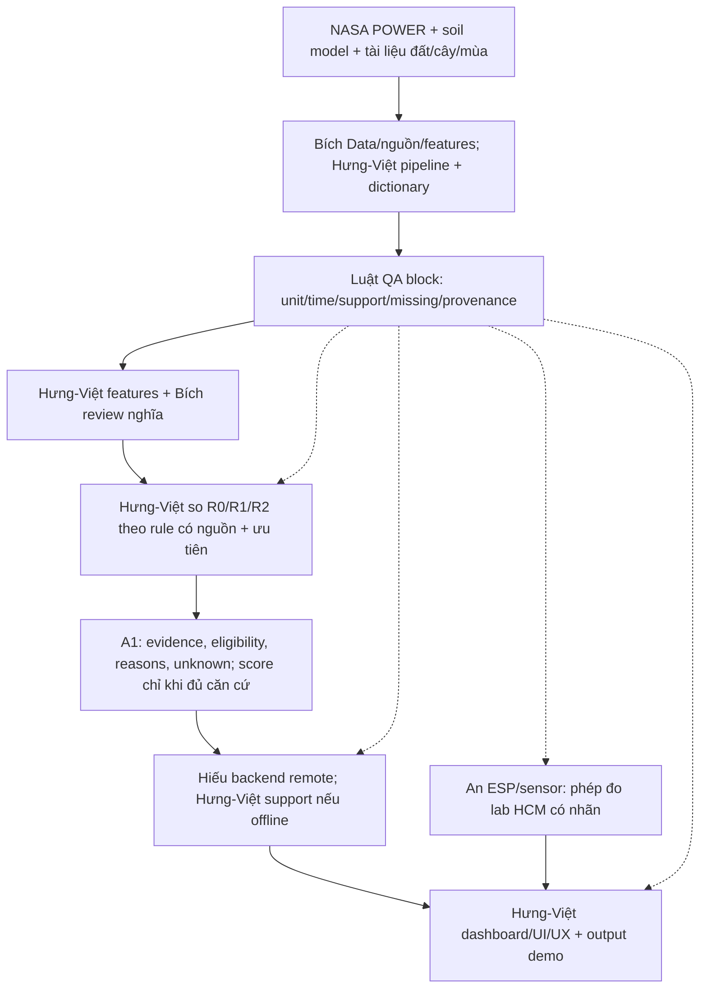

# Kiểm định tổng thể AgroTwin trước giờ G

> 12/11/2026. Desk audit có kiểm file và dữ liệu cached; không phải kiểm nghiệm nông học, product end-to-end, user test hoặc xác nhận của ban giám khảo. Bản hiện hành để gửi là PDF Mỹ Thành **1.3**, 13 trang. Không tạo proposal mới.

## 1. Kết luận thực tế

**Giữ Field Shift và Mỹ Thành là đúng hướng theo brief đã được cung cấp. Tài liệu hiện hành đã đồng bộ về case, roles, phạm vi và unknown sau các sửa trong audit này. Chưa thể kết luận core giải pháp hoặc khâu chuẩn bị đã hoàn tất.** Điểm thiếu quan trọng nhất là điều kiện cây/nước/mùa và rule có căn cứ nối NASA-derived feature vào phép so hoặc lời giải thích lựa chọn. Không giải quyết thiếu đó bằng thêm bản đồ, PDF hoặc sensor.

Trước T0 chỉ nghiên cứu/chuẩn bị được phép; sau T0 mới triển khai project. Đã đọc lại [GO Team trả lời 05/11/2026](https://github.com/nasa/spaceapps/discussions/1813): làm project trước thời gian chính thức có thể bị loại. [Trang Field Shift chính thức](https://www.spaceappschallenge.org/2026/challenges/field-shift-adapting-farms-with-nasa-data/) vẫn trả 502 trong lượt kiểm; không giả là đã đọc đầy đủ Resources/rubric hoặc quy định HCMC. Remote eligibility, agenda/pitch và cách dùng artifact có trước còn phải xác nhận với BTC.

## 2. Đối chiếu từng yếu tố với đề

Nguồn đối chiếu là nguyên văn brief người dùng đã cung cấp, lưu ở [hồ sơ challenge](../challenges/07-field-shift.md). “May” là gợi ý; lựa chọn ba phương án là tiêu chí MVP NeuraX chọn, không biến mọi gợi ý thành yêu cầu NASA bắt buộc.

| Yếu tố | Đang có | Kết luận / gate còn thiếu |
| --- | --- | --- |
| Người dùng và quyết định | Nông dân khám phá luân canh theo ưu tiên, không thay chuyên gia | Đúng mục tiêu. Chưa có phỏng vấn/user test hoặc người dùng thực xác nhận; persona là giả thuyết |
| NASA EO/khí tượng | POWER 2015-2025, mưa/nhiệt thật, có raw/QA | Đúng nguồn được brief nêu. Chưa chứng minh feature đi vào phép so; không gọi chart riêng là đã giải decision support |
| Đất địa phương | SoilGrids model tại tâm block, khoảng dự đoán rộng; evidence đất vùng lịch sử | Có bối cảnh, chưa đủ xác nhận đất tại ruộng/EC/thoát nước. Đề không được giải bằng việc đổi tên soil model thành measured local soil |
| Đặc tính cây và lịch | R0 lúa-lúa-lúa; R1 lúa-bắp non-lúa; R2 lúa-đậu xanh-lúa có nghiên cứu lịch sử | Cấu trúc reference có nguồn; giống, cửa sổ chuyển vụ, điều kiện nước và rule áp dụng tại Mỹ Thành còn thiếu |
| Ưu tiên người dùng | Thiết kế input mục tiêu/trọng số và giải thích | Đúng hướng. Chưa có utility/rule đầy đủ; không cho slider đổi score tùy ý để tạo demo có vẻ thông minh |
| So sánh, lợi ích, rủi ro | Có evidence matrix, unknown, source scope, gate | Chưa đủ kết luận phương án thắng, % nước/năng suất/lợi nhuận. R0 is_current=null cho tới khi xác minh |
| AI/phương pháp | Baseline có giải thích, lọc constraint khi có nguồn; ML/forecast optional | Hợp lý hơn ép model thiếu nhãn. Chưa có model accuracy/validation hoặc response rule NASA-to-crop được kiểm |
| Map và farm mô phỏng | Ranh xã có nguồn, block số hóa ảnh 2025 khoảng 2 ha | Đủ định vị/minh họa. Không là digital twin đã hiệu chuẩn, ranh địa chính, đất đồng nhất hay hiện trạng crop 2026 |
| Sensor và chip | Loan theo thông tin team; datasheet/probe chưa đủ; lab HCM tách nguồn | Có thể bổ sung demo, không bắt buộc để giải core. Chưa kiểm điện/giao tiếp/hiệu chuẩn, chưa xác thực claim 100% nội địa độc lập |
| ENSO | Outlook có ngày và kịch bản có nhãn | Đúng khi làm context; chưa đủ local drought/yield forecast. Không bắt buộc cho MVP, không lấy probability ENSO làm probability hạn ruộng |
| Tính mới/local/global | Flow giải thích/unknown và case Việt Nam là hướng giá trị | Chưa chứng minh độc nhất, superior performance hoặc cơ hội thắng. Không có phiếu điểm để suy chắc nguyên nhân winner thắng |

## 3. Flow đầy đủ và ai sở hữu block

Đây là sơ đồ thiết kế, chưa là luồng thực thi đã chạy; Mermaid chưa render trong lượt audit. Luật QA/đánh giá tất cả block theo input/output/tiêu chí/bằng chứng, không phải cứ Q1 pass rồi mới được làm mọi việc khác. Hưng-Việt cùng đóng góp chính; schema giúp Hiếu/An làm song song sau T0. Hardware hoặc phản hồi remote không được là điểm chặn duy nhất.

**Đầu ra tối thiểu từng block:**

| Block | Owner | Artifact và cách biết đã xong |
| --- | --- | --- |
| Data/evidence | Bích + Hưng-Việt | D1/dictionary/source manifest, K1 có scope/page/method; raw và model/lab tách nguồn |
| Features | Hưng-Việt, Bích review | Grain region-month; đơn vị/coverage/quality. Có định nghĩa và raw trace; không tăng độ phân giải bằng resampling |
| So phương án | Hưng-Việt | Rule và điều kiện có nguồn; NASA feature liên quan được dùng có lý do; score null nếu thiếu; unknown không là eligible |
| QA/evaluation | Luật, hỏi mọi owner | Q1/E1 theo block, invariants/sensitivity/missing/source; không accuracy giả khi không có nhãn |
| Backend | Hiếu, Hưng-Việt support | Contract/input-output, lệnh chạy/handoff và trạng thái lỗi. Chưa có bằng chứng phần này đã chạy cho Mỹ Thành |
| UI/demo | Hưng-Việt | Ba phương án + evidence/unknown/priorities, nguồn/ngày dữ liệu, lab tile riêng, replay có nhãn. Chưa có user test |
| ESP/sensor | An, Luật kiểm đo | H1 raw/timestamp/unit/quality/calibration scope; không VWC% nếu chỉ có dry-wet index, không đo thay Mỹ Thành |

## 4. Thử đi qua một tình huống

**Đây là walkthrough logic bằng tài liệu, không phải chạy app hoặc thử mô hình.** Không chèn số utility/yield tự tạo.

1. Người dùng mở case Mỹ Thành và đặt ưu tiên “nước”. App phải nói R0/R1/R2 là reference, chưa xác nhận lịch của hộ. Baseline thực = unknown.
2. POWER cung cấp bối cảnh mưa/nhiệt vùng. Bích review định nghĩa và Luật kiểm đơn vị/missing/WARN. Một ngày mưa bất thường không được tự sửa rồi gọi dữ liệu sạch.
3. R1 cần xem điều kiện tưới/tiêu và cửa sổ bắp non trở lại lúa; R2 cần điều kiện đúng đậu xanh. Hiện thiếu các bằng chứng đó tại block, nên cả hai giữ needs_review/REFERENCE_ONLY; không tự đặt R2 trên R1 vì là cây họ đậu.
4. Nếu chưa có rule nối điều kiện khí hậu/cây với tiêu chí “nước”, score=null và UI nêu thiếu gì. Việc không xếp hạng giả là đúng, nhưng **core decision support vẫn còn phải hoàn thiện**, không coi unknown-only là đã đáp ứng toàn bộ challenge.
5. Khi Bích cung cấp rule có phạm vi phù hợp, Hưng-Việt ghi rule_id/source/định nghĩa, Luật kiểm input/rule/output; sau đó mới cho thay ưu tiên tác động phép so có giải thích. Rule giả định để thử chỉ ở synthetic/scenario mode, không thay evidence khoa học.
6. An thay độ ẩm chậu HCM thì tile lab thay; ranking Mỹ Thành không tự đổi vì phép đo không cùng nơi/đất. Mất sensor hoặc Hiếu offline vẫn giữ phần so theo snapshot có nhãn và cùng contract.

## 5. Kiểm đồng bộ và các lỗi đã sửa

Kết quả máy đọc tại [consistency-audit.json](cases/my-thanh-cai-lay/consistency-audit.json), tái lập bằng `scripts/research/audit_pre_event_consistency.py` từ root repo với Windows Python bundled/pypdf/Pillow. Không gọi API mới hoặc chạy code sản phẩm.

- Quét Markdown trong NASA research + team + README gốc, kiểm relative links và fences. Không tuyên bố kiểm hết mọi file kỹ năng/vendor/repo sản phẩm bên ngoài scope đó.
- Kiểm 16 SHA raw files, 4.018 daily keys mỗi biến, fill/nonfinite, nhiệt min/mean/max và mưa không âm. Giữ WARN mưa 488,17 mm ngày 14/06/2020; chưa có cross-check độc lập tại Mỹ Thành. Integrity pass không chứng minh đo đúng tại ruộng.
- Đối chiếu geometry xã với raw primary, phép đổi pixel -> tọa độ block, KML parse, 15 raw soil cell values/units tại tâm block. Không khẳng định khảo sát ranh độc lập hoặc hiện trạng cây.
- Kiểm 12 hàng CSV evidence, ID không trùng; ô reviewer/decision/date trống đúng trạng thái chưa review. Chưa được Bích chốt qua audit này.
- PDF 1.3 có 13 trang, gồm bìa/roles/evidence. Hash các nguồn include và output khớp; đã render toàn bộ để review. Ba PDF cũ có notice 1.3, trang gốc giữ nguyên; không giả là đã viết lại nội dung cũ.
- ZIP 26 entries: CRC/hash pass, PDF trùng bản hiện hành, Markdown đã expand include; sửa bốn link hỏng ở profile đi kèm. Link ngoài repo không được xác minh nội dung chỉ nhờ tồn tại URL.
- Còn năm relative links trong README lưu nguyên bản của upstream trỏ thư mục database không kèm checkout. Ghi warning và giữ provenance snapshot; không gọi đó là năm link lỗi trong tài liệu hiện hành.
- Sửa workflow còn trỏ Đức Lập, baseline như đã biết, Hiếu mặc định sở hữu UI và ý “chuyển fallback/đổi bài” khi thiếu rule. Đồng bộ final-selection/decision-log theo xác nhận giữ Mỹ Thành. Thêm is_current nullable, source_kind/evidence_scope và gate NASA-to-comparison trong contract/flow/PDF.

## 6. Chuẩn bị còn lại và điều kiện dừng

| Việc còn lại | Owner | Đủ để dừng chuẩn bị khi |
| --- | --- | --- |
| Review đất-nước-cây-mùa và rule dùng được | Bích, Hưng-Việt; Luật kiểm | Có nguồn cho phần dùng; phần thiếu ghi rõ. Ít nhất chốt một cách dùng NASA feature trong so/giải thích có căn cứ hoặc thừa nhận phần core chưa hoàn tất |
| Freeze một lát cắt Data -> AI -> output | Hưng-Việt | Dictionary/contract rõ, người nhận/unknown/fail/replay rõ; không bắt thêm ML/forecast/3D |
| Khung online/backend handoff | Hiếu + Hưng-Việt | Có thời gian có thể phản hồi và cách tiếp quản, không hứa online liên tục |
| Inventory/datasheet/nhánh demo | An + Luật | Biết gì có thật, gì chưa có và nhãn backup; không chờ sensor để hoàn thiện core |
| Rules/local logistics | Hưng | Xác nhận lịch/pitch/deadline/remote và cách dùng artifact có trước từ BTC; ghi câu còn chờ |
| Theo dõi readiness | Luật hỏi mọi người | Mỗi block có owner, input/output, trạng thái và blocker có bằng chứng; không lấy lời “xong” thay kiểm |

**Sau T0:** mới triển khai và kiểm một luồng end-to-end hẹp theo các gate trên; khi core ổn mới thêm sensor/ENSO. **Trước T0:** không có yêu cầu phải xây xong submission để được gọi chuẩn bị tốt. Hồ sơ này chưa chứng nhận sẵn sàng sản xuất hoặc dự án đủ điều kiện thắng local/global. Không thêm nghiên cứu địa bàn/PDF chỉ để tăng số artifact. Chưa commit/push hoặc liên hệ ai.
