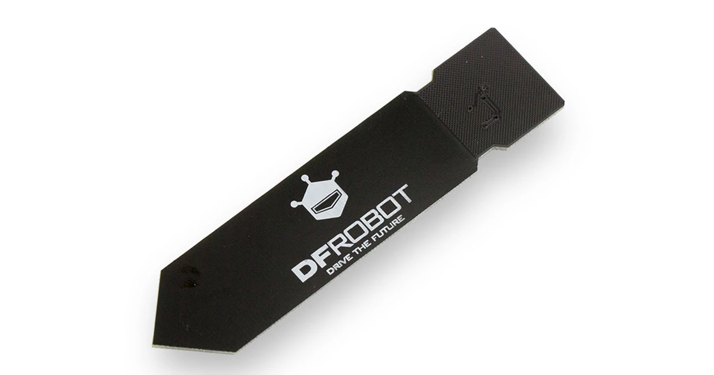
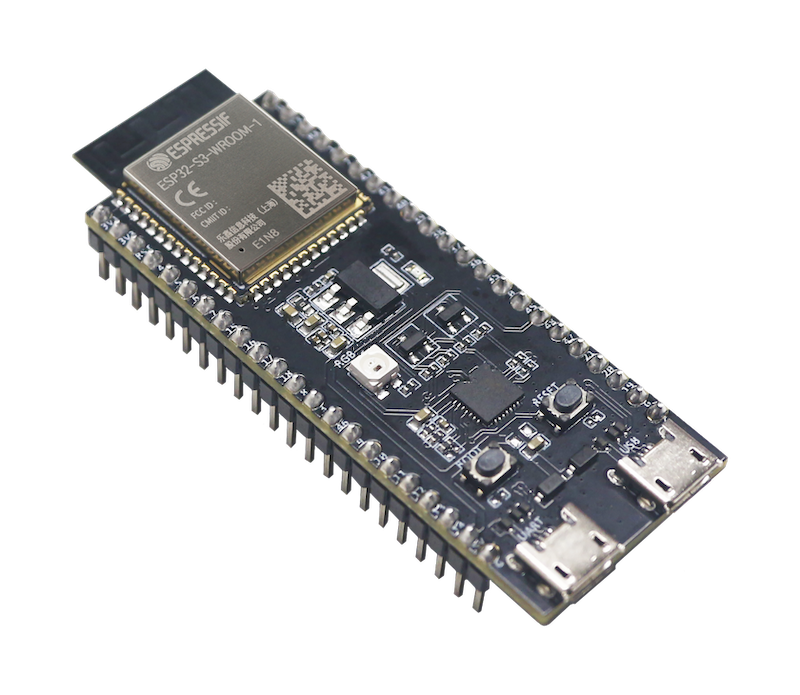
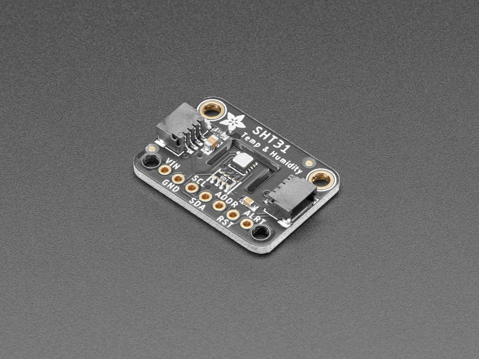

# AgroTwin — Hồ sơ phân tích và thiết kế hệ thống demo

> NeuraX · Field Shift · Bản thiết kế 0.2 · 06/11/2026 · Nội bộ
> Người đọc: An và cả nhóm. Đây là paper thiết kế trước triển khai, không phải báo cáo thực nghiệm. Chưa xác nhận inventory, vùng/cây, sample NASA, giá mua hay kết quả phần cứng. Các ngưỡng và thời gian thử được ghi rõ là đề xuất cần pilot.

## Tóm tắt

AgroTwin được đề xuất để hỗ trợ so sánh luân canh khi điều kiện môi trường và ưu tiên của người trồng thay đổi. Giá trị chính nằm ở việc kết nối dữ liệu NASA, kiến thức cây–đất–mùa có nguồn và một phương pháp xếp hạng giải thích được. Phần cứng bổ sung khả năng quan sát tại điểm đo và chứng minh luồng tích hợp từ thiết bị tới giao diện rồi trở lại thiết bị. Hai vai trò này cần được phân biệt để demo không tạo ấn tượng sai rằng một cảm biến trên bàn có thể xác nhận khuyến nghị cho cả vùng nông nghiệp.

Paper này giải thích thiết kế được ưu tiên, lý do chọn từng thành phần, những lựa chọn chưa cần thiết và cách tiếp tục khi một thành phần không hoạt động. Kiến trúc ban đầu sử dụng một probe ẩm đất điện dung, ESP32, USB Serial và laptop; SHT31 và màn hình chỉ bổ sung sau khi đường đo và dashboard ổn định. Cấu hình tối thiểu là một mốc tích hợp, không phải giới hạn chiều sâu kỹ thuật. Chiều sâu được thể hiện bằng provenance, phương pháp đo, kiểm chất lượng, xử lý lỗi, đánh giá và khả năng tái lập.

Thiết kế chưa chứng minh độ chính xác đo độ ẩm tuyệt đối, lợi ích năng suất hay khả năng tiết kiệm nước. Các kết luận đó cần nghiên cứu riêng. Trong giai đoạn chuẩn bị, đầu ra có thể kiểm được là nguồn và giả định rõ ràng, contract có phiên bản, sơ đồ kết nối theo board thực và protocol kiểm thử đủ để một người khác thực hiện lại.

### Cách đọc tài liệu

Phần 1–4 giải thích bài toán, kiến trúc và tiêu chí quyết định. Phần 5–10 đi sâu vào cảm biến, board, truyền thông, dữ liệu và hiệu chuẩn. Phần 11–14 trình bày kiểm thử, xử lý sự cố, backup và demo. Phần 15–17 dành cho phân công, BOM, quyết định còn mở và nguồn tham khảo. Các nhãn “theo hãng”, “đề xuất” và “chưa kiểm” có ý nghĩa khác nhau; không chuyển thông số danh định thành kết quả đạt được của hệ thống.

## 1. Vấn đề cần giải và vai trò của phần cứng

### 1.1 Quyết định người dùng

Theo brief Field Shift đã lưu, công cụ cần hỗ trợ người trồng khám phá lựa chọn luân canh bằng NASA Earth observations, thông tin đất địa phương, đặc tính cây và ưu tiên sử dụng. Một phương án có thể thuận lợi ở tiêu chí nước nhưng không phù hợp mùa vụ hoặc ràng buộc thị trường. Vì vậy, dashboard cần hiển thị cả điều kiện loại trừ, lý do so sánh và thông tin chưa biết; không chỉ đưa ra một tên cây với điểm số.

MVP đề xuất giới hạn ở một vùng, một nhóm cây và ba chiến lược có căn cứ gồm hiện trạng. Địa phương và cây cụ thể chưa được chọn trong paper. Việc chọn sau này phải dựa vào nguồn nông học và data sample, không bắt đầu từ hiệu ứng demo mong muốn rồi tìm số liệu để minh họa. Một NASA-derived feature chỉ có giá trị khi nó tham gia trực tiếp vào so sánh và giải thích.

### 1.2 Phần cứng tạo giá trị ở đâu?

Node của An có ba đầu ra: một phép đo có quy trình, một luồng dữ liệu có thể truy vết và một trạng thái thiết bị có thể hiểu được. Người xem có thể quan sát số đo tại điểm, thời gian cập nhật, mất kết nối và cách hệ thống hiển thị thông tin cũ. Đây là đóng góp hệ thống thực, ngay cả khi model chạy hoàn toàn trên laptop.

Tuy nhiên, probe trong hai chậu đất tại bàn chỉ quan sát hai mẫu đó. Khác biệt về diện tích đại diện, độ sâu, thời gian và phương pháp đo ngăn việc coi nó như ground truth cho một pixel NASA ở xa. Thiết kế mặc định không đưa H1 tại bàn vào ranking vùng. Nếu sau này có dữ liệu tại nông trại thật, Bích và Việt cần xác định cách đối chiếu không gian–thời gian và response rule trước khi thay đổi vai trò node.

### 1.3 Phạm vi chưa đưa vào lần đầu

Không triển khai điều khiển bơm/van tự động, dự báo năng suất, kết luận sức khỏe đất hoặc khuyến nghị dinh dưỡng từ probe ẩm. Những chức năng này cần biến đo, mô hình, chuyên môn và kiểm định khác. Cắt chúng ở mốc đầu giúp bảo vệ đường NASA → phân tích → quyết định; không có nghĩa chúng không thể là hướng phát triển sau này.

## 2. Kiến trúc tổng thể và ranh giới dữ liệu

<!-- FIGURE:architecture -->

**Hình 1.** Kiến trúc đề xuất với hai luồng độc lập nhưng cùng xuất hiện trên dashboard. Mũi tên biểu diễn bàn giao dữ liệu, không ngụ ý mọi block đã được xây dựng.

### 2.1 Luồng so luân canh

Việt chuẩn hóa NASA data thành D1, kèm dictionary, đơn vị, coverage và provenance. Bích tạo K1 mô tả cây, đất, mùa và quy tắc áp dụng. Quang Luật kiểm Q1 trước khi phần dữ liệu liên quan được dùng. Hưng và Việt xử lý ràng buộc và xếp hạng, xuất A1 để Hiếu render; E1 ghi phương pháp kiểm và giới hạn cùng version.

CSV/JSON là điểm giao ban đầu vì cả Python, R và MATLAB đều có thể trao đổi qua các định dạng này. Dashboard không phải đọc notebook của từng người hoặc decode raster gốc. Snapshot nhỏ giúp demo không phụ thuộc Internet sau khi dữ liệu hợp lệ đã được đóng gói. Nếu sau này cần API, API trả cùng schema thay vì tạo một dạng kết quả song song.

### 2.2 Luồng thiết bị

Probe → ESP32 → bridge trên laptop → log H1 → thẻ context. Chiều ngược lại là một bản tóm tắt A1 đã tính trên laptop → ESP32 → OLED hoặc Serial. Không gửi toàn bộ raster, tập huấn luyện hay model lớn xuống MCU chỉ để chứng minh có AI trên chip. Chức năng thiết bị hiện tại là acquisition, chất lượng tín hiệu, giao tiếp và hiển thị trạng thái.

### 2.3 Tại sao tách hai luồng?

Nếu sensor rút ra, người dùng vẫn phải xem được kết quả NASA snapshot cùng giới hạn của nó. Nếu NASA/K1 chưa đủ, một node đo đẹp cũng không biến phần so luân canh thành đã giải được challenge. Tách luồng cho phép giảm một subsystem mà không che giấu tình trạng subsystem còn lại. Hiếu phải hiển thị riêng “data_as_of của kết quả” và “lần nhận log thiết bị gần nhất”; hai mốc này không thay thế nhau.

## 3. Thiết kế DATA và baseline trước model nâng cao

### 3.1 Chọn ít nguồn theo câu hỏi

NASA POWER là nguồn candidate cho lát cắt khí hậu ban đầu vì Daily API có dữ liệu khí tượng dạng chuỗi và định dạng ứng dụng đọc được [S6]. Đây là căn cứ chọn hướng adapter, chưa xác nhận parameter, product/version, coverage hay tính đại diện cho vùng team chọn. Không mặc định một request tại tọa độ là phép đo ở ruộng.

NASA API có quy ước thời gian riêng, nên adapter phải đọc metadata và chọn chuẩn thời gian rõ ràng trước khi gộp theo tháng. Grain đề xuất vẫn là region × month; tính tổng mưa trên ngày hợp lệ phải đi kèm coverage. Tháng thiếu không tự thành tháng ít mưa. Thêm SMAP/GPM hoặc lớp khác chỉ khi feature đó thay đổi một quyết định có ý nghĩa và team kiểm được đơn vị, scale, QA và phép aggregate.

### 3.2 Baseline xếp hạng

Đầu tiên lọc các chiến lược vi phạm hard constraints đã có căn cứ. Quy tắc thiếu nguồn trả needs_review; không coi “chưa biết” là “phù hợp”. Với phương án còn lại, baseline tổng hợp các utility đã được Bích/Hưng định nghĩa, theo trọng số người dùng. Điểm là chỉ số heuristic có giải thích, không phải xác suất thành công.

Ví dụ công thức nội bộ: score(s) = Σ weight(j) × utility(s,j), với tổng weight bằng 1. Việc đổi ưu tiên có thể đổi thứ hạng; E1 phải cho thấy phần thay đổi đến từ tiêu chí nào. Nếu mọi phương án luôn giữ cùng thứ tự, cần kiểm weights/utility trước khi dựng hiệu ứng tương tác. Không tự thêm một tiêu chí “thị trường” hoặc “năng suất” khi chưa có dữ liệu và định nghĩa.

### 3.3 Forecast là quyết định riêng

Chỉ thêm forecast sau khi baseline A1 chạy đầu cuối và có lịch sử, target, horizon, split theo thời gian và phép so baseline. Prediction không tự là yêu cầu bắt buộc từ việc đề nhắc kỹ thuật SI. Tương tự, slider giảm mưa là scenario do người dùng đặt, không được trình bày như một dự báo xác suất. Kết quả sensor tại bàn không phải nhãn để đánh giá forecast vùng.

## 4. Yêu cầu kỹ thuật và tiêu chí chọn thiết bị

Lựa chọn thiết bị dựa trên chức năng cần chứng minh, thời gian tích hợp và bằng chứng có thể thu thập. Chưa có giá địa phương hoặc inventory nên paper không chấm điểm chi phí bằng số, không gọi phương án là rẻ nhất và không xác nhận linh kiện có thể giao kịp. Thứ tự ưu tiên là dùng đồ đã có và hiểu rõ, sau đó mới mua để lấp một yêu cầu chưa đáp ứng.

| Mã | Yêu cầu đề xuất | Lý do và cách quan sát |
| --- | --- | --- |
| R1 | Đọc được tín hiệu ẩm tại điểm | Có raw, điều kiện đo và quality; không chỉ có animation |
| R2 | Nguồn/tín hiệu phù hợp board thực | Có revision, pin map, đo kiểm trước khi nối |
| R3 | Dữ liệu truy được theo device/run | Log có identity, thời gian, calibration và version |
| R4 | Không phụ thuộc mạng venue | USB Serial và snapshot local có đường chạy độc lập |
| R5 | Không che mất lỗi | UI phân biệt ok, unknown/invalid, stale và replay |
| R6 | So luân canh vẫn hoạt động khi node lỗi | Tắt node mà D1/K1/A1 hợp lệ vẫn đọc được |
| R7 | Thay module không đổi toàn ứng dụng | Adapter giữ contract; thay calibration theo probe |
| R8 | Một người khác thực hiện lại được | Có wiring, BOM, firmware version, protocol và log |

Một thiết bị mạnh hơn chỉ được chọn nếu đáp ứng thêm một yêu cầu có ích. Wi-Fi, nhiều cảm biến hoặc một màn hình đẹp đều có thể giúp demo, nhưng cũng thêm nguồn lỗi. Ngược lại, giảm phần cứng không được biến thành giảm yêu cầu đo và kiểm dữ liệu: một probe đơn giản vẫn cần calibration, protocol và xử lý missing đúng.

Các quyết định ở phần sau có ba mức: ưu tiên cho lần tích hợp đầu; backup có điều kiện; ngoài phạm vi hiện tại. Đây là quyết định NeuraX, không phải yêu cầu bắt buộc NASA hoặc chứng nhận tương thích từ hãng cho mọi tổ hợp module.

## 5. Probe ẩm đất: lý do chọn và giới hạn



**Hình 2.** SEN0193 là mẫu candidate để nhận diện chức năng. Ảnh DFRobot; chưa xác nhận team có đúng SKU này [S1].

### 5.1 Vì sao cần đại lượng này?

Nước là một trong các ưu tiên tự nhiên của Field Shift. Đo tín hiệu liên quan ẩm tại điểm giúp người xem hiểu khác biệt giữa một observation địa phương và chuỗi điều kiện môi trường theo vùng. Probe có thể thử với hai mẫu đất có điều kiện ghi lại, tạo được một tín hiệu thay đổi để kiểm acquisition, log và trạng thái UI.

Điều cần chứng minh là phép đo và luồng dữ liệu phản ánh đúng điều kiện thử. Không cần buộc tín hiệu đó trực tiếp thay ranking cây. Đất ẩm hơn trong chậu hôm nay không đủ để kết luận một rotation tốt hơn trong các mùa tới; mối liên hệ đó cần mô hình và nguồn nông học riêng.

### 5.2 Vì sao ưu tiên điện dung?

SEN0193 là cảm biến điện dung có ngõ analog; hãng mô tả cấu trúc chống ăn mòn và nêu supply 3.3–5.5 V, output 0–3.0 V [S1]. Lựa chọn này cho phép thiết kế một measurement chain tương đối dễ quan sát với ADC trên MCU. Lợi ích tích hợp là có raw để lưu, kiểm clipping và đối chiếu khi thay probe; không phải lời bảo đảm accuracy.

Một probe là đủ để thử hai chậu tuần tự. Hai probe chỉ hữu ích nếu cần đo đồng thời và đã kiểm bias/chênh lệch giữa từng chiếc. Nếu dùng hai chiếc chưa kiểm, người xem có thể đang thấy khác biệt cảm biến thay vì khác biệt đất. Nhân đôi thiết bị trước khi có protocol không làm phép thử thuyết phục hơn.

### 5.3 Điều probe không đo được

Chỉ số đọc còn phụ thuộc cách lắp và điều kiện mẫu; cần cố định độ sâu và cách đặt đất trong protocol. Hãng cảnh báo phần điện tử không chống nước và có giới hạn vùng nhúng khi calibration [S2]. Paper không coi một phép chuẩn hóa hai đầu là đo volumetric water content, không suy ra NPK, pH, sức khỏe đất hoặc năng suất từ cùng tín hiệu này.

## 6. So phương án probe và các cảm biến chưa chọn

| Phương án | Lợi ích có thể có | Trade-off và điều kiện dùng |
| --- | --- | --- |
| Điện dung có tài liệu rõ | Dễ truy thông số và xây protocol | Vẫn phải kiểm board, output và calibrate từng probe |
| Điện dung khác SKU/clone | Dùng được nếu team đã có | Không kế thừa spec/calibration SEN0193; kiểm nguồn và output riêng |
| Probe điện trở có sẵn | Có thể là backup minh họa tín hiệu | Không giả độ bền/tính ổn định tương đương; thử riêng, ghi khác phương pháp |
| Probe công nghiệp | Có thể phù hợp bài đo triển khai thật | Chỉ chọn khi có tài liệu, interface, ngân sách và thời gian kiểm |
| Không có probe hoạt động | Vẫn demo được phần NASA và protocol replay | Mất bằng chứng acquisition live; phải nói rõ phạm vi bị giảm |

### 6.1 Chính sách thay probe

Ưu tiên một probe cùng loại đã kiểm trước thay vì đổi phương pháp sát giờ. Khi thay, cập nhật sensor_id hoặc device mapping, calibration_id và log kiểm lại; không dùng hai mốc dry/wet của probe cũ. Nếu thay cả loại, giữ payload chung nhưng đổi measurement_method trong dictionary. Bảng so trước/sau cần có nhãn khác phương pháp, không dùng chung một thang chỉ số như thể hai cảm biến đã tương đương.

### 6.2 Vì sao chưa dùng pH, EC và NPK?

Đây có thể là biến hữu ích cho domain, nhưng một feature hữu ích không tự biến thành một thiết bị cần mua trong demo đầu. Mỗi loại cần nguồn kỹ thuật, kiểm chuẩn, mẫu tham chiếu và quy tắc diễn giải riêng. Team chưa xác nhận thiết bị, chuẩn hoặc thời gian để làm đúng các bước đó. Thêm chúng lúc này có thể mở rộng số claim nhanh hơn khả năng kiểm chứng.

Phần đất/cây vẫn phải có nguồn trong K1 dù không có probe dinh dưỡng. Khi một constraint cần pH mà không có dữ liệu đáng tin cho vùng, đánh dấu missing/needs_review thay vì lấy “đất mẫu trên bàn” làm đại diện. Việc bỏ một cảm biến không phải bỏ biến khoa học khỏi tư duy; đó là lựa chọn cách thu bằng chứng phù hợp.

### 6.3 Phương án đo sau hackathon

Nếu tiếp tục triển khai ở nông trại, thiết kế cần được xem lại về vỏ, độ sâu, lấy mẫu nhiều điểm, lịch bảo trì, nhiễu, nguồn và calibration theo đất. Prototype bàn không chứng minh khả năng hoạt động dài hạn ngoài trời. Paper giữ nhánh này như câu hỏi phát triển, không đưa vào acceptance đã hoàn tất.

## 7. Board xử lý: ESP32 và phương án thay thế



**Hình 3.** Board S3 là ví dụ nhận diện từ Espressif, không phải chỉ định phải mua đúng biến thể. Ưu tiên board An đã có và đọc được tài liệu [S3].

ESP32 phù hợp vai trò acquisition/bridge vì có thể nhận tín hiệu cảm biến và giao tiếp với laptop, đồng thời để mở khả năng Wi-Fi khi cần. Model, ranking và xử lý NASA chạy trên laptop; tài nguyên MCU không phải tiêu chí chính ở lần đầu. Không cần Jetson hoặc Raspberry Pi chỉ để phát vài giá trị sensor và một summary.

| Lựa chọn | Khi nên dùng | Điều cần kiểm lại |
| --- | --- | --- |
| ESP32 đang có và đã quen | Lựa chọn ưu tiên nếu ADC/USB/I2C đáp ứng | Exact board, logic level, pin, driver và firmware target |
| ESP32-S3-DevKitC-1 | Candidate khi cần board có tài liệu chính thức | Module/flash/PSRAM/revision, cổng USB và pin bị chiếm |
| Một ESP32 dự phòng đã test | Thay board lỗi ít đổi kiến trúc | Pin map, port, calibration ADC và firmware build đúng |
| Arduino UNO Rev3 có sẵn | Backup acquisition qua USB nếu đã có kỹ năng | Kiến trúc 5 V; không nối logic 5 V vào ESP32 [S7] |

Tài liệu DevKitC-1 cho thấy có nhiều biến thể module và revision; một số pin dùng nội bộ cho bộ nhớ, và cáp chỉ sạc không dùng được cho dữ liệu [S3]. Vì vậy, ảnh “ESP32” trên shop hoặc lời nói “có board ESP32” chưa đủ để chốt pinout. An cần chụp rõ mã board/module và hai mặt PCB trước khi Việt/Hiếu khóa interface firmware.

Chuyển sang UNO là thay MCU acquisition, không phải ghép thêm board vào một mạch chưa kiểm. Khi đổi board phải xuất đúng identity và phương pháp ADC; không copy calibration counts từ ESP32. Nếu thời gian không đủ để kiểm lại, bỏ acquisition live và dùng chế độ replay có nhãn sẽ trung thực và dễ kiểm hơn một bản đọc số chưa hiểu.

## 8. Nhiệt/ẩm không khí và hiển thị: cần khi nào?



**Hình 4.** Breakout minh họa Adafruit #2857. Spec của breakout này không tự áp dụng cho mọi module SHT31 cùng tên [S4].

### 8.1 Lý do giữ SHT31 ở mức bổ sung

Nhiệt/ẩm không khí giúp cung cấp context môi trường tại điểm đo, nhưng không thay probe ẩm đất và không phải điều kiện để giải core luân canh. Nó chỉ nên được thêm khi có câu hỏi rõ: hiển thị môi trường xung quanh hoặc kiểm đủ một sensor bus số. Không dùng giá trị không khí ở bàn demo như lịch sử khí hậu của vùng.

SHT31 breakout có giao tiếp I2C nên có thể chia sẻ bus với màn hình nếu địa chỉ và pull-up phù hợp. Với breakout Adafruit, SDA/SCL có pull-up tới Vin [S4]; vì vậy việc cấp nguồn cần được xét cùng logic level MCU. Chọn nguồn phù hợp 3.3 V cho tổ hợp đã kiểm thay vì suy rằng module “hỗ trợ 5 V” đồng nghĩa mọi dây tín hiệu đều an toàn với ESP32.

### 8.2 Backup nếu không có SHT31

Có thể dùng DHT22 đã có nếu kiểm đúng module, pinout, logic và thư viện. Theo hướng dẫn Adafruit, DHT22 không nên được query nhanh hơn một lần mỗi hai giây [S5]; cadence phải theo loại sensor, không dùng một vòng đọc 1 Hz cho mọi channel. Không tuyên bố accuracy hai loại tương đương chỉ vì đều trả nhiệt/ẩm. Nếu chưa có driver ổn định, bỏ channel không khí và ghi “không lắp” thay vì tạo số thay thế.

### 8.3 OLED, LED hay Serial?

OLED hữu ích để chứng minh chiều trả kết quả từ laptop về thiết bị. Tuy vậy, nó không được thành điểm nghẽn: Serial Monitor có thể hiển thị cùng summary gồm run_id, trạng thái, unit và data_as_of. LED chỉ nên báo trạng thái kết nối/chất lượng đã định nghĩa, không gán thành “đất tốt/xấu” hoặc “cây nên trồng” nếu không có quy tắc và chú giải.

## 9. Kết nối, nguồn và thu nhận tín hiệu

<!-- FIGURE:topology -->

**Hình 5.** Sơ đồ chức năng đề xuất. Chưa phải pinout để nối ngay; mapping chân cụ thể là đầu ra sau khi kiểm board thực.

### 9.1 Bảng giao tiếp cần chốt

| Kết nối | Đề xuất ban đầu | Điều kiện trước khi cấp nguồn |
| --- | --- | --- |
| Probe → ESP32 | Analog signal vào ADC được chọn | Kiểm supply, output đo thực, input range và attenuation |
| SHT31/OLED → ESP32 | I2C, nếu lắp | Kiểm địa chỉ, pull-up, mức logic và chân đang dùng |
| ESP32 ↔ laptop | USB Serial | Cáp có data, driver/port, baud và framing thống nhất |
| Nguồn board | USB laptop theo board guide | Không ghép nhiều nguồn ngoài khi chưa hiểu schematic |
| GND | Tham chiếu chung cho mạch đã chọn | Kiểm continuity, tránh dây lỏng hoặc nối nhầm rail |

### 9.2 Vì sao USB trước Wi-Fi?

Đây là lựa chọn vận hành của NeuraX: USB giảm các biến cần cấu hình như SSID, mật khẩu, reconnect và mạng venue, đồng thời giúp thấy log ngay. Nhược điểm là cáp giới hạn bố trí và laptop phải quản lý port. Wi-Fi có ích nếu demo cần di chuyển node; chỉ thêm sau khi cùng protocol chạy ổn qua USB. Không để chọn transport làm thay đổi ý nghĩa phép đo hoặc schema UI.

### 9.3 ADC và tín hiệu thực

Supply của board không phải dải input ADC. Với SEN0193, dù output danh định tối đa 3.0 V, vẫn phải đối chiếu ADC range và attenuation của chip/cấu hình đang dùng. Espressif có driver calibration để chuyển raw ADC sang điện áp trong điều kiện hỗ trợ [S8]. Hiệu chuẩn ADC không phải hiệu chuẩn soil moisture; hai bước giải quyết hai sai số khác nhau.

Khi thấy tín hiệu chạm rail, không sửa bằng cách tăng/giảm chỉ số trên UI. Kiểm nguồn, dây, input configuration và output bằng đồng hồ trước. Ghi raw, firmware version, cấu hình ADC và calibration mapping để có thể chẩn đoán lại. Không giả pin map ESP32 thường áp dụng cho S3.

## 10. Contract log và vòng đời firmware

### 10.1 Framing và identity

Đề xuất đầu tiên là JSON mỗi dòng qua USB Serial: một record hoàn chỉnh kết thúc bằng newline; bridge chỉ parse khi nhận đủ dòng. Debug text dùng kênh riêng hoặc prefix không phải JSON. Mỗi record cần identity ổn định để reconnect/reset không tạo một chuỗi số đo không thể phân biệt.

H1 hiện hành vẫn giữ event_id, device_id, timestamp, event_type, value, unit, quality, calibration_id, source_context và delivery_mode. Có thể thêm tùy chọn boot_id, seq, uptime_ms, host_received_at và timestamp_basis sau khi Việt/Hiếu/An thống nhất version. Đây là đề xuất mở rộng, chưa đổi contract v0.1 trong architecture.md một cách ngầm định.

### 10.2 Timestamp khi MCU chưa có UTC

MCU vừa bật có thể chưa biết giờ UTC. Không tạo chuỗi thời gian có vẻ chính xác từ một clock chưa sync. Bridge có thể gắn UTC lúc nhận record, nhưng phải ghi timestamp_basis là host_received và giữ uptime_ms/sequence để phân tích thứ tự. UTC của host cần kiểm lại. Chưa có clock đo đồng bộ thì không báo latency tuyệt đối một chiều hoặc thời gian observation chính xác tới mili giây.

### 10.3 Ví dụ record minh họa sau bridge

```json
{
  "schema_version": "0.2-proposed",
  "event_id": "SYN-node01-bootA-0007",
  "device_id": "SYN-node01",
  "timestamp": "2026-11-14T02:00:07Z",
  "timestamp_basis": "host_received",
  "event_type": "soil_moisture_index",
  "value": null,
  "unit": "relative_index_0_1",
  "quality": "unknown",
  "calibration_id": null,
  "source_context": "synthetic_contract_example",
  "delivery_mode": "replay"
}
```

Đây là fixture giải thích schema, không phải log thiết bị đã đo. Synthetic mô tả nguồn nội dung; replay mô tả cách giao, hai nhãn không thay nhau. Record thật phải có metadata để phân biệt nguồn.

### 10.4 Firmware và summary

Firmware đọc → giữ raw → kiểm lỗi → đóng gói record → gửi; chiều nhận summary có kiểm schema và identity. Nếu summary mới lỗi parse, giữ bản hợp lệ trước với nhãn cũ, không ghép giá trị từ run mới với unit của run cũ. Bridge là nơi lưu raw log và trạng thái nhận; display không cần giữ toàn bộ lịch sử.

## 11. Hiệu chuẩn: từ raw ADC tới chỉ số có nghĩa

### 11.1 Hai tầng cần tách

Tầng thứ nhất kiểm điện/ADC: nguồn ổn, input nằm trong dải phù hợp, raw không clipping, calibration điện áp nếu dùng đúng driver và cấu hình [S8]. Tầng thứ hai kiểm measurement method: cùng probe phản ứng thế nào với những điều kiện mẫu đã mô tả. Một bước tốt không thay thế bước còn lại.

Theo quy trình tham khảo của DFRobot, mốc trong không khí và nước dùng kiểm khoảng đáp ứng, có giới hạn vùng nhúng [S2]. Đây là kiểm dải cảm biến, không phải chứng nhận độ ẩm thể tích của đất. Nếu dùng mẫu đất “khô hơn/ẩm hơn”, phải ghi cách tạo mẫu, loại đất, lượng nước bổ sung và thời gian chờ; không gọi hai mẫu đó là dry/wet chuẩn tuyệt đối.

### 11.2 Chuẩn hóa hai mốc nội bộ

Đề xuất biểu diễn chỉ số I = (raw − dry_ref)/(wet_ref − dry_ref), chỉ tính khi hai mốc hợp lệ và khác nhau đủ để dùng. Chiều dấu được xác định từ chính probe: không mặc định raw lớn luôn là ẩm hơn. Giữ giá trị chưa clip trong log để phát hiện ngoài dải; nếu UI giới hạn 0–1 để dễ đọc, cần hiện cờ out_of_calibration thay vì che hiện tượng.

Các mốc phải gắn calibration_id, sensor_id, board/ADC configuration, ngày, phương pháp và điều kiện. Đổi probe, nguồn, cấu hình ADC hoặc cách đặt mẫu có thể làm calibration cũ không còn dùng được. Không dùng cùng một cặp mốc cho mọi board chỉ vì code vẫn chạy.

### 11.3 Lọc và tốc độ đọc

Điểm bắt đầu để pilot: đọc probe khoảng một lần/giây, lưu raw và thử median của một cửa sổ nhỏ, ví dụ năm mẫu. Đây là lựa chọn thử của team, chưa là tốc độ tối ưu. Cần quan sát trade-off giữa nhiễu và độ trễ: cửa sổ quá dài làm thao tác đổi chậu bị phản hồi chậm. Không ghi các mẫu filtered như các observation độc lập mới.

### 11.4 Điều kiện không báo phần trăm

Khi chưa có phương pháp tham chiếu và mapping đã kiểm, nhãn đúng là raw ADC hoặc chỉ số tương đối. Việc nhân I với 100 chỉ đổi cách hiển thị, không biến nó thành %VWC hay %RH của đất. Trong báo cáo, dùng đúng tên đại lượng ở dictionary và display.

## 12. Thiết kế phép thử và bằng chứng đạt

### 12.1 Pilot để chọn cấu hình

An kiểm nguồn/firmware trước. Sau đó An và Quang Luật chạy pilot để chọn khoảng lấy mẫu, thời gian chờ ổn định, cách đặt probe và mức báo stale. Những giá trị này được ghi lại trước lượt đánh giá cuối; không đổi liên tục để giữ một biểu đồ đẹp. Bích kiểm mô tả mẫu và cách diễn giải.

Protocol đề xuất ban đầu có ba điều kiện đất tương đối: khô hơn, trung gian và ẩm hơn, cùng loại đất và dụng cụ chứa. Với mỗi điều kiện, thử ba lần lấy probe ra–đặt lại; mỗi lần lưu ít nhất mười mẫu sau thời gian ổn định đã chọn. Các con số là kế hoạch pilot, chưa đảm bảo statistical power hoặc độc lập mẫu. Nhiều readings liên tiếp trong cùng một lần đặt không được đếm như nhiều mẫu đất độc lập.

### 12.2 Phân tích cần làm

Quang Luật báo số bản ghi, missing, clipping, phân bố raw và độ phân tán trong từng lần đặt; so chênh lệch giữa các lần đặt riêng với nhiễu khi giữ nguyên vị trí. Nếu hai điều kiện không tách được so với độ phân tán, không dựng threshold dry/wet chỉ để demo. Có thể hạ claim xuống “đọc tín hiệu” và mở việc chỉnh measurement setup.

| Mục kiểm | Bằng chứng lưu | Điều kiện chấp nhận đề xuất |
| --- | --- | --- |
| Identity/thứ tự | Raw log có device, boot/sequence nếu đã chốt | Không mất liên hệ record–thiết bị khi reset/reconnect |
| Độ lặp | Nhóm log theo lần đặt và mẫu | Báo được độ phân tán, không gọi đó là accuracy |
| Mức tín hiệu | Raw/điện áp và cấu hình ADC | Không bị clipping chưa giải thích |
| Sensor invalid | Kịch bản rút/lỗi được ghi | Invalid/unknown đúng policy; không tự kết luận đất khô |
| Link stale | Thời điểm ngắt và tuổi record | UI đổi trạng thái theo timeout đã thống nhất |
| Summary | A1 và log display cùng run | Giá trị, unit, trạng thái và data_as_of khớp |

### 12.3 Báo cáo cuối

E1/H1 nên có một trang phương pháp và các hình time series/phân bố đủ đọc, kèm limitations. Muốn báo bias/accuracy phải có reference có căn cứ, không lấy sensor còn lại chưa kiểm làm chuẩn. Mẫu synthetic chỉ kiểm contract và trường hợp biên; không dùng tính metric khoa học như thể dữ liệu đo thật.

## 13. Trạng thái lỗi, stale và khả năng phục hồi

<!-- FIGURE:states -->

**Hình 6.** Trạng thái được đề xuất ở bridge/UI. Trạng thái truyền và chất lượng phép đo được lưu riêng: link live không đảm bảo sensor tốt; replay có thể chứa cả record tốt và lỗi.

### 13.1 Không đồng nhất invalid với mất kết nối

Bridge vẫn có thể nhận heartbeat trong khi sensor trả kết quả không dùng được. Ngược lại, một giá trị cuối cùng hợp lý có thể đã quá cũ vì USB rút ra. UI cần hiển thị cả quality và tuổi dữ liệu, không dùng một đèn xanh duy nhất cho tất cả. Điểm bắt đầu để pilot là timeout theo nhiều chu kỳ gửi, ví dụ ba chu kỳ; số giây cuối do team thống nhất sau khi quan sát jitter thực.

### 13.2 Trường hợp open-circuit

Một ADC còn đọc số không chứng minh probe đang nối. Dây signal hở có thể tạo giá trị có vẻ hợp lý; stuck/range checks chỉ là dấu hiệu. Nếu chưa có mạch hoặc phương pháp phát hiện đã thử, dùng quality unknown/needs_check và thao tác kiểm thủ công. Không hứa “rút sensor là tự phát hiện chắc chắn” chỉ từ code kiểm raw khác 0.

### 13.3 Reconnect và reset

Khi nối lại, bridge kiểm lại identity, mở một phiên nhận và không cộng bản ghi trùng vào thống kê như mẫu mới. Nếu chưa có sequence, giới hạn claim về tỷ lệ mất gói vì chưa biết chính xác số record thiết bị đã phát. Với boot_id/seq được thống nhất, có thể ghi gap và duplicate, nhưng vẫn phải xem reset, wrap và record bị loại do parse riêng.

### 13.4 Dữ liệu cũ trên display

Nếu laptop chưa gửi summary mới, OLED/Serial cần ghi trạng thái cũ hoặc unavailable theo policy. Không liên tục cập nhật timestamp hiển thị trong khi vẫn dùng kết quả cũ, vì điều đó khiến người xem hiểu nhầm model vừa chạy. Khi manual restart, giữ log trước đó để phân tích lỗi thay vì xóa sạch rồi chỉ báo buổi demo thành công.

## 14. Backup có điều kiện và phạm vi còn chứng minh được

<!-- FIGURE:backup -->

**Hình 7.** Thang giảm chức năng có chủ đích. Chỉ dùng replay từ log thật khi có log thật; fixture synthetic phải có nhãn riêng. Không cấp nào tự chứng minh độ đúng nông học.

| Mức | Điều kiện kích hoạt | Cấu hình thay thế | Còn chứng minh được / phần mất đi |
| --- | --- | --- | --- |
| B0 | Đủ thiết bị, mọi đường đã thử | Probe + ESP32 + USB, SHT31/OLED nếu ổn | Acquisition live, context, luồng summary |
| B1 | Sensor bổ sung hoặc màn hình lỗi | Giữ probe/USB, bỏ SHT31; dùng Serial/dashboard | Giữ đo ẩm; mất channel không khí/display vật lý |
| B2 | Nếu đã bật nhánh Wi-Fi và mạng không ổn | Quay về USB Serial và snapshot NASA local | Giữ luồng chính; giảm di chuyển node |
| B3 | Probe/board lỗi, có log thật trước đó | Replay log có ngày, device và calibration | Giữ parser/UI/lỗi; không còn acquisition live |
| B4 | Không có log đo thật hợp lệ | Fixture synthetic + core NASA nếu sẵn | Chỉ kiểm contract cho hardware; ghi chưa kiểm đo |

### 14.1 Cách chuyển mà không làm sai bài thi

Owner báo nguyên nhân, artifact bị ảnh hưởng và mức backup mới; Hiếu đổi nhãn UI và script demo trước khi rehearsal tiếp. Không dùng video ghi trước nhưng gọi là live. Nếu USB lỗi do cáp, thử cáp data dự phòng đã kiểm trước khi đổi MCU. Nếu màn hình lỗi, ưu tiên bỏ màn hình trước khi thay bus hoặc firmware đang hoạt động.

### 14.2 Backup phía dữ liệu và model

Nếu Internet chậm, dùng snapshot thật đã có nguồn và ghi data_as_of. Nếu chưa có snapshot, demo synthetic chỉ là prototype contract; không gọi đã dùng NASA data thực trong kết quả. Nếu model nâng cao trễ, giữ baseline giải thích được. Nếu K1 thiếu, khóa phần khuyến nghị liên quan thành needs_review, không để phần cứng che thiếu hụt core. Chuyển challenge chỉ được xem xét theo quyết định team khi gate cốt lõi thất bại; đây không phải thao tác tự động của firmware.

## 15. Ma trận rủi ro và quyết định xử lý

Không gán xác suất hoặc điểm FMEA khi chưa có phép đo. Ma trận này là danh sách tình huống cần thử, cho biết dấu hiệu và cách bảo vệ demo. Mỗi lần lỗi thực tế phải bổ sung log và điều đã xác minh, không ghi nguyên nhân phỏng đoán thành kết luận.

| Rủi ro | Dấu hiệu cần kiểm | Xử lý ưu tiên / backup |
| --- | --- | --- |
| Cáp chỉ sạc / port sai | Có nguồn nhưng bridge không nhận | Cáp data đã kiểm, đúng cổng và driver; chưa sửa model |
| ADC clipping | Giá trị chạm rail qua nhiều điều kiện | Kiểm nguồn/range/attenuation; dừng chỉ số calibrated |
| Probe dao động khi chạm dây | Thay đổi không theo điều kiện mẫu | Kiểm connector/GND/fixture; giữ raw, chưa kết luận về đất |
| Board reset | Boot log, sequence quay lại | Kiểm nguồn, cáp và firmware; tạo phiên mới |
| Sensor I2C không nhận | Scan/read lỗi | Kiểm địa chỉ/pull-up/logic; bỏ channel tùy chọn |
| Wi-Fi không ổn | Link reconnect liên tục | USB Serial; không dùng mạng venue làm đường duy nhất |
| UI giữ số cũ như mới | Data age không đổi nhãn | Tách nhận record và nhận summary; stale theo policy |
| Nguồn nông học thiếu | K1 unknown hoặc constraint không có căn cứ | Giảm cây/vùng/tiêu chí; không bịa rule |
| NASA feature sai unit/time | QA hoặc aggregate lệch | Chặn feature, sửa adapter và version; chạy lại evaluation |
| Thành viên bị dồn việc | D1/A1 hoặc device contract chờ một người | Chia module, giữ schema; Hưng cắt chức năng phụ |

### Quy tắc bảo vệ phần đang chạy

Mỗi thay đổi sau khi có demo ổn cần nói rõ vấn đề đang sửa và cách quay về snapshot trước. Gần mốc khóa feature, ưu tiên lỗi làm sai dữ liệu, claim hoặc đường demo; không đổi toàn bộ transport chỉ để trình diễn không dây. An giữ firmware build đã thử; Hiếu giữ snapshot UI/A1 và raw log; Việt giữ dataset/model version tương ứng.

## 16. Kế hoạch triển khai và trách nhiệm bàn giao

### 16.1 Các phase cần đủ đầu ra

| Phase | Công việc có chiều sâu | Gate và bằng chứng bàn giao |
| --- | --- | --- |
| P0 — phân tích | Chốt người dùng/vùng, NASA candidate, K1, inventory, mục tiêu sensor | Bảng unknown và owner; chưa gọi data ready |
| P1 — thu nhận | Board/cáp/probe đúng; raw log; sơ đồ nguồn và pin | Một log thật truy được, nguồn/range đã kiểm |
| P2 — phương pháp | Pilot calibration, sample protocol, quality và timestamps | Calibration/version, biểu đồ raw và limitations |
| P3 — tích hợp | H1 bridge/UI, A1 summary, reconnect và stale | Demo hai luồng, fixture lỗi và log phản hồi |
| P4 — đánh giá | Kiểm độc lập Q1/E1, độ lặp, claim và backup | Báo cáo, ma trận test, artifact theo run |
| P5 — bàn giao | Storyboard đúng cấu hình, nguồn, package và rehearsal | Người khác chạy lại; nhãn live/replay đúng |

Đây là các phase nội dung, không phải cam kết số giờ của từng thành viên. P0/docs có thể chuẩn bị hiện tại; công việc build tại sự kiện theo quy định BTC. Gate T+2/T+6/T+12 và D−8h trong timeline tiếp tục dùng điều hành, nhưng không thay thế acceptance kỹ thuật ở từng phase.

### 16.2 Ai chịu trách nhiệm gì?

An sở hữu board, wiring, firmware, raw log và hành vi thiết bị khi lỗi. Việt giữ kiến trúc/contract và module DATA/AI, cùng Hiếu chốt bridge; không nhận hết firmware vì là Technical Lead. Hiếu sở hữu adapter, UI state, snapshot và hiển thị kết quả. Quang Luật kiểm phép đo và metric độc lập, không viết lại toàn pipeline. Bích rà meaning/domain; Hưng giữ scope, thứ tự ưu tiên và mức claim.

Mỗi handoff có input version, file đầu ra, cách chạy/kiểm và vấn đề còn mở. Khi Việt kẹt ingestion, Hưng nhận phần model đang chặn; khi Quang Luật bận Q1/E1, An vẫn lưu log tự kiểm và hẹn review. Không để mọi task cùng chờ cả sáu người duyệt.

## 17. BOM theo chức năng và quyết định còn mở

| Nhóm | Hạng mục | Số lượng đề xuất | Lý do / cách giảm |
| --- | --- | --- | --- |
| Core đo | Probe điện dung có tài liệu | 1; thêm dự phòng nếu có | Một chiếc đủ đo tuần tự; probe thay phải calibrate lại |
| Core xử lý | ESP32 có sẵn và USB data | 1 board, 1 cáp + dự phòng | Acquisition/transport; chưa cần MCU mạnh hơn |
| Core lắp | Breadboard/jumper/header đúng module | 1 bộ | Nối chắc, kiểm pin; không để dây thành cơ cấu giữ |
| Core demo | Laptop, hai khay/chậu, đất và nhãn | 1 laptop, 2 mẫu | Hiển thị và quy trình thử; cần ghi điều kiện mẫu |
| Công cụ kiểm | Đồng hồ vạn năng, thước/cốc đong, kẹp | Mượn theo nhu cầu | Kiểm điện và tính tái lập; không phải BOM cảm biến |
| Bổ sung | SHT31 hoặc sensor không khí đã có | 0–1 | Context; bỏ trước khi chặn core |
| Bổ sung | OLED/LED | 0–1 | Chiều summary; Serial thay khi thiếu |
| Hậu cần | Hộp/đế khô, dây/cáp dự phòng | Theo inventory | Giữ board và connector, giảm lỗi thao tác |

### Trước khi mua hoặc khóa wiring

An xác nhận ảnh/mã board và probe, module đã có, đầu cổng USB, màn hình và dụng cụ mượn được. Hưng xác nhận ngân sách dựa trên báo giá thực; paper không có số giá hoặc cam kết tồn kho. Việt/Hiếu/An chốt firmware target, pin map, contract H1 và summary. Bích/Hưng chốt vùng/cây/K1; Quang Luật chốt protocol và báo cáo cần thu.

### Quyết định kỹ thuật đề xuất

Giữ ESP32 và probe điện dung làm đường thử đầu vì phù hợp chức năng và có thể quan sát raw. Giữ USB làm transport đầu để giảm phụ thuộc venue. Chỉ thêm sensor không khí/display sau khi đạt log và xử lý lỗi. Không để node thay thế nguồn nông học. Bất kỳ quyết định nào đổi vì inventory hoặc pilot cần cập nhật ngày, lý do và artifact liên quan; không ghi proposal thành quyết định đã thử thành công.

## 18. Tài liệu tham khảo và nguồn hình

Các nguồn dưới đây được đọc/đối chiếu ngày 06/11/2026. Thông số hãng là danh định theo đúng model được dẫn. Quy trình, phase, threshold pilot và backup trong paper là đề xuất NeuraX, không phải protocol đã được nhà sản xuất xác nhận cho tổ hợp này.

- [S1] DFRobot. SEN0193: chức năng và electrical specifications. https://wiki.dfrobot.com/sen0193
- [S2] DFRobot. Calibration example và giới hạn vùng nhúng của SEN0193. https://wiki.dfrobot.com/sen0193/docs/18037
- [S3] Espressif. ESP32-S3-DevKitC-1 v1.1 User Guide: biến thể, cổng, pin và nguồn. https://documentation.espressif.com/esp-dev-kits/en/latest/esp32s3/esp32-s3-devkitc-1/user_guide_v1.1.html
- [S4] Adafruit. SHT31-D breakout: I2C, pin và pull-up. https://learn.adafruit.com/adafruit-sht31-d-temperature-and-humidity-sensor-breakout/pinouts
- [S5] Adafruit. DHT11/DHT22 overview: cadence và đặc tính sensor. https://learn.adafruit.com/dht/overview
- [S6] NASA POWER. Daily API: chuỗi khí tượng, format và quy ước thời gian. https://power.larc.nasa.gov/docs/services/api/temporal/daily/
- [S7] Arduino. UNO Rev3: chức năng và mức operating voltage. https://store.arduino.cc/products/arduino-uno-rev3
- [S8] Espressif. ESP-IDF ESP32-S3 ADC Calibration Driver. https://docs.espressif.com/projects/esp-idf/en/stable/esp32s3/api-reference/peripherals/adc/adc_calibration.html

Logo NeuraX do người dùng cung cấp; giữ bản gốc tại output/pdf/assets/neurax-logo-original.png. Ảnh probe từ DFRobot, ảnh board từ repo chính thức Espressif và ảnh SHT31 từ Adafruit; URL gốc ở hardware-demo-brief.md. Sơ đồ do NeuraX/trợ lý dựng để giải thích proposal, không phải ảnh hệ thống đã lắp. Brief sáu trang trước chỉ dùng làm bản đọc nhanh; paper này là tài liệu thuyết minh chính.

Nguồn nội bộ: [Field Shift nguyên văn](../challenges/07-field-shift.md), [architecture](architecture.md), [workflow](workflows/field-shift.md), [team-workstreams](team-workstreams.md), [timeline](event-timeline.md), [BOM trước](hardware-preparation.md) và [project brief](project-brief.md). Paper không cập nhật ngầm các schema hiện hành; đề xuất đổi contract phải được chốt riêng.

## Phụ lục A. Checklist review trước khi gọi demo hoàn chỉnh

| Câu hỏi review | Bằng chứng cần chỉ ra |
| --- | --- |
| Vì sao có sensor trong bài luân canh? | Vai trò context/measurement chain và giới hạn không gian–thời gian |
| Vì sao chọn probe này thay vì pH/NPK? | Biến cần đo, tài liệu, protocol và scope thay vì chỉ tên linh kiện |
| NASA data thay đổi quyết định nào? | Feature–rule–score–reason truy nguồn, không chỉ basemap |
| Sensor và model đang live hay replay? | Nhãn từng luồng, timestamp basis và artifact gốc |
| Model được đánh giá như thế nào? | Baseline, constraint/sensitivity và E1 đúng version |
| Rút sensor có phát hiện được không? | Log thử; nếu chưa, ghi unknown và quy trình kiểm thủ công |
| Vì sao số đo có unit này? | Dictionary, calibration method và mapping; không lẫn index với VWC |
| Mất Internet hoặc OLED thì sao? | Cấu hình backup đã rehearsal; phần chứng minh còn/mất được nói rõ |
| Ai có thể chạy lại hệ thống? | Wiring thật, dependency/run commands và package theo version |

## Phụ lục B. Sổ quyết định và biên bản thử để điền

Mẫu này cố ý để trống; không phải checklist đã pass. Với mỗi buổi thử, ghi test_id, ngày/giờ và timezone, người thực hiện, board/probe identity, firmware/hash, nguồn, calibration_id, mẫu/độ sâu, cấu hình lấy mẫu, input A1 version, đường dẫn log và kết quả pass/warn/fail kèm lý do. Người review ký tên hoặc ghi người rà khi thực sự review.

Sau pilot, chốt: cadence mỗi channel; cửa sổ lọc; tiêu chí ổn định; range/clipping policy; timeout stale; cách phát hiện lỗi sensor; reconnect/dedup; board/pin map; nhãn UI; mức backup đã thử. Những thông số chưa có căn cứ giữ TBD, không điền số cho đủ biểu mẫu.

Đầu ra cuối phase chuẩn bị là một quyết định có thể triển khai và kiểm lại: chức năng nào cần có, vì sao chọn, làm bằng thiết bị nào, nhận dữ liệu ra sao, kiểm đúng bằng gì và khi thất bại thì giảm ở đâu. Phase sau mới xác nhận các lựa chọn đó bằng artifact thực.
