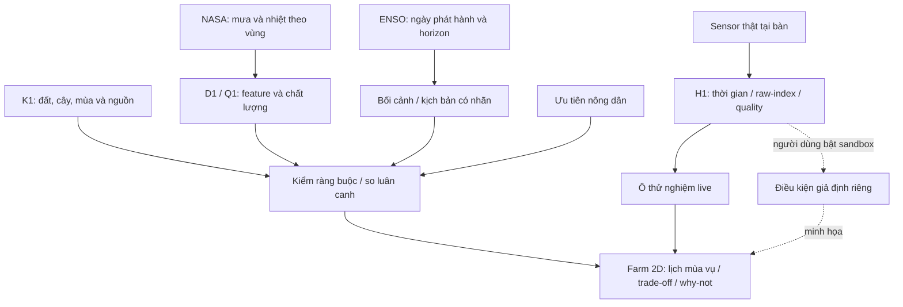

> **TRẠNG THÁI 12/11 - THAM KHẢO/SNAPSHOT:** phần thiết kế, địa bàn, phân công và phase bên dưới có nội dung trước correction. Không dùng làm quyết định hiện hành. Đọc [Bắt đầu ở đây](START-HERE.md), [roles hiện hành](my-thanh-team-roles-2026-11-12.md) và [bảng R0/R1/R2 Mỹ Thành](cases/my-thanh-cai-lay/rotation-evidence-for-bich.md). Hưng-Việt cùng core/UI khi cần; Hiếu backend remote gián đoạn; Bích Data/review nguồn-feature; An ESP demo; Luật QA/thống kê/đánh giá từng block. Không lấy Đức Lập/bắp hạt/đậu phộng hoặc lời “prototype ngay” ở snapshot thay case và quy định hiện tại.

# Khoanh vùng và farm mô phỏng kết nối sensor

> Evidence mới hơn trong cùng ngày: [case audit và NASA sample](cases/duc-lap/README.md). Đã có dữ liệu POWER thật với QA WARN, chưa có baseline; ưu tiên review bắp/mè, đậu phộng vẫn là candidate. Phần “chưa sample” ở review thiết kế bên dưới là trạng thái trước lượt audit này.

> Review 12/11/2026. Khuyến nghị nghiên cứu và thiết kế; chưa là quyết định team, khảo sát thực địa hoặc mô hình đã kiểm định. Chờ thông số chip HTTPSLAB.

## Case ưu tiên

Khoanh nghiên cứu vào **khu vực Đức Lập Hạ cũ, nay thuộc xã Đức Lập, tỉnh Tây Ninh**. Chưa có hộ/thửa/tọa độ được xác minh. Không tự lấy tâm xã thành trang trại thật. Nhóm cây nghiên cứu ban đầu: đậu phộng, bắp, lúa; chưa khẳng định cùng phù hợp một thửa.

| Nguồn đọc 12/11 | Xác nhận | Giới hạn |
| --- | --- | --- |
| Trung tâm Khuyến nông Quốc gia, cơ giới hóa đậu phộng Long An | Vụ Đông Xuân 2015–2016 có mô hình tại Đức Lập Hạ, Mỹ Hạnh Bắc, Mỹ Hạnh Nam, Tân Mỹ | Lịch sử; không xác nhận hiện trạng năm 2026 |
| Nghị quyết 1682, mục 31, Cổng Chính phủ | Đức Lập Hạ, Mỹ Hạnh Bắc và một phần Đức Hòa Thượng thành xã Đức Lập | Không suy Đức Lập Thượng cũ cũng thuộc xã này |
| Báo địa phương 22/04/2025, hộ tại Đức Lập Thượng cũ | Ghi nhận đậu phộng Đông Xuân – bắp Hè Thu – lúa vụ còn lại | Khác điểm nghiên cứu ưu tiên; có bối cảnh thu hồi đất; không lấy hộ đó làm pilot hay baseline mặc định |

Nguồn:

- https://khuyennongvn.gov.vn/chuong-trinh-nganh-nong-nghiep/tai-co-cau-nganh-nong-nghiep/long-an-co-gioi-hoa--giai-phap-can-thiet-trong-canh-tac-dau-phong-15728.html
- https://xaydungchinhsach.chinhphu.vn/toan-van-nghi-quyet-so-1682-nq-ubtvqh15-sap-xep-cac-dvhc-cap-xa-cua-tinh-tay-ninh-nam-2025-119250616210257367.htm
- https://baotayninh.vn/tien-phong-ban-giao-mat-bang-cho-du-an-khu-do-thi-130839.html

Chọn nơi này vì có evidence khuyến nông trực tiếp và phù hợp hướng tiếp cận địa phương của team, không vì đã chứng minh nơi tối ưu/hạn cao nhất. Chưa đủ nguồn gán loại đất, pH, khả năng giữ nước hay mức ảnh hưởng ENSO cho toàn khu.

Bích cần case sheet: địa điểm/tọa độ xác minh; đất và nguồn kiểm; nước tưới/thoát nước; cây/giống; lịch/hiện trạng; vấn đề nông dân; lao động/đầu ra; nguồn kỹ thuật và người review. Mỗi mục có ngày, phạm vi, trạng thái. Thành viên môi trường không mặc nhiên thay chuyên gia nông học. Hiện trạng phải có nguồn/hộ xác nhận; hai phương án thay thế phải qua kiểm đất–mùa–nước. Thiếu thì needs_review hoặc demo synthetic có nhãn.

Fallback là điểm gần TP.HCM có nguồn và người liên hệ tốt hơn, có thể Củ Chi. Nếu chưa tiếp cận hộ thì gọi là case nghiên cứu bằng dữ liệu công khai, không bịa phỏng vấn.

## Fact check mức bám đề

Field Shift hướng tới hỗ trợ khám phá luân canh bằng NASA, đất địa phương, cây và ưu tiên nông dân. Brief lưu ở [hồ sơ challenge](../challenges/07-field-shift.md); summary official search khớp, trang live vẫn có lỗi truy cập. Chưa xác nhận Resources/rules đầy đủ 2026. Nguồn: https://www.spaceappschallenge.org/2026/challenges/field-shift-adapting-farms-with-nasa-data/

Core đề xuất vẫn bám đề: so hiện trạng với hai phương án, dùng NASA/K1 thực sự trong phương pháp, cho đổi ưu tiên, hiển thị nguồn/trade-off/missing. Farm tương tác phù hợp nếu giúp hiểu chuỗi cây và lịch mùa vụ. Dễ lệch nếu chỉ còn game tưới cây, board dashboard, hoặc forecast không có kiểm định. Giữ ít nhất một tiêu chí đất/luân canh có nguồn; nếu không định lượng được thì ghi định tính/unknown, không bịa soil-health score.

ENSO giữ vai trò input bối cảnh có ngày/horizon. Khi chưa có quan hệ địa phương được kiểm định, không tự dùng nó nhân giảm mưa hay xác suất thiếu nước. Kịch bản nóng/khô phải ghi giả định; outlook hiện tại không dùng để đánh giá ngược lịch sử.

## Farm 2D với sensor thật

Khuyến nghị ba dải UI: bối cảnh vùng/nguồn; ba hàng luân canh trên lịch mùa vụ; ô thử nghiệm sensor live. Mỗi phương án có eligibility, score hoặc trạng thái review, why-not và evidence. Cửa sổ 12 tháng chỉ là UI; mùa vụ có thể băng năm. Không cần 3D, game economy, tự động tưới hay mô hình năng suất trong MVP.

Sensor tại bàn đo mẫu thật, gắn nhãn vị trí. Hai mẫu có độ ẩm khác nhau có thể giúp demo mà không chờ đất khô trong vài phút. Đổi mẫu làm đổi giá trị và đồ họa ô thử nghiệm; không đổi đất của vùng Đức Lập hoặc ranking vùng. Chưa hiệu chuẩn VWC thì hiện raw/index tương đối; chưa biết board kèm sensor nào thì chưa chốt phép đo hay wiring. Không suy ADC thành năng suất hoặc làm cây chết ngay trên UI như kết quả khoa học.

Tùy chọn sau core: người dùng bật sandbox, chủ động đưa số đo mẫu bàn thành điều kiện giả định. Không ghi đè dữ liệu vùng. Chưa hứa cân bằng nước/tăng trưởng nếu thiếu tham số đất, root depth, đơn vị độ ẩm, rainfall/ET/irrigation và kiểm baseline. Tên AgroTwin là tên sản phẩm; không tuyên bố digital twin đã hiệu chuẩn.

Kiến trúc logic đề xuất; Mermaid chưa render/validate trong lượt này. Sơ đồ không xác nhận hardware đã chạy.

## Tiềm năng và bằng chứng còn thiếu

Điểm mạnh tiềm năng: biến lựa chọn luân canh thành thao tác dễ thấy; đổi ưu tiên; mở căn cứ; nhận ra thiếu thông tin. Sensor tạo tương tác vật lý và minh họa measurement chain. Không có căn cứ gọi độc nhất hoặc dự đoán xác suất thắng; Orion và GreenOrbit đã công khai mô tả NASA/ranking/ưu tiên. Nguồn: https://github.com/Zul-Qarnain/field-shift và https://github.com/yunusarfat/Nasa-space_challenge-2026-GreenOrbit . Đây là self-description, chưa kiểm runtime.

Rủi ro chính: K1 địa phương, tiếp cận người dùng, nhầm quy mô, tích hợp thiết bị và scope quá rộng. Chưa có measured impact hay user test. Gate trước demo khuyến nghị thật: case sheet; sample NASA kiểm unit/coverage; ba phương án được review; một thay đổi kết quả giải thích được; người xem phân biệt live/historical/synthetic; ngắt sensor không làm mất core.

## Storyboard

Thông điệp: “Trước mùa vụ tới, nông dân cần biết mình có những lựa chọn luân canh nào, vì sao phù hợp và điều gì còn phải kiểm.”

1. Mở case Đức Lập, nói rõ trạng thái nghiên cứu, không bịa hộ/phỏng vấn. Hỏi: giữ lịch hiện tại hay thay đổi khi nguồn nước không chắc chắn?
2. Hiện lịch sử NASA và outlook ENSO riêng; chỉ rõ grain/ngày và giới hạn.
3. So hiện trạng với hai phương án trên lịch mùa vụ; mở nguồn đất/cây và trade-off.
4. Đổi ưu tiên/kịch bản; giải thích hạng và why-not, kể cả cần review.
5. Chuyển sang ô thử nghiệm live, đổi mẫu đo, xem giá trị và quality; nói đây là mẫu tại bàn.
6. Ngắt thiết bị để hiện stale/unavailable trong khi core còn dùng được; kết bằng pilot hẹp cần kiểm với nông dân.

Câu chuyện Việt Nam tạo bối cảnh, quyết định và bằng chứng tạo sức thuyết phục. An ninh lương thực là đóng góp dài hạn. Chip nội địa là nguồn lực tích hợp, chưa chứng minh bảo mật. Không mở pitch bằng chip hay hứa giải quyết an ninh lương thực toàn cầu.

## Artifact và bước tiếp theo

Đọc cùng [proposal](project-brief.md) và [intake](local-case-and-hardware-intake.md). Cập nhật sau review: proposal/PDF 0.4 ngày 12/11 đã tích hợp case/flow/storyboard và [kế hoạch local/global](local-to-global-strategy.md); paper An 0.3 cập nhật trạng thái HTTPSLAB nhưng wiring board mượn vẫn chờ model. Chưa tải/kiểm sample NASA, chạy model, thử sensor hoặc kiểm định rule địa phương.
