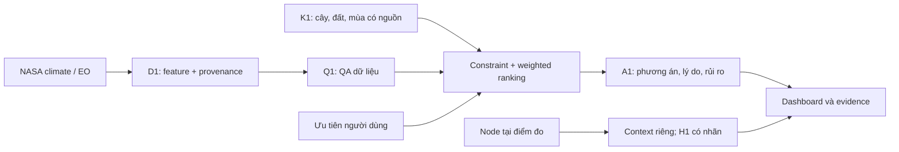
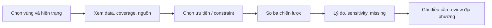
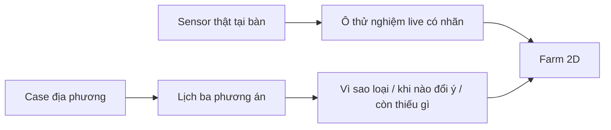
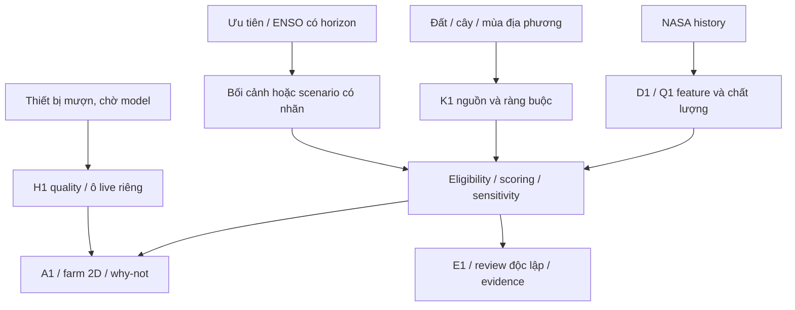
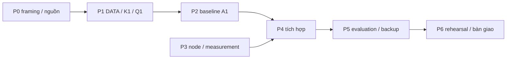
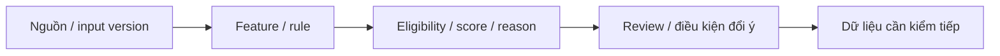

> **TRẠNG THÁI 12/11 - THAM KHẢO/SNAPSHOT:** phần thiết kế, địa bàn, phân công và phase bên dưới có nội dung trước correction. Không dùng làm quyết định hiện hành. Đọc [Bắt đầu ở đây](START-HERE.md), [roles hiện hành](my-thanh-team-roles-2026-11-12.md) và [bảng R0/R1/R2 Mỹ Thành](cases/my-thanh-cai-lay/rotation-evidence-for-bich.md). Hưng-Việt cùng core/UI khi cần; Hiếu backend remote gián đoạn; Bích Data/review nguồn-feature; An ESP demo; Luật QA/thống kê/đánh giá từng block. Không lấy Đức Lập/bắp hạt/đậu phộng hoặc lời “prototype ngay” ở snapshot thay case và quy định hiện tại.

# AgroTwin — Proposal sơ bộ dự án

> NeuraX · NASA Space Apps 2026 / Field Shift · Bản 0.4 · 12/11/2026 · Nội bộ
> Trạng thái: đề xuất trước triển khai. Challenge đã được chọn ngày 04/11; người dùng là nông dân; ưu tiên nghiên cứu Đức Lập Hạ cũ (nay thuộc xã Đức Lập, Tây Ninh). Thửa đất/hiện trạng, K1, sample NASA, thông số chip HTTPSLAB và giờ BTC vẫn chưa xác nhận. Đây không phải báo cáo sản phẩm đã chạy hoặc dự án đã được duyệt toàn bộ.

## Tóm tắt đề xuất

AgroTwin là công cụ hỗ trợ khám phá luân canh được NeuraX đề xuất cho Field Shift. Công cụ kết hợp dữ liệu môi trường NASA, thông tin cây–đất–mùa có nguồn và ưu tiên người sử dụng để so sánh hiện trạng với các phương án khác. Kết quả cần cho biết phương án có đủ điều kiện để so sánh hay không, vì sao được xếp hạng, dữ liệu nào hỗ trợ và điều gì cần người có chuyên môn địa phương xem lại.

MVP đề xuất tập trung vào một vùng và một nhóm cây, so ba chiến lược có căn cứ gồm luân canh hiện tại. Phương pháp đầu tiên là lọc ràng buộc rồi xếp hạng đa tiêu chí có giải thích. Forecast chỉ bổ sung khi có target, lịch sử và kiểm ngoài mẫu; phần cứng là node đo context tại điểm và kiểm tích hợp. Cả hai nhánh có thể giảm chức năng mà không che tình trạng luồng NASA chính.

AgroTwin là tên concept đang dùng trong repo, chưa có nghĩa hệ thống đã là digital twin đồng bộ realtime, mô phỏng sinh lý cây hoặc phản ánh chính xác mọi thửa ruộng. Trong proposal, sản phẩm được mô tả theo chức năng dự kiến: hỗ trợ so phương án trên dữ liệu có giới hạn và giả định công khai.

Giá trị kỳ vọng là giúp người dùng hiểu trade-off và khoảng trống thông tin trước khi trao đổi với người tư vấn. Team chưa có phỏng vấn nông dân, pilot ngoài đồng hoặc số đo tác động mùa vụ được ghi nhận. Không đưa claim tăng năng suất, giảm nước theo phần trăm hoặc dự báo thu nhập vào mục tiêu đã chứng minh. Thành công trong hackathon được đánh giá bằng một luồng quyết định có căn cứ, nguồn truy được, phương pháp có kiểm và demo trung thực.

### Cách sử dụng proposal

Tài liệu đi từ bài toán → giải pháp → dữ liệu/phương pháp → kiến trúc → đánh giá → thực hiện → rủi ro. Markdown là bản nguồn chính; PDF xuất từ cùng nội dung để review/chia sẻ. Schema chi tiết thuộc architecture/workflow; hardware chuyên sâu thuộc paper cho An. Khi có quyết định hoặc artifact thật, cập nhật tài liệu sở hữu và version; không biến giả định thành kết quả.

### Cập nhật phương án 12/11

Đề xuất AgroTwin là farm 2D để khám phá luân canh: vì sao loại, khi nào đổi ý, còn thiếu gì. Đây là hướng nâng chất lượng bài thi local và chuẩn bị gói review global, không phải cam kết giải thưởng. Người dùng đã xác nhận là nông dân. Case ưu tiên nghiên cứu Đức Lập Hạ cũ; nhóm cây tìm nguồn là đậu phộng–bắp–lúa, chưa là chuỗi đã hợp lệ. Chip HTTPSLAB đã được đồng ý cho mượn theo người dùng, đang chờ model/datasheet. Sensor live ở ô thử nghiệm riêng. Phần 19 đưa kế hoạch, đánh giá và cách cắt scope.

## 1. Bối cảnh, vấn đề và cơ hội

### 1.1 Cuộc thi và đề đã chọn

NASA mô tả Space Apps 2026 là sự kiện toàn cầu hai ngày 14–15/11, nơi các đội dùng dữ liệu mở giải bài toán do chuyên gia NASA đặt ra [S1]. Theo decision log, NeuraX đã chọn Field Shift ngày 04/11. Brief do người dùng cung cấp đã được lưu nguyên văn; file gửi lại 06/11 trùng sau chuẩn hóa khoảng trắng. Trang challenge live trả lỗi 502 trong lượt đối chiếu 07/11, nên chưa xác nhận Resources mới trên website.

Theo brief đã lưu, Field Shift hướng tới công cụ hỗ trợ khám phá luân canh bằng NASA Earth observations, thông tin đất, đặc tính cây và ưu tiên nông dân. Gợi ý so ba chiến lược được NeuraX chọn làm tiêu chí MVP; không coi mọi gợi ý tùy chọn trong đề là yêu cầu bắt buộc NASA.

### 1.2 Vấn đề cần giải

Quyết định luân canh có thể liên quan nước/nhiệt, cửa sổ mùa vụ, đặc tính đất, lịch sử cây và constraint thực tế. Phương án tốt về nước có thể không phù hợp mùa hoặc điều kiện canh tác. Biểu đồ khí hậu riêng lẻ chưa cho biết các phương án đánh đổi ra sao; một lời khuyên tên cây không có nguồn cũng không cho biết khi nào nên tin hoặc xem lại.

Proposal giả định có nhu cầu trình bày thống nhất các yếu tố này. Giả định cần kiểm bằng người dùng hoặc mentor domain; chưa có bằng chứng một nhóm nông dân cụ thể đang dùng công cụ nào, sẵn sàng đổi quy trình hay trả tiền cho sản phẩm.

### 1.3 Cơ hội thiết kế

FAO mô tả đa dạng hóa cây và luân canh trong bối cảnh quản lý đất, nước và sinh vật đất [S4]. Đây là nền tảng xác định câu hỏi/tìm nguồn K1, không phải bảng chọn cây tự động cho mọi vùng. AgroTwin đề xuất làm rõ điều kiện môi trường và ưu tiên dẫn tới một so sánh giải thích được, đồng thời chỉ ra trường hợp thiếu dữ liệu hoặc cần review.

## 2. Người dùng, stakeholder và giả định cần kiểm

### 2.1 Nhóm sử dụng ưu tiên

Đề xuất người dùng đầu tiên là người tư vấn nông nghiệp hoặc người trồng đang cân nhắc nhóm cây quen thuộc trong một vùng xác định. Đây là giả thuyết phạm vi, chưa phải persona đã phỏng vấn. Bắt đầu với người có thể đối chiếu domain giúp review kết quả dễ hơn nhắm ngay ứng dụng tự phục vụ cho mọi nông dân.

| Nhóm | Quyết định/công việc dự kiến | Điều cần kiểm |
| --- | --- | --- |
| Người trồng | So hiện trạng với lựa chọn thay thế theo ưu tiên | Đang chọn cây/mùa nào, constraint nào không thể đổi? |
| Người tư vấn/domain reviewer | Kiểm nguồn và lý do phương án | Bằng chứng gì để chấp nhận/bác bỏ gợi ý? |
| Team dữ liệu/mô hình | Chuẩn hóa, kiểm và giải thích kết quả | Feature nào thực sự cần cho quyết định? |
| Giám khảo/người xem | Hiểu giá trị NASA, phương pháp và giới hạn | Theo được một case từ nguồn tới quyết định không? |

### 2.2 Khám phá người dùng

Hưng/Bích chuẩn bị câu hỏi về hiện trạng, thời gian lập kế hoạch, nước, thiết bị, thị trường, nguồn thông tin đang dùng và rủi ro người dùng không chấp nhận. Hỏi họ sẽ làm gì khác sau khi thấy kết quả thay vì chỉ hỏi có thích dashboard. Không ghi cuộc nói chuyện chưa diễn ra thành validation.

Nếu tiếp cận được người dùng/mentor, lưu ngày, vai trò, bối cảnh và ý kiến được phép ghi; tách quan sát khỏi diễn giải của team. Không cần thu tọa độ ruộng/thông tin cá nhân nếu chưa phục vụ câu hỏi. Feedback ít người chỉ dùng sửa thiết kế, không đại diện thị trường hoặc tác động diện rộng.

### 2.3 Chọn vùng và cây

Ưu tiên vùng có dữ liệu môi trường phù hợp, tài liệu cây–đất–mùa truy nguồn được và người có thể rà ý nghĩa. Không chọn chỉ vì basemap đẹp hoặc crop label phổ biến. Hưng tổng hợp quyết định sau input Bích/Việt/Quang Luật; proposal không tự điền địa danh/cây khi thiếu căn cứ.

### 2.4 Khoanh vùng có bằng chứng và giới hạn

Ưu tiên khu vực Đức Lập Hạ cũ, nay thuộc xã Đức Lập, tỉnh Tây Ninh theo mục 31 Nghị quyết 1682 [S10]. Khuyến nông Quốc gia ghi nhận mô hình đậu phộng tại địa bàn này vụ Đông Xuân 2015–2016 [S9]. Đó là bằng chứng lịch sử cho một đầu mối nghiên cứu, chưa xác nhận nông hộ/thửa đất đang hoạt động năm 2026. Chưa có tọa độ thửa; không gán tâm xã thành trang trại thật hoặc suy đất toàn vùng từ tên địa phương.

Bích cần xác minh đất, nguồn nước, lịch cây/giống, hiện trạng, ràng buộc lao động/đầu ra và nguồn kỹ thuật. Nhóm lúa–bắp–đậu phộng là candidate. Hiện trạng và hai chuỗi thay thế chỉ khóa sau review. Nếu thiếu nguồn hoặc người liên hệ, chọn điểm gần TP.HCM có bằng chứng tốt hơn; Củ Chi là fallback tiếp cận, chưa là case đã audit. Nông dân là user đã xác nhận, nhưng nhu cầu và tính hữu ích cụ thể vẫn cần hỏi/test.

## 3. Mục tiêu, giả thuyết và thành công

### 3.1 Mục tiêu sản phẩm

AgroTwin cần trả lời: trong tập chiến lược có căn cứ đang xét, phương án nào phù hợp hơn với ràng buộc/ưu tiên đã nhập; kết luận dựa vào dữ liệu nào; và điều gì chưa chắc. Không xác nhận lựa chọn tốt nhất tuyệt đối cho mọi nông trại hoặc dự báo outcome chưa có nhãn.

| Giả thuyết thiết kế | Dấu hiệu có thể kiểm | Trạng thái |
| --- | --- | --- |
| GTH1: NASA feature thay đổi so sánh có ý nghĩa | Trace feature → rule/utility → reason; case có/không feature | Chưa thử |
| GTH2: Giải thích giúp hiểu trade-off | Người review mô tả lại lý do và một giới hạn | Chưa có người thử |
| GTH3: Baseline đủ cho MVP | A1 và sensitivity tính lại độc lập được | Chưa triển khai |
| GTH4: Contract giảm việc chờ tích hợp | UI/device đọc cùng schema/version, không chờ notebook | Mới là thiết kế |
| GTH5: Node bổ sung context hữu ích | Người xem phân biệt đo tại điểm và NASA theo vùng | Chưa thử demo |

### 3.2 Tiêu chí thành công nội bộ

MVP đạt khi nguồn case truy lại được; eligible set không vi phạm known hard constraints; cùng input/version cho cùng kết quả; đổi ưu tiên có giải thích; missing/stale/unavailable hiện đúng; và người khác chạy lại package theo hướng dẫn. Đây là tiêu chí NeuraX, không phải trọng số NASA.

Impact dài hạn như giảm nước, tăng ổn định sản xuất hoặc giảm thời gian quyết định cần protocol ngoài hackathon. Không dùng phần trăm tự đặt làm kết quả kỳ vọng đã có căn cứ. Sau khi có người dùng/data, team mới chọn metric tác động và baseline thực.

## 4. Giải pháp và phạm vi MVP

**Hình 1.** Luồng giải pháp đề xuất. Tên package là contract dự kiến; sơ đồ không chứng minh các package đã tồn tại.

### 4.1 Core, bổ sung và ngoài phạm vi

| Mức | Chức năng | Điều kiện giữ/cắt |
| --- | --- | --- |
| Core | Một vùng, tập chiến lược có nguồn gồm hiện trạng | Thiếu ba phương án thì partial, không tạo cho đủ số |
| Core | NASA features, K1, QA và provenance | Data fail chặn đúng criterion/tính năng |
| Core | Constraint filtering, ranking, giải thích | Unknown không tự thành eligible |
| Core | Dashboard, trạng thái lỗi, snapshot, nguồn | Một đường demo hoàn chỉnh trước hiệu ứng phụ |
| Bổ sung | Scenario/sensitivity tương tác | Có response rule và nhãn giả định |
| Bổ sung có gate | Forecast một target khí hậu | Có lịch sử, split và baseline |
| Subsystem team | Node ẩm đất và summary display | Measurement/test plan; không chặn core NASA |
| Ngoài MVP | Tưới tự động, custom PCB, đa vùng/cây toàn quốc | Cần câu hỏi và nguồn lực riêng |
| Ngoài claim hiện tại | Yield/thu nhập/soil health đã xác thực | Chưa có nhãn và protocol outcome |

### 4.2 Lý do giữ phạm vi

Một vùng và ít nguồn cho phép kiểm unit, grain, metadata và domain trên một lát cắt. Thêm vùng/cây tăng cả phạm vi rule, mùa vụ và validation. Ba chiến lược phải có cơ sở địa phương, không chỉ đổi nhãn trên ba thẻ.

Tối thiểu ở số trường hợp triển khai đầu tiên; chiều sâu vẫn gồm provenance, kiểm độc lập, uncertainty, case thất bại và phục hồi. Dashboard ít feature nhưng kiểm được toàn chuỗi phục vụ mục tiêu tốt hơn nhiều lớp chưa biết đúng/sai.

## 5. Hành trình sử dụng và trải nghiệm

**Hình 2.** Hành trình từ context tới review. Thiếu dữ liệu phải có đường partial/unavailable, không ép tiếp tục với số giả.

### 5.1 Màn hình cần có

Màn context nêu vùng, period, nguồn và scale. Màn ưu tiên chỉ bật tiêu chí đã có utility/rule; tiêu chí thiếu data bị khóa hoặc có nhãn chưa hỗ trợ. Màn so sánh đặt hiện trạng cạnh lựa chọn khác, hiển thị eligibility, contributions và nguồn. Màn evidence giải thích vì sao một chiến lược bị loại hoặc cần review.

<!-- FIGURE:wireframe -->

**Hình 3.** Wireframe nội bộ minh họa bố cục; chưa phải screenshot sản phẩm. Không có số đo hoặc cây thật trong hình.

### 5.2 Quy tắc UI

Không dùng màu làm cách duy nhất truyền đạt kết quả. Score có nhãn “chỉ số phù hợp theo tiêu chí đang xét”, không như xác suất cây thành công. Giải thích ngắn ở lớp đầu, nguồn/phương pháp mở sâu. Người dùng thấy data_as_of, thiếu tiêu chí gì và ranking thuộc scenario nào.

Node có thẻ riêng ghi nơi đo thực, thời gian, quality và live/replay; không cập nhật timestamp NASA. Sensor rút ra không làm mất chiến lược nếu A1 còn hợp lệ; sensor live không mở khóa chiến lược thiếu K1.

### 5.3 Farm 2D, sensor thật và ba tương tác

Giao diện đề xuất gồm bối cảnh vùng/nguồn, ba hàng kế hoạch theo mùa và ô sensor live. Nông dân nhìn thứ tự cây, điều kiện hợp lệ, đánh đổi và dữ liệu thiếu. Không dựng chỉ số tăng trưởng/năng suất nếu chưa có mô hình kiểm định. Một cửa sổ 12 tháng là cách hiển thị, không ép mọi mùa vụ kết thúc đúng năm dương lịch.

**Hình bổ sung — Farm tương tác.** Đây là wireframe chức năng đề xuất; không phải screenshot sản phẩm đã chạy. Sensor tại bàn không đại diện ruộng trong case. What-if dùng số đo chỉ khi bật sandbox riêng và không ghi đè dữ liệu vùng.

### 5.4 Kiểm trải nghiệm

Khi có prototype/người thử, giao nhiệm vụ: chọn ưu tiên, giải thích hai phương án khác nhau ở đâu, tìm nguồn và nêu điều cần hỏi chuyên gia. Ghi bước hiểu sai để sửa UI. Chưa có người thử thì chỉ báo kiểm nội bộ; không gọi farmer-friendly validated từ việc team tự thấy dễ dùng.

## 6. Kế hoạch dữ liệu NASA và quản trị nguồn

### 6.1 Candidate và mức xác nhận

| Nguồn | Vai trò dự kiến | Mức xác nhận và gate |
| --- | --- | --- |
| POWER Daily | Khí tượng để aggregate theo period | Đọc docs 07/11 [S2]; chưa sample vùng/cây |
| POWER Monthly | Candidate nếu monthly grain đủ | Đọc docs [S3]; kiểm meaning/unit từng parameter |
| GPM/SMAP hoặc EO bổ sung | Context nước nếu thay đổi quyết định | Chưa chốt product; cần QA/scale khả thi |
| Nông học địa phương | K1 cây, đất, mùa, constraint | Chưa có bảng đã rà cho vùng chọn |
| Ưu tiên | Weight/constraint đầu vào | Lựa chọn người dùng, không phải observation NASA |
| Node bàn | Context tại điểm, test tích hợp | Chưa đo; không là ground truth vùng xa |

POWER có chuỗi khí tượng và format ứng dụng đọc được; Daily có chuẩn thời gian cần ghi tường minh [S2]. Monthly phản hồi theo năm/tháng nhưng không vì vậy mọi parameter đều là tổng tháng [S3]. Cần đọc metadata từng biến thay vì dựa vào tên cột.

### 6.2 Input ENSO và dữ liệu thử trước

Theo yêu cầu team, ENSO/El Niño được đưa vào bối cảnh hỗ trợ chuẩn bị mùa vụ. Bản tin phải có provider, ngày phát hành, horizon và xác suất nếu có. Trong lượt đọc 12/11, trang NOAA CPC hiển thị bản 08/10/2026 và dự kiến cập nhật 12/11 [S11]; chưa coi đó là bản tháng 11. Không suy xác suất El Niño thành xác suất thiếu nước tại một ruộng.

Muốn ENSO đổi ranking cần quan hệ địa phương được kiểm định hoặc outlook khu vực có nguồn. Khi chưa có, hiển thị bối cảnh và chạy kịch bản nóng/khô có nhãn giả định. Historical data NASA không phải seasonal forecast. Không dùng outlook hiện tại để đánh giá ngược các năm lịch sử.

POWER là dữ liệu mở có thể thử trước; không cần chờ BTC giao riêng một dataset [S2]. Sau khi chốt AOI nghiên cứu mới kiểm sample/unit/grain/coverage/QA. Thay dataset không chỉ đổi URL: kiểm metadata và tính lại feature/score. Sensor thử bằng payload thiết bị riêng; NASA data không thay log thật.

### 6.3 Grain và dictionary

Theo workflow, features.csv có một dòng region_id × tháng: key, period_start/end, precip_sum_mm, air_temp_mean_c, coverage, source_ids. Period cuối exclusive theo contract. Metadata phân biệt height/surface: air temperature và land-surface temperature không ghép dưới một tên vì cùng độ C.

Nếu precipitation trả rate/trung bình ngày, chuyển sang tổng tháng theo đúng unit và số ngày hợp lệ. Không cộng monthly khác meaning, không coi tháng thiếu là tổng đầy đủ. Aggregate, timezone, missing code và denominator coverage cần ghi trước khi xuất D1.

### 6.4 Source register

Mỗi nguồn ghi provider, URL, product/version, ngày truy cập, AOI/period, unit, spatial/temporal support, QA, license/citation, biến và transform. Tách đọc docs / tải sample / kiểm sample. Hiện POWER mới đọc docs; không gọi data case là ready.

## 7. K1 và quy tắc nông học

### 7.1 K1 cần gì?

K1 gồm crops, rotations, constraints. Crop record có definition, unit/scale, vùng áp dụng, source. Rotation record có thứ tự season_index, thời gian và hiện trạng/phương án. Constraint có rule, scope, evidence, lý do, status và reviewer. Danh sách tên cây chưa đủ tạo phương án có nghĩa.

FAO là bối cảnh tổng quát [S4], không xác nhận cây A đi sau cây B tại một tỉnh cụ thể. Bích cần nguồn áp dụng đúng vùng/cây và ghi chỗ chưa tương thích. Ba chiến lược trên UI khác với số loài trong một hệ canh tác; không chuyển tiêu chí giữa các nguồn chỉ vì cùng con số.

### 7.2 Hard constraints và soft preferences

Hard constraint là điều kiện loại trừ có căn cứ/phạm vi, ví dụ cửa sổ mùa không phù hợp theo nguồn chọn. Soft preference là ưu tiên giữa các phương án hợp lệ, như nước hoặc đặc tính đất có proxy đã định nghĩa. Weight không được mua lại vi phạm hard constraint.

Market, pest, dinh dưỡng/lợi nhuận chỉ có khi đủ source/definition cho case. Không gán market suitability từ suy đoán hoặc nói tốt cho đất chỉ từ mưa. Thiếu rule quan trọng thì needs_review cho biết cần ai/bằng chứng gì để tiếp tục.

### 7.3 Missing policy

Không đổi missing thành 0, không bỏ criterion khác nhau cho từng phương án rồi so như công bằng. Dimension bắt buộc thiếu thì chưa rank đầy đủ. Nếu chấp nhận phạm vi tiêu chí giảm, dùng cùng phạm vi cho tập so, ghi version/warnings và chạy lại evaluation.

## 8. Baseline và ví dụ tính minh họa

### 8.1 Trình tự

D1 qua Q1 và K1 có nguồn → kiểm đủ input → lọc constraints → utility theo definition → chuẩn hóa weights hợp lệ → score → rank kèm contributions/source/limits. Ineligible không đặt cạnh eligible dưới cùng nhãn khuyến nghị; needs_review giải thích vì sao chưa so được.

Score(s) = Σ weight(j) × utility(s,j), tổng weights bằng 1. Utility có thể ordinal/rule-based; không gọi là mô hình sinh lý cây. Tie hiển thị đồng hạng hoặc theo policy đã ghi, không dùng thứ tự file làm ưu tiên ngầm.

### 8.2 Ví dụ synthetic — chỉ kiểm công thức

Giả sử SYN-A/B/C đều đủ điều kiện và có utility minh họa dưới đây. Không phải dữ liệu cây thật, observation NASA hoặc kết quả nghiên cứu; không dùng các số này tư vấn canh tác.

| Chiến lược synthetic | Water | Soil | Climate |
| --- | --- | --- | --- |
| SYN-A — hiện trạng minh họa | 0.40 | 0.70 | 0.60 |
| SYN-B | 0.80 | 0.60 | 0.70 |
| SYN-C | 0.65 | 0.85 | 0.50 |

Weights 0.60/0.25/0.15 cho A=0.5050, B=0.7350, C=0.6775; rank B → C → A. Weights 0.20/0.60/0.20 cho A=0.6200, B=0.6600, C=0.7400; rank C → B → A. Thứ hạng đổi vì ưu tiên đổi, không do sensor chuyển chậu hoặc forecast mới.

<!-- FIGURE:score -->

**Hình 4.** Score synthetic tính từ bảng và weights trên. Chỉ phục vụ arithmetic/explanation, không là benchmark hoặc khuyến nghị thật.

### 8.3 Kiểm độc lập

Quang Luật tính lại một mẫu score/contributions bằng R hoặc MATLAB, đối chiếu tolerance đã thống nhất. Bích/Hưng rà meaning utility; Việt rà implementation/contract. Đúng số học vẫn có thể sai domain, nên hai lớp review phải tách biệt.

## 9. Scenario, sensitivity, forecast và nhánh nâng cao

### 9.1 Scenario và sensitivity

Đổi weights là sensitivity theo ưu tiên. Đổi mưa/nhiệt giả định là scenario về điều kiện; muốn tính lại utility sau scenario cần response rule có căn cứ riêng. Khi chưa có response rule, giao diện có thể giải thích giả định nhưng không xuất điểm mới như đã mô hình được tác động.

Sensitivity cần cho thấy phương án nào đổi rank và criterion nào chi phối. Rank reversal khi đổi ưu tiên có thể là hành vi mong muốn. Cần điều tra input giống nhau nhưng rank khác, hoặc thay đổi rất nhỏ do rounding làm kết luận thiếu ổn định trong khi UI lại nói chắc chắn. Policy cần nêu cách xử lý weights bằng 0, weights âm, tổng khác 1, tie và criterion bị thiếu.

### 9.2 Forecast có gate riêng

Nhánh của Việt dự kiến dự báo tổng mưa tháng tiếp theo cho vùng, so seasonal-naive cùng tháng năm trước. Giả định khoảng năm năm monthly trong workflow chỉ là ngưỡng thẩm định ban đầu, không bảo đảm đủ dữ liệu hoặc accuracy. Tách train/validation/test theo thời gian; fit imputer/scaler và chọn candidate chỉ bằng phần dữ liệu được phép.

Quang Luật kiểm MAE theo unit, horizon, fold và coverage, đồng thời kiểm leakage. Chỉ giữ candidate khi protocol có ý nghĩa; thiếu data hoặc không thêm giá trị so baseline thì forecast=null. Forecast mưa cũng chưa tự đổi ranking cây nếu chưa có response rule. Không đổi nhãn analysis sang forecast để đủ chữ AI.

### 9.3 ML, tối ưu và giải thích tự động

ML, optimizer tổ hợp hoặc ảnh EO thêm chỉ được đưa vào khi có vấn đề cụ thể baseline chưa giải tốt. Khi số phương án nhỏ, enumeration/ranking dễ kiểm hơn xây optimizer không cần thiết. Nếu dùng LLM viết explanation, nội dung phải bám score/facts đã tính và có nguồn, không tự phát minh constraint hay dữ liệu nông học.

Mỗi candidate có mục đích, input cần thêm, baseline so và tiêu chí dừng. Không huấn luyện model lớn, mua API hoặc provision hạ tầng vì một ý tưởng chưa qua data gate. Tại T+12 chưa có demo A1 thật thì dừng candidate để bảo vệ integration và evaluation.

## 10. Kiến trúc hệ thống và lựa chọn triển khai

**Hình 5.** Kiến trúc logic đề xuất với ba luồng nguồn và sensor riêng. Các mũi tên không chứng minh module đã triển khai. ENSO chỉ đổi ranking sau khi vượt gate quan hệ địa phương; sensor bàn không thay input vùng.

### 10.1 Vì sao batch/snapshot trước?

Batch nhỏ tạo D1/A1 có version để đối chiếu Q1/E1 và dùng offline. Hiếu không cần môi trường notebook của Việt hoặc phiên MATLAB của Quang Luật. Nhược điểm là kết quả không tự cập nhật realtime; UI phải có data_as_of và cách reload snapshot rõ.

API/backend có thể thêm khi có yêu cầu cần thiết, giữ envelope chung. Chưa có căn cứ cho microservices, streaming toàn hệ thống, cloud GPU hay database phức tạp. Ngôn ngữ/framework/deployment cuối thuộc repo sản phẩm sau khi đọc dependency/lock; không giả đã có React/FastAPI hoặc host được provision.

### 10.2 Gói bàn giao

| Package | Nội dung | Acceptance chính |
| --- | --- | --- |
| D1 | Features, manifest, dictionary, provenance, split nếu có | Đúng grain/unit/key, source, data_mode, version |
| Q1 | QA theo feature/entity/period | Lỗi có record/policy; pass/warn/fail đúng phạm vi |
| K1 | Cây, rotation, constraint và evidence | Rule có scope/source; unknown không thành pass |
| A1 | Kết quả render và warnings | UI không tính lại ranking/metric |
| E1 | Protocol, split, kiểm và limitations | Cùng dataset/model version A1 |
| H1 | Log thiết bị/context | Identity/time/unit/quality và live/replay rõ |

### 10.3 Version và các trạng thái

Sửa data tạo dataset_version mới; sửa method tạo model_version mới; đổi meaning/grain/unit cần thống nhất contract. Không ghép A1 và E1 từ hai version như một run. data_mode phân biệt synthetic/observed/mixed; delivery_mode phân biệt live/replay. result_kind phân biệt analysis/forecast/scenario. Thiếu evaluation_ref thật thì để null, không dựng link tới báo cáo chưa tồn tại.

Việt giữ quyết định kỹ thuật, Hưng giữ scope/ưu tiên; Hiếu và An tự chủ trong contract. Chi tiết authoritative ở architecture.md và workflow Field Shift. H1 0.2 trong paper hardware là proposal riêng, chưa âm thầm thay contract v0.1.

### 10.4 Tách docs và implementation

neurax-docs giữ WHY, proposal và quyết định. nasasac26-neurax giữ code, notebook, dependency, pipeline và as-built khi thực sự triển khai. Không dựng thư mục frontend/backend rỗng chỉ để giống proposal. Khi implementation khác thiết kế, cập nhật lý do và tài liệu sở hữu thay vì sửa một PDF độc lập rồi để Markdown cũ.

## 11. Yêu cầu chức năng và phi chức năng

| Mã | Chức năng đề xuất | Nghiệm thu |
| --- | --- | --- |
| F01 | Chọn vùng/hiện trạng trong phạm vi hỗ trợ | Đúng ID/period/source |
| F02 | Xem features và chất lượng | Nodata, coverage, unit, scale không bị giấu |
| F03 | Nhập ưu tiên hợp lệ | Weights có policy; input lỗi không âm thầm dùng mặc định |
| F04 | Kiểm constraint và so phương án | Ineligible/needs_review được giải thích |
| F05 | Xem contributions và nguồn | Tổng khớp score, evidence resolve |
| F06 | Sensitivity/scenario nếu hỗ trợ | Tham số/run riêng; không gọi là forecast |
| F07 | Evaluation cùng version | Có method/limits; thiếu E1 hiện rõ |
| F08 | Context node nếu có | Quality/age/live/replay độc lập NASA |
| F09 | Snapshot khi mất Internet | Không tạo số giả live |
| F10 | Partial/unavailable có ý nghĩa | Subsystem fail không biến missing thành 0 |

### 11.1 Tái lập và truy vết

Run có input/model version, tham số, source mapping và cách chạy. Cùng snapshot phải tái tạo kết quả trong tolerance tính toán công bố. CSV UTF-8, missing theo quy ước; JSON không có NaN/sentinel gây hiểu sai. Artifact nộp có source/license/citation theo thành phần. Dữ liệu thô giữ nguyên; transform và file kết quả được phân biệt.

### 11.2 Hiệu năng và khả dụng

Target runtime cần pilot trên laptop thực; chưa có benchmark nên không cam kết latency. Ưu tiên lát cắt nhỏ, cache snapshot, preload màn demo và báo đang xử lý/lỗi/cũ thay vì spinner vô hạn. Nếu chậm, giảm volume/feature không thiết yếu trước khi thêm hạ tầng chưa thử.

### 11.3 Ngôn ngữ và dữ liệu nhạy cảm

Điều phối nội bộ tiếng Việt, giữ dataset/field tiếng Anh. Bản đối ngoại chuẩn bị tiếng Anh và đối chiếu luật 2026. Repo nội bộ không có nghĩa artifact nộp có thể khóa quyền; Hưng kiểm link/visibility theo quy định. Không tự thu định danh hoặc tọa độ nhạy cảm ngoài mục đích case. Chọn ví dụ vùng công khai khi đủ cho câu hỏi.

## 12. Kế hoạch đánh giá và chứng minh giá trị

### 12.1 Bốn lớp đánh giá

DATA kiểm unit, missing, duplicates, coverage, support và aggregate. Phương pháp kiểm constraints, arithmetic, sensitivity, interpretation. Sản phẩm kiểm hành trình, lỗi, snapshot và version. Người dùng kiểm hiểu trade-off/giới hạn và tìm được bằng chứng. Không thay lớp cuối bằng số lượt bấm hoặc số câu chatbot trả lời.

| Bài kiểm | Metric/evidence dự kiến | Diễn giải |
| --- | --- | --- |
| Traceability | Source IDs và transform resolve trong demo case | Nguồn rõ không tự chứng minh domain đúng |
| Constraints | Vi phạm known hard constraints trong eligible set | Có vi phạm là lỗi core |
| Arithmetic | Score/contributions tính lại độc lập | Kiểm triển khai, không accuracy nông học |
| Sensitivity | Rank/contributions qua weights có nghĩa | Đổi ưu tiên hợp lý khác lỗi tính |
| Forecast nếu có | MAE, baseline, split/time/horizon/coverage | Chỉ kết luận trên target/holdout đã kiểm |
| UI/integration | Case pass/warn/fail, version và log | Video đẹp không thay toàn bộ test |
| Người dùng nếu có | Task completion, hiểu reason/limitation, ghi chú | Feedback định tính, không khái quát mẫu nhỏ |
| Hardware | Raw, độ lặp, missing/stale/reconnect | Repeatability khác absolute accuracy |

### 12.2 Core test cases

Có case hợp lệ, thiếu feature bắt buộc, vi phạm constraint, tie, weights sai, tất cả phương án needs_review và A1/E1 khác version. Ghi expected behavior trước khi chạy. Synthetic kiểm invariant/edge case; demo khoa học cần NASA-derived data và K1 thật có nguồn. Không báo metric trên fixture như kết quả ngoài mẫu.

Với forecast, cố định split trước khi so candidate, không lặp chọn model bằng test. Với rule/ranking không có outcome label, kiểm feasibility, arithmetic, sensitivity và domain review thay vì tạo nhãn đúng từ chính rule rồi báo accuracy cao. Một review domain vẫn là ý kiến trong phạm vi nguồn/người rà, không thay field validation.

### 12.3 Review độc lập và report

Quang Luật kiểm một mẫu aggregate và score/metric; Bích rà interpretation/constraint evidence; Hưng–Việt review chéo AI module. Giữ cả kết quả chưa đạt và lỗi thực tế. Báo cáo ghi n/coverage, method, version, giới hạn và artifact; không chép metric run cũ lên UI đang đọc run mới.

## 13. Hardware trong hệ thống và giá trị tích hợp

Node của An có method đo và contract riêng. Cấu hình tham chiếu dự phòng là một probe ẩm đất điện dung, ESP32 nếu inventory xác nhận, USB data và laptop; SHT31/OLED theo inventory/test. Nhánh ưu tiên mới là HTTPSLAB chờ thông số ở mục 13.1. Một probe đo hai chậu tuần tự được nếu protocol cố định; không cần mua hai chiếc chỉ để demo trông nhiều thiết bị.

Giá trị là acquisition, quality, timestamp, stale và chiều summary từ laptop về thiết bị. Nó bổ sung chiều sâu hệ thống nhưng không thay NASA, K1 hoặc model evaluation. Sensor tại bàn không tự vào ranking vùng; đổi ưu tiên trên app tách khỏi chuyển chậu. Đây là ranh giới quan trọng cần người xem hiểu.

Muốn dùng H1 làm model input sau này cần observation đúng vùng/thời gian, calibration, tính đại diện và response rule. Khi đó mới đánh giá input địa phương cải thiện quyết định nào. Trước khi đạt, giữ context riêng và hiển thị giới hạn rõ.

Paper [hardware-design-paper.md](hardware-design-paper.md) / [PDF cho An](../../output/pdf/NeuraX-AgroTwin-Technical-Paper-An.pdf) giải thích alternatives, nguồn/ADC, calibration, test, lỗi và backup B0–B4. Proposal không lặp hết thông số. Các cấu hình ở đó là đề xuất NeuraX, chưa xác nhận inventory/tương thích module thực tế.

### 13.1 HTTPSLAB và trạng thái mới

Theo người dùng, bên HTTPSLAB đã đồng ý cho mượn chip nội địa; chờ tên/model, board, datasheet, SDK, sensor kèm theo và payload thật. Chưa xác nhận phạm vi thiết kế/chế tạo của từng thành phần. Không dùng claim “100% chip và sensor nội địa” hoặc “bảo đảm an ninh dữ liệu” khi chưa có evidence. Hardware paper 0.3 cập nhật nhánh thiết bị mượn; ESP32/probe là cấu hình tham chiếu dự phòng có điều kiện inventory.

An xác minh acquisition/giao tiếp theo board thực. H1 phải giữ source/time/unit/quality và live/replay; không cần model AI chạy trên chip. Nếu chip chưa đến, core vẫn hoạt động; replay phải có nhãn hoặc bỏ ô live. Không fake số đo như live.

## 14. Đội hình, ownership và làm song song

| Thành viên | Đầu ra chính | Reviewer/người nhận |
| --- | --- | --- |
| Việt — Technical Lead / DATA + AI | Kiến trúc/contract, D1, AI module, tích hợp | Hưng rà logic, Quang Luật QA, Hiếu nhận A1 |
| Hưng — Team Owner / AI | Scope, constraints/ranking, protocol, claim | Việt kỹ thuật; Bích/Quang Luật rà |
| Bích — Domain | K1, meaning, nguồn/giới hạn nông học | Hưng/Việt/Quang Luật |
| Quang Luật — DATA QA/thống kê | Q1/E1 độc lập, charts/report, kiểm log cùng An | Việt/Hưng/Hiếu/An |
| Hiếu — Software/DEPLOY | Adapter, dashboard, UI state, snapshot/demo | Việt contract; team review |
| An — Hardware/Embedded | Board, wiring, firmware, H1, summary/fault tests | Quang Luật log; Hiếu bridge |

### 14.1 Tránh điểm nghẽn Technical Lead

Việt chốt interface/review ở mốc, không duyệt mọi chỉnh sửa nhỏ. Hiếu dựng UI theo A1 fixture có nhãn; An kiểm board và chuẩn bị protocol độc lập; Quang Luật làm QC/evaluation trước data. Nếu ingestion kéo dài, Hưng nhận module AI đang chặn; không dồn UI/hardware cho Việt.

### 14.2 Công cụ và handoff

Quang Luật dùng R hoặc MATLAB, xuất CSV/JSON/figures và method. Runtime demo không phụ thuộc MATLAB license hoặc phiên Overleaf. Handoff có owner, input version, output, acceptance, reviewer và mốc cần có. Vai trò là kế hoạch, availability chưa được suy từ tên trong bảng.

### 14.3 Nhịp điều hành

Cập nhật “có artifact gì / thiếu gì / cần ai / trước mốc nào”. Review T+2/T+6/T+12/D−8h ưu tiên lỗi đường găng. Một owner tránh nhiều task cùng đang chặn người khác. Hưng cắt scope sau input kỹ thuật/domain; không bỏ Q1 để giữ giao diện đẹp. Đầu việc nhỏ được owner tự quyết trong contract để giảm chờ.

## 15. Phase, lịch dự kiến và đường găng

**Hình 6.** Dependency logic, không cam kết mọi phase tuần tự hoặc availability đã xác nhận. UI/fixture/protocol có thể chuẩn bị song song.

### 15.1 Nội dung và gate

| Phase | Công việc | Đầu ra/gate |
| --- | --- | --- |
| P0 framing/nguồn | Vùng/cây, câu hỏi người dùng, Resources, inventory/unknown | Một scope, owner, method đánh giá dự kiến |
| P1 D1/K1/Q1 | NASA sample, dictionary, aggregate, rule, QA | Feature đủ điều kiện, K1 có nguồn; fail thì thu hẹp |
| P2 baseline | Constraint, utility, rank, reason, sensitivity | A1 đầu tiên tính lại được |
| P3 measurement | Board/probe, raw, calibration/pilot | H1, wiring/BOM thật và limits |
| P4 integration | Dashboard, packages, display, stale/reconnect | Hai luồng chạy, version khớp |
| P5 evaluation/backup | Kiểm độc lập, fault cases, scope giảm, claim | Pass/warn/fail có artifact, fallback đã thử |
| P6 bàn giao | Storyboard, sources, package/run commands/nộp | Người khác kiểm lại; receipt khi thực nộp |

### 15.2 Chuẩn bị 07–13/11

07–10/11 đề xuất review proposal, source mapping, K1 candidate, storyboard, interface trên docs và inventory. 11–12/11 chốt scope review, owner/backup, protocol và logistics theo availability. 13/11 kiểm giờ local/global, venue, cách nộp, link và quy định chuẩn bị. Đây là kế hoạch nội bộ cho thời gian còn lại, không coi các mốc đã qua là việc vừa hoàn thành.

Build/huấn luyện submission project theo thời điểm BTC cho phép. Đọc nguồn/thiết kế không tự cấp quyền mua đồ, đăng ký, công bố hay nộp. Khi có hướng dẫn BTC khác, Hưng sửa timeline và team tính lại gates. Thời gian nghiên cứu chưa đồng nghĩa được build trước toàn bộ submission.

### 15.3 Gate khi thi

T+2 kiểm data/core/contract; T+6 có D1 pass/baseline; T+12 có demo A1 thật hoặc cắt candidate; D−8h freeze; D−4h rehearsal; D−2h nộp bản đầu; D−1h kiểm link/receipt. D là hạn sớm nhất cần bản ổn định giữa local/global theo giờ thực đã xác nhận. Không coi 48 giờ là 48 giờ lao động mỗi người; bảo vệ nghỉ, di chuyển và buffer.

Đường găng chính là K1/D1 → Q1 → baseline A1 → UI/evaluation → demo. Hardware có nhánh riêng nhưng vẫn phải đạt contract trước tích hợp. Nếu core chậm, không tăng model hoặc thiết bị để bù cảm giác tiến độ.

## 16. Rủi ro, backup và điều kiện mở rộng

| Rủi ro | Dấu hiệu/gate | Xử lý ưu tiên |
| --- | --- | --- |
| Thiếu cây–đất–mùa | K1 chưa đủ tập chiến lược | Thu hẹp; chưa đủ thì needs_review, không bịa rule |
| NASA không phù hợp | Access/coverage/unit fail | Sample nhỏ/nguồn phù hợp; chưa có thì contract prototype |
| Sai scale/time | Q1/check độc lập lệch | Chặn feature, sửa version, đánh giá lại |
| Scope phình | Chưa A1 mà backlog tăng | Baseline trước, bỏ layer/model/animation phụ |
| Node không ổn | Raw/range/link fail | Bỏ phụ kiện, USB, đồ đã test; replay có nhãn |
| Internet/venue lỗi | Không gọi nguồn/host | Snapshot local thật có provenance/data_as_of |
| Handoff khác version | UI/metric không khớp | Package immutable, contract review |
| Claim vượt evidence | Yield/water savings chưa đo | Hưng/Bích rà; hypothesis hoặc bỏ |
| Luật/giờ chưa rõ | Thiếu tài liệu BTC đúng năm | Hưng xác nhận D, không suy từ 2025 |

### 16.1 Backup theo subsystem

DATA: nguồn/lát cắt nhỏ hơn hoặc snapshot thật; không có observation thật thì synthetic. Model: baseline đã kiểm, không gọi output bất kỳ là forecast. UI: một đường offline ổn định. Hardware: các mức trong paper An. Mỗi thay đổi nói rõ phần chứng minh còn/mất; video/replay không được giả live.

Khi feature fail QA, chặn tính năng phụ thuộc thay vì mặc định chặn cả dashboard hoặc bỏ qua lỗi. Nếu K1 thiếu, sensor chạy không làm core thành hoàn chỉnh. Nếu forecast không đạt, analysis/scenario vẫn có giá trị trong phạm vi đúng nhãn.

### 16.2 Khi nào xem lại challenge?

Field Shift đã chọn; một linh kiện thiếu không tự mở lại ranking. Chỉ xem ở mức team khi core NASA/K1 không thể đạt scope thực tế và fallback có bằng chứng tốt hơn. Hưng tổng hợp và ghi decision log; không tự đổi challenge trong implementation. Earth Analog/MODIS giữ làm phương án nghiên cứu dự phòng.

### 16.3 Khi nào mở rộng?

Sau demo core có nguồn, evaluation có nghĩa và còn capacity trước freeze. Feature mới nêu người dùng được gì, data cần thêm, acceptance và cách quay lại baseline. Không thêm subsystem chỉ vì có người làm được hoặc một ô dashboard còn trống. Feature sau freeze chỉ giữ nếu sửa lỗi ảnh hưởng dữ liệu, claim hoặc đường demo.

## 17. Nguồn lực, chi phí và duy trì

### 17.1 Hiện biết và chưa biết

Sáu vai trò đã được đề xuất, nhưng chưa có bảng giờ rảnh xác nhận hay inventory đầy đủ. Ưu tiên laptop/board có sẵn, ít nguồn data, batch và artifact chung. Không xác nhận GPU, cloud credit, license hay production infrastructure khi chưa kiểm.

| Hạng mục | Dự trù theo cách nào | Trạng thái |
| --- | --- | --- |
| Hardware | SKU, số có/mượn/mua và báo giá thực | Chưa inventory/giá chốt |
| Runtime sản phẩm | Dependency/lock, OS chính | Chưa khóa stack |
| Hosting | Local/offline; host khi cần và được giao | Chưa provision/paid service |
| Domain review | Tìm/rà nguồn và feedback nếu tiếp cận được | Chưa đối tác nông học xác nhận |
| Artifact đối ngoại | Tiếng Anh, source/demo/quyền truy cập | Theo luật 2026 cần xác nhận |

### 17.2 Tái lập và vận hành

Khi build, repo sản phẩm ghi interpreter/env, lock/requirements, data manifest, run/check commands và output. Theo defaults máy, EO/AI thiên Linux có thể dùng WSL sau khi đọc dependency; không chia sẻ .venv/node_modules giữa Windows và Linux. Đây là định hướng, chưa phải migration đã thực hiện.

Sau thi cần pilot domain/người dùng, data vùng thật, protocol impact và cơ chế cập nhật K1. Demo thành công chưa chứng minh production readiness. Khả năng trả tiền/business model cũng cần nghiên cứu; chưa có căn cứ đưa dự báo doanh thu vào proposal.

### 17.3 Chi phí cơ hội và bảo trì

Thêm nguồn hoặc một sensor tạo chi phí update, QA và người hiểu nó. Hưng ưu tiên theo tác động tới quyết định và bottleneck, không theo độ mới của công nghệ. Khi handoff sau thi, cần người sở hữu mỗi package và cách biết nguồn/model đã cũ; nếu chưa có người nhận, giữ bản prototype có giới hạn rõ.

## 18. Tác động kỳ vọng, khác biệt và bài thi

### 18.1 Theory of change sơ bộ

Input là NASA, K1 và ưu tiên; hoạt động là QA/so sánh/giải thích; output là comparison/evidence package. Outcome gần được giả định là hiểu trade-off và biết điều cần review. Impact dài hạn cần triển khai/đo riêng. Chuỗi này ngăn nhảy từ “có dashboard” sang “đã tăng năng suất”.

### 18.2 Khác biệt cần kiểm

> Review mới 12/11: [audit tính mới](../competitor-research/field-shift-novelty-audit-2026-11-12.md) và [đội thắng local/global](../past-winners/evidence-review-2026-11-12.md). NASA/ranking/ENSO/explainability và farm mô phỏng đều có tiền lệ trong mẫu khảo sát. Đóng góp địa phương và tiện ích cần được chứng minh, chưa có căn cứ gọi AgroTwin độc nhất. Proposal/PDF 0.4 tích hợp kết luận audit; mục 18.4 dùng commit Orion mới 11/11.

Giả thuyết khác biệt là evidence/uncertainty hiện ngay trong quyết định, cùng measurement chain có thể kiểm. Chưa có khảo sát từng project để nói độc nhất. Research đối thủ phải có URL/ngày, tính năng quan sát được và điểm so; concept công khai không chứng minh chất lượng implementation.

| Góc review nội bộ | Evidence cần chuẩn bị |
| --- | --- |
| Impact | Vấn đề có nguồn/feedback thật; potential tách measured |
| Creativity | So approach hiện có bằng nguồn; cải tiến có ích |
| Validity | D1/K1/Q1, method/E1 và limits |
| Relevance | NASA feature thực sự tham gia so luân canh |
| Presentation | Một case dễ theo, visual đúng, claim/source kiểm được |

Đây là khung trong playbook; hướng dẫn chấm chi tiết đã đọc là 2025, không tự áp trọng số/luật loại trực tiếp cho 2026. Hưng cần xác nhận requirements đúng năm trước bản nộp.

### 18.3 Storyline

Quyết định/hiện trạng → điều kiện và coverage NASA → so chiến lược → đổi ưu tiên/giải thích → mở source/missing → node context/lỗi → bước cần kiểm tiếp. Thời lượng rehearsal không là giới hạn video/slides BTC. Replay/synthetic phải được nói ngay ở phần liên quan.

### 18.4 Tiền lệ, đối thủ và giới hạn nguyên nhân thắng

Orion Field Shift tại commit 4a80fa8ddb7dab99e2bf27cdfb95432a94fe6001 (11/11) mô tả NASA/ranking/scenario/provenance và Niño 3.4/DMI [S7]. MODEL_CARD cùng commit vẫn ghi validating/not shipped; không dùng README built làm chứng minh forecast đã tốt. GreenOrbit tại commit c9b3961caaa061a8a3af28963f7743bcdbecf91f mô tả POWER, ba rotation, ưu tiên và warming scenario; simulator nhiều năm còn ở roadmap [S8]. Đây là self-description, chưa audit runtime/award/eligibility.

| Tiền lệ | Bằng chứng được xác nhận | Hàm ý suy luận cho NeuraX |
| --- | --- | --- |
| NVS-knot / 2plant | Galactic Impact global 2024; hỗ trợ rủi ro trồng [S5] | Giải một quyết định cụ thể |
| Zumorroda-X | Art & Technology global 2025; mini-games nông nghiệp [S6] | Farm game không tự là mới |
| HerCode Space | Storytelling global 2025; A Solar Tale [S6] | Chọn người xem và mạch truyện |
| QUEÑARIS | Local Impact global 2025; câu chuyện nước Arequipa [S6] | Địa phương hóa bằng vấn đề có căn cứ |
| BlueMarble | Giải Nhất local Ninh Bình 2025 [S12]; sách đa phương tiện [S14] | Dữ liệu có thể kể thành trải nghiệm |
| Lotus Data Voyage | Giải Ba local [S12]; mô phỏng nông nghiệp [S14] | Hướng simulation có tiền lệ tại Việt Nam |
| DeepEnd / Dublin | Community Choice local; có nhận xét judge về truyền đạt [S15] | Tương tác phải giúp hiểu sản phẩm |

Giải local, Global Nominee và Global Winner khác nhau. BTC SEPA cập nhật danh sách nominee Ninh Bình [S13]; không gọi các đội này là global winners. HCMC chưa có nguồn đội thắng/project đủ rõ. NASA công bố giải và mô tả sản phẩm, không đủ phiếu điểm để suy nguyên nhân thắng chắc chắn. Nhận xét local NCI không là công thức thắng global. Đây là mẫu chọn có giới hạn, không thống kê toàn bộ đội thắng và không có nhóm đối chứng không thắng.

Kết luận: phần lớn thành phần AgroTwin có tiền lệ. Case địa phương, tương tác và evidence là hướng tạo giá trị cần chứng minh; chưa có bằng chứng độc nhất hay tốt hơn đối thủ. Sensor thật là demo tích hợp tiềm năng, không tự là phát minh. Không tăng số dataset/AI/3D chỉ để tạo vẻ mới.

### 18.5 Định vị có thể bảo vệ trước giám khảo

Đề xuất định vị: một case địa phương được dẫn nguồn đến từng ràng buộc, giúp người review biết vì sao chọn, vì sao loại và điều gì có thể đổi kết luận. Đây là hướng thiết kế cần chứng minh bằng sản phẩm và review độc lập; chưa là ưu thế đã đo so với Orion hay công cụ thương mại.

Demo cần mở được chuỗi source → feature → quality → constraint → score → recommendation. Một phương án bị loại phải hiện constraint_id và nguồn K1; một phương án đổi hạng phải chỉ ra trọng số hoặc điều kiện gây đổi. Một dữ liệu thiếu phải dẫn đến trạng thái review/unknown phù hợp, thay vì tự lấp để cho kết quả đẹp. Hardware đóng vai trò minh họa measurement chain, không là bằng chứng độ đúng của xếp hạng vùng.

### 18.6 Ma trận bám đề và bằng chứng cần nộp

| Yếu tố từ brief Field Shift đã lưu | Cách đáp ứng dự kiến | Bằng chứng / khoảng trống |
| --- | --- | --- |
| Điều kiện môi trường từ NASA | Feature có grain, unit, period và provenance | D1/Q1; chưa có sample audit vùng đã chốt |
| So lựa chọn cây / luân canh | Ba chiến lược có hiện trạng và constraints | K1 có nguồn địa phương; chưa chốt vùng/cây |
| Ưu tiên và đánh đổi | Weights, sensitivity, lý do và why-not | A1/E1; cần test độc lập và user review |
| Tính hữu ích | Một người dùng, một quyết định và bước tiếp theo rõ | Chưa có phỏng vấn/pilot xác nhận |
| Nhánh dự báo nâng cao | Chỉ mở nếu vượt baseline theo gate mục 9 | Không lấy synthetic hoặc hindcast làm dự báo đã xác thực |
| Bài nộp và tính hợp lệ 2026 | Hưng đối chiếu guide và local BTC trước nộp | Chưa xác nhận đầy đủ guide 2026; khung 2025 chỉ tham khảo |

Không gọi proposal là “đã đáp ứng đầy đủ mọi luật 2026” khi chưa kiểm guide đúng năm. Cần xác nhận định dạng, thời lượng, hạn/múi giờ, khai báo AI/nguồn, quyền sử dụng, quy định chuẩn bị trước sự kiện và tiêu chí địa phương. Danh sách này là việc cần xác minh, không phải tuyên bố những điều kiện cụ thể đã được NASA ban hành.

### 18.7 Câu chuyện demo và phản biện

Nhân vật dưới đây là tình huống minh họa, chưa là nông dân đã phỏng vấn. Một người tư vấn phải so hiện trạng với hai phương án mùa sau trong điều kiện dữ liệu không hoàn hảo. Mở đầu bằng câu hỏi “vì sao chọn phương án này, và điều gì khiến chúng ta đổi ý?”. Hiện coverage NASA và nguồn K1 trước kết quả. So ba phương án; đổi ưu tiên để bộc lộ trade-off; mở why-not và nguồn. Chủ động đưa một ca thiếu dữ liệu để hệ thống yêu cầu review. Cuối cùng minh họa node đo tại bàn với nhãn context riêng, rồi đề nghị pilot hẹp để kiểm tính hữu ích.

| Câu hỏi giám khảo | Câu trả lời cần chứng minh |
| --- | --- |
| Vì sao cần NASA? | Truy từ parameter thực sự dùng tới criterion và quyết định; bỏ feature đó có tác động gì |
| Điểm mới so dự án khác? | Trình bày case địa phương, evidence packet và review; thừa nhận phần trùng công khai |
| Điểm số có đáng tin? | Cho xem nguồn K1, chuẩn hóa, missing policy, sensitivity và E1 độc lập |
| Cảm biến chứng minh gì? | Chứng minh thu nhận/log/trạng thái phép đo tại điểm; không xác thực pixel NASA từ một chậu |
| Đã tạo tác động thực tế chưa? | Chưa; nêu giả thuyết, thiết kế pilot và cách đo trước/sau phù hợp |
| AI có bắt buộc không? | Baseline giải thích được là core; ML chỉ dùng khi có bằng chứng cải thiện |

## 19. Phương án nâng chất lượng cho local và global

### 19.1 Phương án được khuyến nghị

Giữ Field Shift, chọn một case nghiên cứu tại Đức Lập Hạ cũ (nay thuộc xã Đức Lập, Tây Ninh), người dùng là nông dân. AgroTwin là farm 2D tương tác để so kế hoạch luân canh, mở căn cứ và tìm điều kiện làm kết luận thay đổi. Sensor thật tạo một ô thử nghiệm live riêng; chip HTTPSLAB đang chờ model/datasheet. Không chờ chip để hoàn thành core NASA/K1.

Định vị làm việc: **Hiểu lựa chọn trước mùa vụ: vì sao chọn, vì sao loại, khi nào cần đổi ý.** Khác biệt hữu ích cần được chứng minh qua case địa phương, phương pháp và trải nghiệm; không tự gọi độc nhất. [Audit đối thủ](../competitor-research/field-shift-novelty-audit-2026-11-12.md) cho thấy NASA/ranking/ENSO/explanation và farm game đều có tiền lệ.

### 19.2 Ba tương tác phải làm tốt

| Tương tác | Giá trị cho quyết định | Bằng chứng cần có |
| --- | --- | --- |
| Vì sao loại? | Một kế hoạch vi phạm ràng buộc được nêu lý do và nguồn, không chỉ điểm thấp | constraint_id, scope, source, trạng thái; rule được review |
| Khi nào đổi ý? | Chỉ ra thay đổi ưu tiên hoặc giả định khiến kết quả đổi, hòa hoặc chưa chắc chắn | Sweep hữu hạn trong miền cho phép, contributions; không bịa ngưỡng chính xác |
| Còn thiếu gì? | Hướng người dùng tới dữ liệu/câu hỏi cần kiểm trước khi quyết định | Danh sách thiếu gắn rule; unknown không thành pass |

Chỉ gọi ngưỡng đổi kết luận khi phương pháp thực sự tìm được: ghi rõ lưới bước, miền quét và các biến giữ cố định. Nếu không tìm thấy thì hiện “chưa thấy đổi hạng trong miền đã thử”; nếu thiếu dữ liệu thì needs_review. Cận ngưỡng số học không phải xác suất đúng nông học. Không điều chỉnh trọng số để ép một màn đảo hạng đẹp.

### 19.3 Case và phương án

Nguồn khuyến nông xác nhận mô hình đậu phộng lịch sử tại Đức Lập Hạ, không đủ chứng minh hiện trạng 2026 hoặc loại đất của một thửa. Bích lập case sheet đất/nước/mùa/giống/hiện trạng/nguồn và khoảng trống. Nhóm cây nghiên cứu lúa–bắp–đậu phộng chưa là ba chuỗi đã hợp lệ. Hưng/Bích chốt hiện trạng và hai phương án sau review; nếu chỉ hai phương án đủ bằng chứng thì ghi rõ giới hạn, không bịa phương án thứ ba.

Chốt AOI nghiên cứu trước khi lấy NASA sample; tọa độ có thể là điểm nghiên cứu công khai có nhãn, không giả một ruộng đã khảo sát. Độ phân giải NASA không đủ để tách các ruộng nhỏ chỉ vì UI cho zoom gần. Nếu không có nguồn đất, giữ unknown hoặc đổi case có nguồn tốt hơn. [Dossier địa phương](local-case-scope-and-simulation.md) ghi nguồn và mapping địa danh.

### 19.4 Luồng sản phẩm

NASA history → feature/quality → constraint/score → farm 2D → evidence packet. ENSO có ngày phát hành/horizon là input bối cảnh; muốn dùng thay ranking cần quan hệ địa phương hoặc forecast khu vực được dẫn nguồn. Chưa có thì dùng kịch bản giả định riêng và không gọi là dự báo El Niño tại ruộng. Sensor H1 → quality → ô live; sandbox cần bật riêng, không ghi đè dữ liệu vùng.

Farm hiển thị chuỗi cây theo mùa và các khoảng đất trống nếu lịch có căn cứ; lợi ích đất không được suy trực tiếp từ một probe ẩm. Giữ score định tính khi nguồn chỉ hỗ trợ định tính; không quy đổi thành % tăng sức khỏe đất/năng suất.

### 19.5 Chuẩn bị local và gói review global

Đây là hai góc trình bày của cùng sản phẩm và cùng bằng chứng, không phải hai hệ thống. Local judges cũng cần validity; global judges cũng cần hiểu câu chuyện nhanh. Việc đạt giải local không tự bảo đảm global nomination; xác nhận quy trình đúng năm với BTC.

| Góc chuẩn bị | Local: trình bày trực tiếp theo thời lượng BTC | Global: reviewer tự xem artifact |
| --- | --- | --- |
| Hiểu bài toán | Một case Việt Nam và quyết định cụ thể | Tóm tắt tiếng Anh đủ context địa phương |
| Demo | Một đường so kế hoạch hoàn chỉnh, chuyển sensor có nhãn | Demo truy cập được, snapshot và hướng dẫn ngắn |
| Khoa học | Mở một rule/source và phép tính kiểm lại | Method/data card, manifest, E1 cùng version |
| Tính mới | Thừa nhận overlap, nêu đóng góp cần chứng minh | So dự án public theo commit/nguồn; không claim đầu tiên |
| Độ tin cậy | Thử missing/stale/mất mạng và backup | Limitations, data_as_of, cách chạy lại và phụ thuộc |
| Bài nộp | Q&A và format/deadline địa phương đã xác nhận | Guide global đúng năm, nguồn/license/AI disclosure |

Các hạng mục chỉ là lăng kính: Validity/Relevance làm nền; Presentation/Impact phải có case và artifact. Không tăng feature để cố gắn nhãn Best Technology hoặc Local Impact.

### 19.6 Protocol đánh giá nhỏ nhưng có ý nghĩa

Quang Luật kiểm độc lập bảng tính/rule trong một case bằng công cụ quen thuộc; giữ input và expected output tách khỏi code sản phẩm. DATA kiểm grain/unit/time/nodata; method kiểm ràng buộc, tie, missing và sensitivity; UI kiểm hiển thị đúng trạng thái.

Đề xuất thử khám phá với 3–5 người nếu tiếp cận được, phân biệt nông dân/người tư vấn với thành viên team hoặc sinh viên. Đây là số mục tiêu tuyển, chưa là người đã tham gia. Cho cùng thông tin vào bảng tĩnh và AgroTwin, đổi thứ tự giữa người tham gia để giảm hiệu ứng học. Không cho feedback ở lượt đầu trước khi hoàn thành lượt sau. Ghi familiarity và mức hỗ trợ.

Ba tác vụ: tìm phương án bị loại và lý do; nêu điều kiện có thể đổi lựa chọn; nhận ra thông tin chưa đủ và nguồn cần kiểm. Ghi hoàn thành/thời gian/lỗi hiểu/nguyên văn feedback nếu được đồng ý; không bịa quote. Dữ liệu cá nhân không cần cho demo. Mẫu nhỏ dùng phát hiện vấn đề và cải tiến, không khẳng định statistical significance hay hiệu quả toàn bộ nông dân. Nếu chỉ test với bạn học thì gọi usability smoke test.

Gate nội bộ đề xuất: không vi phạm known hard constraints trong eligible set; phép tính khớp review độc lập; mọi lý do demo mở được source; người review phân biệt history/scenario/live; không có lỗi khiến sensor tại bàn bị hiểu thành dữ liệu ruộng. Các gate này không thay xác nhận khoa học ngoài phạm vi.

### 19.7 Trình tự và cắt scope

| Mốc | Đầu ra ưu tiên | Owner dẫn / điều kiện dừng |
| --- | --- | --- |
| Chuẩn bị 12–13/11 | Case sheet, data/rule candidates, guide check, storyboard, thông số chip khi có | Hưng/Bích; Việt/Quang Luật; An. Chỉ triển khai theo thời gian BTC cho phép |
| Khối đầu của thời gian build được phép | Một case D1/Q1/K1/A1 chạy end-to-end | Việt/Hưng/Hiếu; thiếu domain thì needs_review |
| Sau core | Ba tương tác, review độc lập và fault cases | Hưng/Quang Luật/Hiếu |
| Sau khi nhận board | Adapter/log thật, live tile và stale | An/Quang Luật; không chặn core |
| Trước khóa nộp | Rehearsal, brief Anh, snapshot, hướng dẫn, link/format/credits | Cả team, Hưng tổng hợp |

Nếu phải cắt: bỏ 3D, chatbot, nguồn EO phụ, forecast học máy, cloud realtime, actuator và animation phụ trước. Giữ decision flow, NASA thực chất, K1/limits, evidence và bài nộp. Nếu thiếu chip: replay có nhãn hoặc bỏ live, không giả truyền số đo. Nếu thiếu K1: giữ case nghiên cứu minh bạch hoặc đổi case có nguồn, không dùng synthetic làm tư vấn thật.

### 19.8 Storyboard và thông điệp

Mở bằng câu hỏi nông dân cần quyết, không mở bằng danh sách công nghệ. Dùng case nghiên cứu công khai, chưa đặt tên người thật nếu chưa phỏng vấn. Một kế hoạch có thể tốt về nước nhưng bị loại bởi lịch/đất; một kế hoạch có thể đổi hạng khi ưu tiên đổi; một kết quả có thể cần review khi thiếu nguồn. Sau đó minh họa phép đo live và giới hạn quy mô. Kết bằng pilot hẹp và việc sẽ đo để chứng minh ích lợi.

Draft English: “AgroTwin helps farmers explore crop-rotation choices before the next season. For a local study case, it shows why a plan is eligible, what could change the ranking, and what still needs local review. NASA climate history informs the comparison; a separate live sensor tile demonstrates point measurements.”

Đây là nháp thông điệp, không mô tả các chức năng đã triển khai. Thời lượng rehearsal nội bộ không thay thời lượng BTC. Không hứa bảo đảm an ninh lương thực, tăng năng suất hoặc chip nội địa tự bảo đảm an ninh dữ liệu.

### 19.9 Gói bàn giao và tiêu chí xong

Proposal/PDF đồng bộ; paper An có trạng thái thiết bị mới và backup; case sheet/K1; sample NASA/manifest/Q1; A1/E1; storyboard; method/data card; credits; instructions/snapshot. Năm gói sản phẩm sau docs chỉ được ghi hoàn tất khi có artifact thật ở repo sản phẩm. Với mỗi claim pitch, ghi source hoặc phép thử, version, owner và giới hạn.

Không cần chờ sau local mới chuẩn bị gói review độc lập; chuẩn bị cùng core. Không tự ý sửa sản phẩm sau deadline; mọi cập nhật bài nộp theo BTC. Mục tiêu là giảm lý do bị loại và tăng chất lượng bằng chứng, không đưa xác suất thắng thiếu cơ sở.

**Hình bổ sung — Chuỗi bằng chứng.** Mỗi claim phải dẫn về input và phép kiểm cùng version; chưa có artifact thì giữ trạng thái đề xuất.

## 20. Deliverables, acceptance và quyết định tiếp theo

| Deliverable | Owner dẫn | Hoàn tất khi |
| --- | --- | --- |
| Problem/scope/source register | Hưng + Bích/Việt | Case rõ, unknown có owner, nguồn có status |
| D1/Q1/K1 | Việt + Quang Luật + Bích | Unit/grain/source/rule kiểm và version |
| Baseline A1/E1 | Hưng/Việt + Quang Luật | Tính lại được; constraints/sensitivity/limits |
| Dashboard/demo package | Hiếu | Core, partial/unavailable và offline đúng |
| Node H1/test report | An + Quang Luật | Wiring/BOM thực, calibration/log/backup |
| Proposal/paper/methodology | Team theo ownership | Source/version khớp; proposal tách as-built |
| Page/pitch/nộp | Hưng + Hiếu + team | Đúng luật, link/source/disclosure và receipt thật |

### 20.1 Definition of done core MVP

Reviewer đi được từ câu hỏi tới data/constraint/score/reason của ít nhất một case có nguồn. Eligible set không vi phạm known hard constraints; arithmetic/metadata khớp; warnings không mất ở UI. Có package/hướng dẫn chạy lại và evidence cùng version. Claim khoa học bằng mức kiểm đã làm. Chưa có artifact thì proposal không ghi pass.

### 20.2 Việc cần giải ngay

Hưng/Bích kiểm nhu cầu nông dân và case Đức Lập, chốt cây/chiến lược có nguồn. Việt xác định product/parameter/sample và mapping. Quang Luật chốt Q1/E1/edge cases trước khi chọn candidate. Hiếu/Việt thống nhất A1/UI state; An xác nhận board/inventory. Hưng xác minh giờ, ngôn ngữ, format, source/license và quyền chuẩn bị trước với BTC.

Owner quyết định chi tiết implementation trong contract. Đổi scope, meaning criterion hoặc trạng thái team cần ghi ngày/lý do. Proposal 0.4 là baseline review, không đồng nghĩa team đã approve toàn bộ nội dung.

## 21. Nguồn và phạm vi xác minh

Nguồn S1–S4 được đọc 07/11; nguồn bổ sung được đọc/đối chiếu 12/11/2026. Các nguồn là bằng chứng theo phạm vi mô tả, không là phép thử thực địa. Field Shift dựa bản người dùng lưu trong repo; live 502, chưa audit Resources mới. NASA/FAO giúp hiểu bối cảnh và tìm nguồn, không xác nhận dataset case, nông học địa phương hoặc model đã chạy.

- [S1] NASA Science. Space Apps 2026: mô hình và ngày sự kiện. https://science.nasa.gov/universe/nasa-welcomes-all-ages-experience-levels-for-space-apps-challenge/
- [S2] NASA POWER. Daily API: response, format, time standards. https://power.larc.nasa.gov/docs/services/api/temporal/daily/
- [S3] NASA POWER. Monthly/Annual API: grain và format. https://power.larc.nasa.gov/docs/services/api/temporal/monthly/
- [S4] FAO. Species diversification: luân canh và mục tiêu quản lý. https://www.fao.org/conservation-agriculture/in-practice/species-diversification/en/

- [S5] NASA. Global Winners 2024: NVS-knot và các hạng mục. https://www.nasa.gov/learning-resources/stem-engagement-at-nasa/nasa-international-space-apps-challenge-announces-2024-global-winners/
- [S6] NASA. Global Winners 2025: mô tả và giải, không phải phiếu điểm. https://www.nasa.gov/learning-resources/stem-engagement-at-nasa/nasa-announces-2025-international-space-apps-challenge-global-winners/
- [S7] Team Orion. README tại commit 11/11/2026; tự mô tả. https://github.com/Zul-Qarnain/field-shift/blob/4a80fa8ddb7dab99e2bf27cdfb95432a94fe6001/README.md
- [S8] GreenOrbit. README cố định commit; tự mô tả. https://github.com/yunusarfat/Nasa-space_challenge-2026-GreenOrbit/blob/c9b3961caaa061a8a3af28963f7743bcdbecf91f/README.md
- [S9] Khuyến nông Quốc gia. Mô hình đậu phộng Long An lịch sử. https://khuyennongvn.gov.vn/chuong-trinh-nganh-nong-nghiep/tai-co-cau-nganh-nong-nghiep/long-an-co-gioi-hoa--giai-phap-can-thiet-trong-canh-tac-dau-phong-15728.html
- [S10] Cổng Chính phủ. Nghị quyết 1682, địa danh Đức Lập mục 31. https://xaydungchinhsach.chinhphu.vn/toan-van-nghi-quyet-so-1682-nq-ubtvqh15-sap-xep-cac-dvhc-cap-xa-cua-tinh-tay-ninh-nam-2025-119250616210257367.htm
- [S11] NOAA CPC. ENSO Diagnostic Discussion, bản hiển thị 08/10 trong lượt đọc 12/11. https://www.cpc.ncep.noaa.gov/products/analysis_monitoring/enso_advisory/ensodisc.shtml
- [S12] Cổng Khánh Hội, Ninh Bình. Công bố giải local 2025. https://khanhhoi.ninhbinh.gov.vn/thong-tin-tuyen-truyen/trao-giai-cuoc-thi-sang-tao-ung-dung-khong-gian-nasa-space-apps-challenge-2025-tai-ninh-binh-327.html
- [S13] BTC SEPA. Cập nhật tám Global Nominees Ninh Bình 2025. https://sepa.org.vn/en/nasa-space-apps-challenge-ninh-binh-2025-announces-eight-global-nominee-teams-selected-for-the-next-round-of-global-evaluation.htm
- [S14] VietnamNet. Phỏng vấn và tường thuật sản phẩm đội local 2025. https://vietnamnet.vn/90-doi-tranh-tai-tai-nasa-space-apps-challenge-2025-thap-lua-dam-me-stem-2450162.html
- [S15] National College of Ireland. Dự án Dublin 2025 và nhận xét judges. https://blog.ncirl.ie/nasa-space-apps-challenge-projects-that-launched

Nguồn nội bộ: [brief nguyên văn](../challenges/07-field-shift.md), [final-selection](../final-selection.md), [decision-log](../decision-log.md), [provenance](../sources/challenge-intake.md), [team-profile](../../team/team-profile.md), [workflow](workflows/field-shift.md), [architecture](architecture.md), [workstreams](team-workstreams.md), [timeline](event-timeline.md), [playbook](competition-playbook.md).

Proposal sở hữu framing, mục tiêu, phạm vi tổng thể/kế hoạch review. Workflow/architecture sở hữu schema/method; paper An sở hữu kỹ thuật thiết bị. Khi khác biệt, chốt nguồn sở hữu thay vì sửa PDF riêng. PDF proposal xuất cùng thuyết minh và visual tương ứng Markdown; logo do người dùng cung cấp, sơ đồ/wireframe/chart synthetic là minh họa NeuraX, chưa là screenshot/kết quả thật.

[PDF proposal](../../output/pdf/NeuraX-AgroTwin-Preliminary-Proposal.pdf) · [Paper cho An](hardware-design-paper.md) · [PDF hardware](../../output/pdf/NeuraX-AgroTwin-Technical-Paper-An.pdf).

## Phụ lục A. Giả định và câu hỏi review

| ID | Unknown | Owner và evidence cần có |
| --- | --- | --- |
| A01 | Nông dân đã xác nhận; case Đức Lập đề xuất, thửa/hiện trạng còn mở | Hưng + Bích: case sheet và nguồn/feedback |
| A02 | Ba chiến lược có cơ sở | Bích + Hưng: rotations/constraints có nguồn |
| A03 | NASA sample đủ cho grain | Việt + Quang Luật: product/unit/coverage/mapping |
| A04 | Utility/weights giải thích được | Hưng/Bích + Quang Luật: definition/sensitivity |
| A05 | Forecast có giá trị | Việt + Quang Luật: split/MAE/baseline; thiếu thì bỏ |
| A06 | HTTPSLAB đồng ý cho mượn theo user; model và sensor còn mở | An: datasheet/SDK, log, electrical checks |
| A07 | Capacity khớp kế hoạch | Từng thành viên, Hưng tổng hợp |
| A08 | Luật/giờ HCMC | Hưng: tài liệu BTC đúng năm/deadline |
| A09 | Khác biệt so approach hiện có | Research có URL/ngày và so cụ thể |

## Phụ lục B. Biên bản review proposal

Ghi ngày/version, người tham gia thực tế, nội dung giữ/sửa và unknown còn mở. Mỗi quyết định có lý do, evidence, owner, mốc cần có và artifact bị ảnh hưởng. Kết luận có thể chấp nhận scope có điều kiện hoặc yêu cầu thu hẹp, không nhất thiết approved cho toàn dự án.

Bước tiếp theo là chốt case sheet/K1 tại Đức Lập, kiểm sample NASA, xác nhận board/luật rồi build theo thời gian được phép. Khi có phép thử thật, cập nhật method/as-built và kết quả tại repo sản phẩm; giữ proposal để biết giả định và lý do thay đổi.
