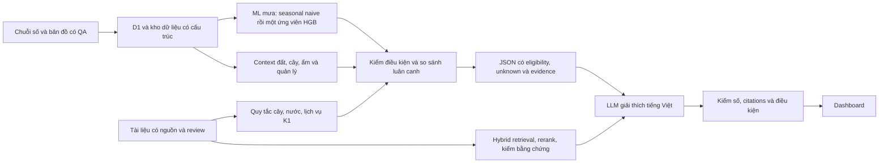

# Mỹ Thành: EDA vệ tinh, review file Bích và đề xuất ML + RAG

> Ngày 14/11/2026. Bản nghiên cứu để trao đổi, chưa chọn features, chưa chốt kiến trúc/output và chưa training. Các kết quả mới bổ sung mốc handoff trước; không sửa lịch sử hoặc tự thay quyết định team.

## Chỉ đạo hiện tại của người dùng

1. Giữ POWER cho khí hậu; MODIS cho diễn biến thực vật vùng; SMAP cho ẩm–khô vùng; thêm HLS/Sentinel-2 cho chi tiết; dữ liệu Bích bổ sung đất–nước–cây–lịch vụ.
2. Đã nhận `data.3.xlsx`, lưu bản sao có tên rõ và hash trong Lab, giữ nguyên Downloads.
3. Người dùng xác nhận các tên trong trao đổi chỉ cùng địa bàn mong muốn; dùng nhãn **Mỹ Thành, Đồng Tháp** và giữ tọa độ pack **10.4790980766, 106.0216210397**. Chưa tự geocode địa điểm khác; từng nguồn vẫn phải kiểm scope.
4. Thứ tự: **EDA → kiến trúc dự tính → cùng chốt features → chốt kiến trúc/output → preprocessing và workflow AI**.
5. Mục tiêu người dùng nêu: **17h ngày 14/11 có baseline để chốt/kiểm**. Không tự báo baseline đã chạy hoặc lời hứa cả team chưa xác nhận.

## Kết quả mới đã có

- MODIS: 69 kỳ 2023–2025, lưới vùng 17 × 17 ô; đối chiếu 138 giá trị NDVI/EVI ở tâm khớp query một ô cũ. Native sinusoidal cell ~231,66 m; không phải đo từng ruộng 2 ha.
- SMAP: lấy được **L4 qua kho NASA POWER công khai**, 31/03/2015–31/12/2025, lưới vùng 7 × 7 ô. SFMC và RZMC tại ô gần tâm có 3.928/3.929 ngày; thiếu 20/09/2025. Đây là model-assimilated estimates, không đổi tên thành L3 hoặc field measurement. Upstream L4 version chưa được metadata redistribution pin; source status=reviewing.
- Sentinel-2: lớp chi tiết thuộc **ESA/Copernicus**, bổ sung NASA. Collection-1 và kiểm offset là lựa chọn kỹ thuật EDA; không tự xem ảnh là nhãn cây hoặc bản đồ dinh dưỡng. Số scene/QA cuối cùng xem report Lab.
- Bích: 3 sheet, 12 dòng tóm tắt, không URL/hyperlink hoặc actual time series/raster. SOC `30–45 dg/kg = 3–4,5%` lệch 10 lần. Nhu cầu nước 1200/950/850 mm thiếu kỳ tính/định nghĩa; pH khác phương pháp chưa có phép hiệu chỉnh được xác minh. Chưa thành K1 hoặc training labels.

## Đề xuất kiến trúc để thảo luận

RAG không có một “version mới nhất” chung. Đề xuất retrieval kết hợp keyword và ngữ nghĩa đa ngôn ngữ, lọc theo crop/địa bàn/phương pháp/năm/review status, rerank và kiểm bằng chứng. Có thể vận dụng corrective retrieval có giới hạn; không khẳng định đã triển khai CRAG/Self-RAG hoặc huấn luyện critic chỉ vì có bước kiểm. LLM giải thích số đã tính và quy tắc đã duyệt; không tự forecast hoặc tạo ngưỡng nông học.

Không inner-join tất cả nguồn có các cửa sổ rất khác nhau thành vài scene rồi train mưa. Ảnh có thể là context trước, chỉ thêm vào forecast nếu coverage/available_at và kiểm ngoài mẫu hỗ trợ. Chưa có nhãn để supervised-learn cây/rotation tốt nhất.

## Gói để team đọc trong Lab

Các đường dẫn dưới tính từ root `neurax-fieldshift-lab` cùng workspace, nhánh `research/bich-satellite-eda-2026-11-14`:

- `docs/satellite-bich-review-2026-11-14/README.md`: kết quả và giới hạn.
- `docs/satellite-bich-review-2026-11-14/bich-review.md`: ô lỗi, yêu cầu bổ sung và tin nhắn gửi Bích.
- `docs/satellite-bich-review-2026-11-14/ai-architecture-proposal.md`: method, inputs/outputs, RAG context, evaluation và runtime.
- `docs/satellite-bich-review-2026-11-14/feature-review.csv`: candidates, không phải danh sách đã chọn.
- `notebooks/resources/08-modis-spatial-eda.ipynb`, `09-smap-l4-eda.ipynb`, `10-sentinel2-eda.ipynb`, `11-bich-handoff-review.ipynb`.
- Local raw/runs ở `data/raw/satellite-context-2026-11-14/`, `data/raw/bich-handoff-2026-11-14/`, `runs/satellite-context-2026-11-14/`, `runs/bich-handoff-2026-11-14/`. Không commit raw hoặc tự upload.

Chốt features cùng Việt sau khi đọc visual và kiến trúc. Bích bổ sung nguồn/crop rules; Quang Luật kiểm QA và số học; cùng Hưng thống nhất scope/output. Review tự động không thay independent Q1/K1. Không gửi tin cho người khác trong lượt này.

## Nguồn chính đọc ngày 14/11

- [NASA POWER SMAP hydrology](https://power.larc.nasa.gov/docs/methodology/data/sources_hydrology/): pathway L4 và phạm vi nguồn; không chứng nhận field accuracy.
- [NASA ORNL subsetting](https://modis.ornl.gov/data.html): subset khoa học và GeoTIFF.
- [ISRIC units](https://docs.isric.org/globaldata/soilgrids/SoilGrids_faqs_01.html): kiểm SOC/N/CEC.
- [CRAG](https://arxiv.org/abs/2401.15884), [Self-RAG](https://arxiv.org/abs/2310.11511), [CRITIC-R1 2026](https://arxiv.org/abs/2605.29886): các hướng nghiên cứu, không phải kết quả NeuraX.
