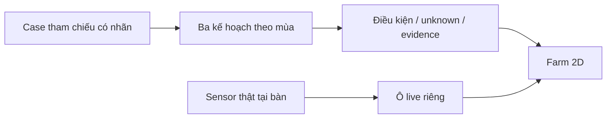

> **TRẠNG THÁI 12/11 - THAM KHẢO/SNAPSHOT:** phần thiết kế, địa bàn, phân công và phase bên dưới có nội dung trước correction. Không dùng làm quyết định hiện hành. Đọc [Bắt đầu ở đây](START-HERE.md), [roles hiện hành](my-thanh-team-roles-2026-11-12.md) và [bảng R0/R1/R2 Mỹ Thành](cases/my-thanh-cai-lay/rotation-evidence-for-bich.md). Hưng-Việt cùng core/UI khi cần; Hiếu backend remote gián đoạn; Bích Data/review nguồn-feature; An ESP demo; Luật QA/thống kê/đánh giá từng block. Không lấy Đức Lập/bắp hạt/đậu phộng hoặc lời “prototype ngay” ở snapshot thay case và quy định hiện tại.

# AgroTwin — Đề xuất để team quyết định và bắt đầu

> Bản 1.0 · 12/11/2026 · NeuraX nội bộ · Kết thúc vòng desk research để đề xuất scope, không phải kết thúc xác minh nông học thực địa.

## 1. Quyết định được đề nghị

Đề nghị team thông qua **AgroTwin: farm 2D hỗ trợ khám phá kế hoạch luân canh tại một case nghiên cứu Đức Lập**. Người dùng mục tiêu là nông dân; giai đoạn đầu có thể cần người tư vấn hỗ trợ. Phạm vi thi gồm dữ liệu NASA thật, ba kế hoạch tham chiếu có provenance, lý do/ràng buộc/unknown, kịch bản có nhãn và ô sensor thật riêng khi thiết bị sẵn sàng. Không lấy việc chưa có nông hộ làm lý do dừng prototype; cũng không biến thửa giả định thành hộ đã khảo sát.

Phân biệt hai mode: **reference/sandbox** để trình bày và thử logic; **farm-specific** chỉ mở khuyến nghị sau khi có hiện trạng/đất/nước/lịch của người dùng và review phù hợp. Hai mode dùng cùng contract, không là hai sản phẩm. Trong reference, nhãn UI là “phương án tham chiếu”, không là “hiện trạng nông dân Đức Lập”. R0 thật vẫn null.

Thông điệp: “Trước mùa vụ, hiểu vì sao một kế hoạch được cân nhắc, điều gì có thể làm lựa chọn thay đổi và còn phải kiểm thông tin nào.” Mục tiêu cạnh tranh local và được đề cử global chuyển thành chất lượng bài toán, phương pháp, demo và artifact; không có bằng chứng để gán xác suất thắng.

## 2. Nghiên cứu đã trả lời được gì?

| Câu hỏi | Kết quả có căn cứ | Kết luận cho scope |
| --- | --- | --- |
| Case có liên hệ nông nghiệp thật? | Có nguồn khuyến nông bắp và đậu phộng lịch sử tại Đức Lập Hạ [S1][S2] | Giữ địa bàn nghiên cứu, chưa nhận có farm partner |
| Có NASA data thử được? | Đã tải/audit POWER 2015–2025: 4.018 ngày, bốn biến, 16.072 giá trị | Ingestion/schema đủ để triển khai prototype lịch sử |
| Mưa đã sạch hoàn toàn? | Không: một extreme day, cross-model disagreement | Giữ WARN, không tối ưu lịch bằng outlier |
| Có cơ cấu mùa cho phương án khác? | IAS có lúa Đông Xuân–mè Xuân Hè–lúa Hè Thu [S3]; bắp có tiền lệ Đông Xuân tại địa bàn [S1] | Có reference menu, chưa có lịch thửa hoàn chỉnh |
| Đã biết hiện trạng, đất và nước tại ruộng? | Chưa | Farm-specific ranking chưa được mở |
| Ý tưởng độc nhất? | NASA/ranking/ENSO và farm game có tiền lệ | Chứng minh ích lợi và thực hiện tốt; không claim đầu tiên |

Đức Lập Hạ cũ nay thuộc xã Đức Lập, Tây Ninh theo nguồn địa danh trong dossier. Điểm API 10.91123 N / 106.44351 E là tham chiếu GeoNames, không là ruộng hay centroid ranh giới đã kiểm. Không suy đất cát pha của dự án lịch sử thành soil record cho điểm API hoặc toàn xã. Dossier giữ chi tiết nguồn, thời gian và access failures.

## 3. Data audit và cách xử lý bất đồng

POWER Daily v2.10.3, header MERRA2/POWER, UTC, T2M/T2M_MAX/T2M_MIN đơn vị C và PRECTOTCORR mm/day. Sample 01/01/2015–31/12/2025 đủ keys/leap days, không fill/nonfinite/duplicate; Tmin ≤ Tmean ≤ Tmax, mưa không âm, tổng tháng khớp cộng ngày. Các kiểm này không đo accuracy. Source grid khí tượng 0,5° × 0,625°, không phải trạm ruộng.

Giá trị 494,17 mm/day ngày 14/06/2020 vượt threshold review khám phá 200. Đã thử đối chiếu độc lập sản phẩm ERA5 qua Open-Meteo, chọn rõ models=era5 và daily UTC [S4].

| Cửa sổ UTC | POWER | ERA5 qua Open-Meteo | Điều được phép kết luận |
| --- | --- | --- | --- |
| 14/06/2020 | 494,17 mm | 17,3 mm | Hai product bất đồng lớn |
| Tổng 6 ngày | 651,17 mm | 65,2 mm | Không chỉ nhìn một mốc ngày; chưa xác minh ground truth |

Tổng sáu ngày là 12–17/06/2020 UTC. ERA5 trả điểm 11,0 N / 106,5 E, lưới 0,25°. MERRA2/POWER có support khác. So đơn vị và UTC chỉ loại bớt lỗi diễn giải, không làm hai grid thành cùng phép đo. Không kết luận NASA sai/ERA5 đúng, không sửa hoặc lấy trung bình hai nguồn. Giữ raw, URL, timestamp, hashes và comparison CSV riêng.

Mưa mean/median theo tháng khác nhau trong sample; không chọn statistic chỉ để có kết quả đẹp. Prototype dùng biểu đồ lịch sử có mean/median và warning, chưa lấy một ngày extreme hoặc tổng mưa năm thành crop-suitability score. Temperature và lịch sử mưa hỗ trợ hiểu exposure; dự báo mùa tới hoặc tác động El Niño tại ruộng cần nguồn/phương pháp khác. ENSO ở scope đầu là bối cảnh có ngày/horizon, không tự nhân hệ số vào ranking.

### NASA giúp câu hỏi nào trong prototype?

Đã tính thêm exposure cho cửa sổ tham chiếu bắt đầu 15/01, dài 75 ngày mỗi năm 2015–2025. Ngày bắt đầu là giả định thiết kế, không là lịch ruộng; độ dài lấy cận trên của candidate giống để thử phương pháp. Từ raw NASA, tổng mưa trong cửa sổ có median 12,0 mm, mean 27,42 mm, min–max 0,35–112,84 mm; T2M trung bình 29,295 C. Có CSV 11 cửa sổ, cùng raw hash. Không có event tháng 6 trong các cửa sổ này; không phải đã làm sạch series.

Đây là historical exposure, chưa là forecast hoặc water deficit: chưa có ET, hệ số cây, trữ nước đất và tưới. Giá trị cho quyết định là buộc hỏi nguồn nước và lịch xuống giống, thay vì suy “chịu hạn” thành “không cần nước”. Prototype phải cho đổi cửa sổ giả định và truy nguồn kết quả. Không xếp hạng ba plans bằng con số exposure của riêng một cây/cửa sổ.

## 4. Ba kế hoạch cụ thể để mang ra bàn

Đề nghị dùng ba kế hoạch dưới đây làm **reference menu cho cùng một tình huống giả định có nhãn**. Đây là thiết kế phương án để team review, chưa là ba rotation phù hợp cùng một thửa. Bản research JSON giữ baseline thực tế null và reference menu riêng.

| ID / nhãn UI | Chuỗi season-tag để review | Căn cứ và phần thiết kế thêm |
| --- | --- | --- |
| REF-RICE / Tham chiếu ba vụ lúa | Lúa Đông Xuân → lúa Hè Thu → lúa Thu Đông | Có báo cáo lịch sử ba vụ ở Đức Hòa [S5]; dùng làm tham chiếu, không nói hiện trạng Đức Lập 2026 |
| REF-MAIZE / Hai lúa, một bắp | Bắp Đông Xuân → lúa Hè Thu → lúa Thu Đông | Bắp Đông Xuân ở dự án địa phương [S1]; ghép với hai vụ lúa là candidate do NeuraX thiết kế, chưa là chuỗi được nguồn xác nhận tại cùng thửa |
| REF-SESAME / Hai lúa, một mè | Lúa Đông Xuân → mè Xuân Hè → lúa Hè Thu | Cấu trúc được IAS mô tả [S3]; chuyển tới thửa Đức Lập và ngày/giống vẫn cần review |

Mè ĐH-1 là candidate giống có source, không phải quyết định mua giống hoặc khuyến cáo hiện tại. IAS mô tả thời gian 70–75 ngày, mùa Xuân Hè tháng 1–3 và áp dụng lịch sử tại Đức Hòa [S3]. Không tự chuyển nhãn mùa thành ngày xuống giống cố định. Rice calendar, khoảng chuẩn bị đất và thời gian bắp tại điều kiện địa phương vẫn chưa chốt. Không mang số ngày giống ở Nghệ An làm duration ở Long An chỉ vì trùng tên.

Giữ đậu phộng là nhánh dự phòng domain: có lịch sử địa phương [S2], nhưng nguồn kỹ thuật/chuỗi đủ tại cùng thửa chưa mạnh hơn cấu trúc mè hiện tìm được. Không bỏ một cây vì kết quả chưa thuận câu chuyện, cũng không giữ nó chỉ vì bản proposal đầu đã có. Nếu người review xác nhận đậu phộng phù hợp hơn, thay REF-SESAME có ghi rationale/source.

## 5. Phương pháp tối thiểu có thể bảo vệ

**Lớp 1: kiểm thông tin và điều kiện.** Mỗi kế hoạch có current/proposed/reference, nguồn và scope, season tags, ngày/giống nếu có, yêu cầu đất/nước/thoát nước, điều kiện lao động/đầu ra cần kiểm. Unknown không thành pass. Vi phạm đã có evidence thì excluded, thiếu evidence thì needs_review.

**Lớp 2: so sánh có giải thích.** Hiện lịch, historical climate exposure, câu hỏi/rủi ro và criterion định tính được nguồn hỗ trợ. Khi có eligible set và utility đã được review mới bật weighted ranking; chưa đủ thì vẫn cho xem evidence và không xuất “kế hoạch tốt nhất”. Score prototype/synthetic không dùng chung nhãn kết quả nông học.

**Lớp 3: sensitivity có giới hạn.** Chỉ quét ưu tiên/giả định trong miền được phép; ghi grid step và biến giữ cố định. Nếu không có đảo hạng thì hiện không thấy đổi trong miền đã thử. Không chỉnh weights hoặc xử lý outlier để ép một màn đảo hạng. Threshold số học không phải xác suất cây thành công.

Một ví dụ sandbox để giải thích điều kiện lịch: người dùng giả định có khoảng trống 90 ngày, chuẩn bị đất 7 ngày, thời gian mè 70–75 ngày theo source. Tổng cần 77–82 ngày nên **qua kiểm lịch theo các giả định này**. Nếu chỉ còn 75 ngày thì không đủ ngay cả cận ngắn. Dù qua lịch, khi chưa biết đất/nước thì trạng thái tổng vẫn needs_review. 90/75 ngày trống và 7 ngày chuẩn bị là input minh họa, không phải số đo ruộng hay ngưỡng IAS.

Không tính yield, lợi nhuận, % tiết kiệm nước hoặc soil-health gain từ POWER/sensor. Không gọi một crop họ đậu tự cải tạo đất; quản lý tàn dư, nền đất và thực hành cần nguồn. Thêm model forecast chỉ khi có target/horizon/split/baseline và bằng chứng cải thiện; không cần để hoàn thành scope đầu.

## 6. Giao diện và vai trò sensor

Farm 2D có ba vùng: case/context; lịch ba reference plans và why-not; evidence/unknown. Nhãn history/scenario/reference/live hiển thị tại nội dung liên quan. Một ô sensor riêng nhận H1 thật, chỉ số/time/quality và lỗi stale. Board HTTPSLAB đang chờ model/datasheet; không chờ nó để làm NASA/K1/UI.

**Hình — Farm tương tác đề xuất.** Wireframe hiển thị cấu trúc, chưa là screenshot có dữ liệu nông hộ. Các thanh không khẳng định lịch cây đã xác minh.

Chuyển mẫu tại bàn làm đổi tile live, không đổi đất Đức Lập hoặc ranking vùng. Nếu bật what-if từ sensor thì gắn sandbox, không ghi đè source. Nếu chưa nhận board thì replay có nhãn hoặc bỏ live; không giả dữ liệu. Không mô phỏng cây chết/tăng trưởng ngay chỉ từ ADC. Phần cứng là minh họa measurement chain, không là bằng chứng đúng nông học hoặc bảo mật chỉ vì chip nội địa.

## 7. Một đường demo và câu chuyện

Mở: “Một nông dân đang cân nhắc thay một vụ trong lịch trồng. Trước khi quyết, họ cần biết kế hoạch có khớp mùa, đất và nước không.” Nói ngay đây là tình huống tham chiếu nghiên cứu, chưa là lời chứng thực nông hộ.

1. Chọn case Đức Lập, mở NASA history thật và nhãn grid/time/WARN.
2. Đặt ba reference plans lên lịch; mở nguồn, chỉ rõ một chuỗi là ghép thiết kế và một chuỗi có nguồn cấu trúc.
3. Chạy tình huống sandbox khoảng trống 90 rồi 75 ngày; hiển thị cách tính và điều kiện bị chặn. Sau đó mở unknown đất/nước để cho thấy vì sao không tự khuyến nghị.
4. Khi có rule/utility review thật, cho thử ưu tiên và giải thích kết quả; nếu chưa có thì không diễn như đã ranking chính xác.
5. Chuyển ô live, đổi mẫu/ngắt kết nối, phân biệt mẫu bàn với dữ liệu vùng.
6. Kết: “Prototype giúp minh bạch điều kiện và câu hỏi trước khi đổi luân canh. Bước pilot sẽ kiểm nó có giúp nông dân hiểu và chuẩn bị tốt hơn không.”

Không mở bằng danh sách AI/chip/ENSO. Việt Nam là bối cảnh có căn cứ; an ninh lương thực là hướng đóng góp dài hạn. Bài học winner/đối thủ là làm một đường hữu ích và kiểm được, không sao chép game rồi xem là độc đáo. Không có scorecard global để gọi đây là công thức thắng.

## 8. Phân công và tiêu chí bàn giao

| Người dẫn | Đầu ra cần có | Hoàn tất khi |
| --- | --- | --- |
| Hưng | Scope, reference menu, eligibility/why-not | Phân biệt source-backed/design/unknown; không ép ranking |
| Bích | K1 source/rule/transfer review và case sheet | Nêu được đất/nước/lịch còn thiếu và nguồn kiểm; không gán toàn xã một loại đất |
| Việt | D1/Q1 và A1 adapter trên sample đã lưu | Reproduce raw/derived/version, WARN đi tới UI |
| Quang Luật | Kiểm độc lập data, arithmetic và sandbox | Báo cáo pass/warn/fail cùng input/version; không gọi cross-model là ground truth |
| Hiếu | Farm 2D, comparison, source/unknown states | Một luồng xem được không cần notebook, không mất warning |
| An | Intake HTTPSLAB, adapter/log khi có board | Exact model/toolchain/payload; live/replay/stale đúng |

Chỉ build sản phẩm theo thời gian BTC cho phép. Đề xuất order: case/reference/contract → một đường NASA tới UI → conditions/evidence → sensor → rehearsal/bài nộp. Không quy định service/framework khi repo sản phẩm chưa kiểm dependency. Không tạo notebook, train model hoặc provision cloud chỉ vì proposal có AI.

## 9. Gate local, global và cắt scope

| Gate trước khóa bản demo | Evidence tối thiểu | Nếu chưa đạt |
| --- | --- | --- |
| G1 nguồn và trạng thái đúng | NASA raw/hash và warning; source plans | Chỉ claim desk-research prototype |
| G2 điều kiện và giải thích | Tính lịch kiểm lại; unknown/excluded không biến pass | Bỏ automatic ranking |
| G3 hiểu đúng người dùng | Rehearsal người chưa biết dự án; nếu có farmer thì ghi đúng vai trò | Sửa lỗi hiểu, không ghi farmer-validated |
| G4 bài nộp truy cập được | Link/backup, method card, credits, nháp Anh | Ưu tiên artifact, cắt animation/model phụ |
| G5 đúng luật 2026 | Guide/local BTC về format/deadline/eligibility/AI/source | Hưng xác nhận trước submission, không áp năm cũ |

Local: một quyết định dễ theo và Q&A có evidence. Global: reviewer xem độc lập cùng dữ liệu/method/limits/credits và hướng dẫn. Không có hai hệ thống chất lượng khác nhau. Thắng local không tự đảm bảo nomination; không tự gọi nominee là winner.

Nếu cần cắt, bỏ 3D/chatbot/forecast/nguồn EO phụ/return display/actuator trước. Giữ NASA thực chất, reference menu có nguồn, conditions/unknown, evidence, lỗi dữ liệu và bài nộp. Thiếu chip không chặn core. Thiếu hộ thật không giả hộ; chuyển reference mode. Thiếu rule không ép rank. Dùng gate để bảo vệ khả năng demo và tính đúng của claim.

## 10. Điểm cần cả team thống nhất trong buổi họp

Đề nghị chốt năm điều: giữ case nghiên cứu Đức Lập; chọn reference mode cho bản đầu; dùng ba menu ở phần 4 với nhãn provenance; ưu tiên gate điều kiện trước ranking; sensor tách ở ô live. Đây là đề xuất để thảo luận, chưa ghi là team đã approve.

Họp 30 phút đề xuất: 5 phút bài toán/evidence; 10 phút ba plans và giới hạn; 10 phút mỗi owner nhắc lại input/output và công suất; 5 phút ghi keep/change/drop và mốc kế tiếp. Nháp này không phải lịch đã đặt. Hưng ghi quyết định thực tế vào decision log.

Những gì không thể kết thúc chỉ bằng search: soil/water/baseline/giống tại thửa, usability với nông dân và hardware thực. Đây là các gate pilot, không là lý do kéo dài desk research vô hạn. Đã đủ căn cứ để đề nghị xây prototype theo scope trên; chưa đủ để triển khai tư vấn mùa vụ cho người dân. Điều kiện nhận dữ liệu/feedback thực sẽ nâng reference lên farm-specific, không phải đổi toàn bộ kiến trúc.

## 11. Bằng chứng, tính mới và giới hạn hiện tại

NASA/ranking/scenario/ENSO đã có trong Orion/GreenOrbit; game nông nghiệp có ở Zumorroda-X và Lotus Data Voyage. Phần ghép farm+sensor chưa được khảo sát đủ để gọi đầu tiên. Giá trị cần chứng minh của AgroTwin là giúp người xem hiểu điều kiện/unknown và kiểm lý do, trong một context Việt Nam có nguồn. Bản này không tuyên bố phát minh thuật toán, nâng năng suất, giảm nước hoặc khả năng thắng.

Kế hoạch kiểm utility: nếu tiếp cận được 3–5 người thì so tác vụ bằng bảng tĩnh và UI, đổi thứ tự; ghi thời gian/lỗi hiểu và mức hỗ trợ. Nếu chỉ có bạn học thì gọi smoke test, không farmer validation. Kiểm arithmetic và điều kiện độc lập bằng công cụ Quang Luật quen dùng. Một sample 11 năm và một event cross-check không thay validation khí hậu/đất/nông học.

## 12. Nguồn và artifact đọc tiếp

- [S1] Khuyến nông Quốc gia, 2014: dự án bắp có Đức Lập Hạ. https://khuyennongvn.gov.vn/hoat-dong-khuyen-nong/chuyen-giao-tbkt/long-an-day-manh-lien-ket-san-xuat-va-tieu-thu-bap-lai-9643.html
- [S2] Khuyến nông Quốc gia: mô hình đậu phộng 2015–2016. https://khuyennongvn.gov.vn/chuong-trinh-nganh-nong-nghiep/tai-co-cau-nganh-nong-nghiep/long-an-co-gioi-hoa--giai-phap-can-thiet-trong-canh-tac-dau-phong-15728.html
- [S3] IAS: Giống mè ĐH-1 và cơ cấu mùa; nguồn kỹ thuật, cần review áp dụng thửa. https://iasvn.org/giong-me-dh-1
- [S4] Open-Meteo: Historical Weather API, ERA5 0,25°, daily và attribution. https://open-meteo.com/en/docs/historical-weather-api
- [S5] Báo địa phương 2018: ba vụ lúa tại Đức Hòa và khuyến cáo được tường thuật. https://baotayninh.vn/duc-hoa-thu-hoach-khan-truong-lua-thu-dong-2018-18462.html
- [S6] NASA POWER Daily: time standard và response. https://power.larc.nasa.gov/docs/services/api/temporal/daily/
- [S7] NASA POWER tutorial: source grid. https://power.larc.nasa.gov/docs/tutorials/service-data-request/api/

Nguồn mới S3–S5 đọc 12/11/2026; các nguồn địa phương còn lại đã được đọc trong audit cùng ngày. Trang challenge live vẫn 502 khi thử; chưa có guide local/global 2026 đầy đủ trong lượt này. Tên giải không được thay thành nguyên nhân thắng chắc chắn.

Artifact: [case và nguồn chi tiết](cases/duc-lap/README.md), [reference menu JSON](cases/duc-lap/reference-menu.json), [NASA raw/QA](../sources/data-audits/duc-lap-2026-11-12/README.md), [exposure tham chiếu](../sources/data-audits/duc-lap-2026-11-12/reference-exposure/README.md), [event cross-check](../sources/data-audits/duc-lap-2026-11-12/event-crosscheck/README.md), [audit novelty](../competitor-research/field-shift-novelty-audit-2026-11-12.md), [winner review](../past-winners/evidence-review-2026-11-12.md), [proposal tổng thể 0.4](project-brief.md), [paper hardware](hardware-design-paper.md).

Bản này là đề xuất quyết định sau desk research. Chưa có team approval, farm pilot, production ranking, firmware hoặc user test được ghi pass. Data/research scripts có thể chạy lại từ raw và giữ nguồn; code sản phẩm/as-built thuộc repo sản phẩm.
