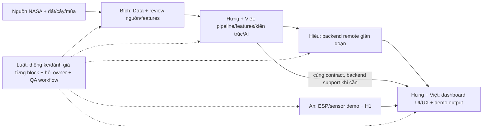

# Sáu người làm song song, bàn giao bằng dữ liệu

> Áp dụng case đã giữ là Mỹ Thành: [phân công 12/11 và ranh giới trước/sau T0](my-thanh-team-roles-2026-11-12.md), [bảng đất-nước-cây-mùa để Bích review](cases/my-thanh-cai-lay/rotation-evidence-for-bich.md). Chỉ triển khai project sau giờ BTC cho phép; ba chuỗi là reference, chưa là hiện trạng block đã xác minh.

> 2026-10-30 · Áp dụng một trong ba idea, không xây cả ba tại sự kiện.
> Quang Luật: DATA QA/thống kê/báo cáo; An: hardware. Xem [lịch 14–15/11](event-timeline.md) và [hợp đồng bàn giao](architecture.md).

## Phân công hiện hành - 12/11/2026

| Owner | Job | Đầu ra / người nhận |
| --- | --- | --- |
| Hưng + Việt | Hai đóng góp chính; cùng features, pipeline data, kiến trúc và output demo. Hưng workflow/scope Data -> AI; Việt technical AI/Data Analysis | D1/A1/contract; cùng làm UI/UX và hỗ trợ backend khi cần |
| Bích | Data, rà nguồn/src, ý nghĩa/chất lượng dữ liệu, review features và đất-nước-cây-mùa | Data/evidence + K1 cho Hưng-Việt; phối hợp Luật |
| Hiếu | Backend/API/adapter, remote có lúc offline | Phần chạy được, README/run command, trạng thái/handoff cho Hưng-Việt |
| Tiểu An | Demo ESP/sensor, tích hợp đo/firmware và log có nhãn lab | H1 cho Luật kiểm và Hưng-Việt nối demo |
| Quang Luật | Thống kê, đánh giá và QA từng block; hỏi từng owner để hiểu workflow và cập nhật tình hình | Q1/E1 + bảng owner/input/output/status/blocker/next action |

Sơ đồ là phân công đề xuất triển khai sau T0, chưa là luồng đã chạy. Hưng-Việt cùng thống nhất contract, không để cả team chờ xong DATA. Bích làm Data trong phạm vi chuyên ngành và review nguồn/features; Luật không thay người viết mọi module mà kiểm input/output, thống kê, tiêu chí và blocker theo block.

## Hiếu remote: bàn giao không phụ thuộc phản hồi ngay

Hiếu báo sẽ đi Đà Nẵng sáu ngày, không dự trực tiếp T7/CN, có lúc offline/không xem được tin nhắn. Chưa xác nhận khung online hoặc điều kiện dự remote với BTC. Không lập lịch trực hoặc hứa Hiếu luôn sẵn.

- Trước T0: xác nhận giờ có thể online, đầu việc backend vừa sức và cách bàn giao trong phạm vi BTC cho phép; Hưng hỏi BTC về remote, không tự suy đủ điều kiện.
- Sau T0: chia backend thành phần nhỏ có contract, lệnh chạy và ví dụ input/output. Mỗi handoff ghi phần xong, phần dở, lỗi và bước tiếp theo; không chuyển credential qua tài liệu.
- Hưng-Việt có khả năng tiếp quản/hỗ trợ backend và cùng làm dashboard UI/UX; giữ một đường demo tối thiểu theo cùng schema. Recorded/synthetic/replay phải có nhãn nếu backend/live chưa sẵn.
- Luật hỏi owner và ghi bảng QA theo block: nguồn -> xử lý -> features -> AI -> backend -> UI -> ESP. Trạng thái chưa có bằng chứng ghi chưa kiểm, không suy từ lời báo “xong”.

## QA theo block và mốc phối hợp

Luật theo dõi các block chức năng: nguồn/Data -> tiền xử lý -> features -> AI/so sánh -> backend -> dashboard -> ESP/sensor. Mỗi block có owner, input/output, tiêu chí, artifact/bằng chứng kiểm, pass/warn/fail hoặc chưa kiểm, blocker và next action. Luật hỏi owner để nắm tình hình; không chỉ kiểm sensor cuối demo hoặc tự sửa ngưỡng domain.

Hưng-Việt cùng thống nhất schema/contract, chia rõ đầu việc đang làm và review chéo; Hưng giữ workflow/scope, Việt tập trung technical AI/Data Analysis. Bích làm Data/review nguồn/feature; Hiếu backend theo khung online đã xác nhận; An firmware/log. Chưa có cam kết giờ rảnh nên không đặt lịch trực hoặc phiên hỗ trợ cứng cho thành viên.

Sau T0 có thể dùng các mốc review ngắn T+2/T+6/T+12 nếu phù hợp lịch thực; đó là kế hoạch nội bộ, không agenda BTC. Mỗi lần cập nhật ghi “đã có / thiếu gì / cần ai / bước tiếp”. Nếu nguồn hoặc thiết bị chưa đủ, cắt feature phụ hoặc dùng replay có nhãn, không gán metric/hiệu quả chưa kiểm.

## Tài liệu nguồn duy nhất cho phân công

[Roles hiện hành](my-thanh-team-roles-2026-11-12.md) là nguồn phân công; [hồ sơ năng lực](../../team/team-profile.md) giữ bằng chứng năng lực; [START-HERE](START-HERE.md) hướng dẫn thứ tự đọc. Workflow Earth Analog/MODIS và proposal cũ chỉ còn tham khảo, không dùng chia việc cho case Mỹ Thành hiện tại.
