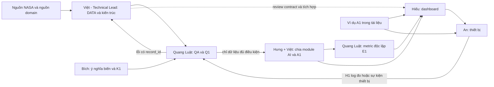

# Sáu người làm song song, bàn giao bằng dữ liệu

> 2026-10-30 · Áp dụng một trong ba idea, không xây cả ba tại sự kiện.
> Quang Luật: DATA QA/thống kê/báo cáo; An: hardware. Xem [lịch 14–15/11](event-timeline.md) và [hợp đồng bàn giao](architecture.md).

## Phân công chính

| Owner | Việc chính | Đầu ra cho người tiếp theo | Reviewer / người nhận |
| --- | --- | --- | --- |
| Việt — Technical Lead | Chốt kiến trúc/contract; pipeline DATA và module AI theo idea; review integration | D1 + module AI/A1 theo phân công, technical decisions và checklist tích hợp | Hưng rà logic/model; Quang Luật kiểm số; Bích kiểm nghĩa |
| Quang Luật | EDA, QC, thống kê độc lập, kiểm split/metric | Q1: báo cáo pass/warn/fail theo feature và sample; bảng lỗi; chart | Việt sửa dữ liệu; Hưng nhận phần pass |
| Bích | Câu hỏi khoa học, biến/ràng buộc và giới hạn | K1: bảng domain có nguồn, phương pháp diễn giải | Hưng và Quang Luật |
| Hưng | Định hướng/scope; module AI theo idea, baseline trước cải tiến sau | A1 của module mình sở hữu + protocol đánh giá; E1 do Quang Luật kiểm độc lập | Việt review kỹ thuật; Quang Luật kiểm; Hiếu/An nhận A1 |
| Hiếu | Adapter kết quả, dashboard, trạng thái lỗi, demo package | Giao diện chạy được với A1 mẫu và A1 thật | Hưng/Bích rà nội dung, An tích hợp |
| Tiểu An | Node hoặc thiết bị điều khiển/hiển thị tùy idea | H1: log thiết bị; thiết bị đọc kết quả rút gọn | Quang Luật kiểm log; Hiếu kiểm truyền/hiển thị |

Sơ đồ chỉ luồng bàn giao, không có nghĩa mọi người chờ DATA xong. Việt chốt contract để Hiếu và An làm song song; Việt và Hưng chia module AI theo cùng schema. Khi dữ liệu thật đến, Việt thay adapter đầu vào thay vì bắt cả team đổi kiểu dữ liệu.

## Quyền sở hữu theo từng idea

| Người | Field Shift | Earth Analog | MODIS/VIIRS |
| --- | --- | --- | --- |
| Việt — TL/DATA/AI | EO features + seasonal-naive forecast khi đủ chuỗi; kiến trúc | Feature extraction + distance/similarity implementation; kiến trúc | Data pipeline + baseline anomaly; forecast chỉ khi đủ điều kiện; kiến trúc |
| Quang Luật | Missingness, seasonality, QC, metric forecast nếu có | Đơn vị/scale, phân bố feature, sensitivity rank | Overlap, bias/MAE, seasonality, holdout |
| Bích | Đất/cây/mùa, quy tắc rotation | Dimension analog và chỗ không tương đồng | Nguồn nhiệt, mùa đốt, giới hạn đếm |
| Hưng | Constraint/ranking và tiêu chí đánh giá | Mục tiêu test, dimensions/weights và đánh giá ranking | Harmonization B0/B1 và tiêu chí đánh giá |
| Hiếu | So 3 chiến lược, nguồn và rủi ro | Map và bảng giải thích từng site | Calendar raw/harmonized + export |
| An | Node điểm đo và hiển thị | Bộ đo nghiêng minh họa hoặc controller chọn site | Thiết bị hiển thị calendar/anomaly, không cần sensor cháy |

Workflow chi tiết: [Field Shift](workflows/field-shift.md) · [Earth Analog](workflows/earth-analog.md) · [MODIS/VIIRS](workflows/modis-viirs.md).

## Task có thể bắt đầu độc lập

| ID | Owner | Input | Deliverable / done | Phụ thuộc |
| --- | --- | --- | --- | --- |
| DOC-01 | Việt (TL), Hưng + Hiếu phối hợp | Brief và ví dụ dưới các workflow | Chốt schema v0.1, người dùng, một demo path | Chưa cần data |
| DOC-02 | Bích | Brief + tài liệu domain | Dictionary/constraints có evidence; đánh dấu unknown | Chưa cần tải raster |
| DOC-03 | Quang Luật | Schema + phương pháp | QA checklist, expected cases, biểu đồ cần có, evaluation protocol | Không cần model |
| DOC-04 | Việt | Danh mục nguồn candidate | Bảng raw field → canonical field; ghi chưa biết units/access | Không cần UI |
| DOC-05 | An | Loại đầu ra DEPLOY + inventory | Sơ đồ thiết bị, contract H1, quy trình lỗi/stale | Không cần AI chạy trên chip |
| EVT-01 | Việt | Nguồn thật tại sự kiện | D1 một lát cắt nhỏ có lineage | Nguồn truy cập được |
| EVT-02 | Quang Luật + Bích | D1 + K1 | Q1 có pass/warn/fail, ví dụ sai và cách sửa | EVT-01; làm cuốn chiếu từng feature |
| EVT-03 | Hưng/Việt theo module trong workflow | D1 pass + K1 | Baseline A1 cho một trường hợp; Việt rà contract tích hợp | Không đợi mọi dataset |
| EVT-04 | Hiếu | A1 mẫu trước, A1 thật sau | Một đường demo, không lỗi khi result=[] hoặc partial | Contract ổn định |
| EVT-05 | An; Quang Luật hỗ trợ | H1, result summary | Thiết bị chạy độc lập và log kiểm tra | Không chặn EVT-03/04 |
| EVT-06 | Quang Luật | Kết quả baseline/candidate, split cố định | E1 nêu metric, n, coverage, phương pháp và giới hạn | EVT-03 |
| EVT-07 | Hưng + cả team | Demo + E1 + references | Pitch, report và nộp thử trước hạn | Mốc theo event-timeline |

DOC là chuẩn bị tài liệu hiện tại. EVT là công việc dự kiến khi thời gian làm dự án của sự kiện bắt đầu; chưa được thực hiện trong lượt này.

## Quyết định và tránh quá tải Technical Lead

Việt quyết định cấu trúc DATA/AI, contract, lựa chọn triển khai và giải quyết lỗi tích hợp liên block. Hưng quyết định bài toán/scope và ưu tiên; Bích rà domain; Quang Luật độc lập kiểm QA/E1. Hiếu tự chủ UI/deploy và An tự chủ firmware trong contract đã chốt.

Mỗi module AI có một người làm chính theo bảng trên, người kia review; không cùng viết hai baseline trùng nhau. T+2 chốt contract; T+6 review D1/model interface; T+12 review chạy đầu cuối. Nếu Việt bị kẹt ingestion, Hưng nhận module AI đang chặn, Quang Luật nhận EDA/QC; không dồn thêm UI/hardware cho Việt.

## Quang Luật làm DATA và kiểm thiết bị như thế nào?

Đầu ra đầu tiên là một **báo cáo QA một trang**: số dòng/kỳ, thiếu dữ liệu, duplicate, unit/range, biểu đồ phân bố, các record lỗi và khuyến nghị. Khi có dữ liệu thật, Quang Luật kiểm một mẫu nhỏ độc lập trong R hoặc MATLAB thay vì viết lại toàn pipeline của Việt.

Với An: thống nhất điều kiện thử và log trước, sau đó phân tích độ lặp lại, tỷ lệ mất bản ghi, sai lệch so tham chiếu nếu có. Không có thiết bị chuẩn thì chỉ báo độ lặp, không báo độ chính xác tuyệt đối. Tối đa một phiên hỗ trợ khoảng 60–90 phút trước mốc khóa feature; ưu tiên D1/Q1/E1 nếu đang tắc.

AutoCAD chỉ dùng nếu An xác định một giá/gá đơn giản là cần thiết. Dùng linh kiện/hộp có sẵn trước; bỏ deliverable chế tạo riêng khỏi đường găng.

## Tránh phí thời gian

- Chỉ chọn **một idea** để triển khai; ba workflow là ba phương án để ra quyết định.
- Mỗi owner tối đa một task đường găng đang làm; cập nhật async “đã có / thiếu gì / cần ai / trước khi nào”.
- Đồng bộ 10 phút ở các mốc T+2, T+6, T+12 và D−8h; không họp dài mỗi khi sửa một cột.
- Việt và Hưng công bố package immutable kèm version; Hiếu chỉ đọc schema, không đọc notebook.
- Quang Luật có quyền báo fail kèm record và tiêu chí. Hưng quyết định cắt feature; không bỏ qua lỗi units/source để giữ demo.
- Đóng scope theo deadline: baseline trước ML, demo trước animation, nguồn đúng trước nhiều layer, báo cáo ngắn trước định dạng LaTeX cầu kỳ.
