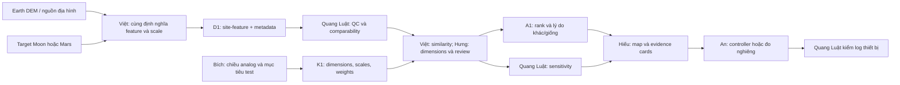

# Earth Analog — workflow TerraTwin

> Đề xuất 2026-10-30; chưa có dữ liệu đã audit. [Brief](../../challenges/10-earth-analogs-moon-mars.md) · [Contract](../architecture.md) · [Lịch](../event-timeline.md).
> Mục tiêu hẹp: tìm vùng Earth giống một target Moon/Mars ở **địa hình phục vụ thử di chuyển/thiết bị**. Không tuyên bố analog toàn diện.

## Kiến trúc

**Việt — Technical Lead / DATA + AI:** sở hữu feature pipeline, triển khai distance/similarity baseline, contract và integration. **Hưng:** chốt mục tiêu test, dimensions/scales/weights với Bích, rà logic và tiêu chí đánh giá; không viết thêm một similarity engine trùng với Việt.



Không gắn đầu ra một IMU tại bàn vào feature của một sa mạc. Thiết bị minh họa cách đo/test; chỉ bổ sung data site khi vị trí và quy trình khớp.

## DATA cần gì?

Một target planetary + 3–5 vùng Earth, ít nhất một candidate không chỉ là địa điểm analog kinh điển. Tìm nguồn Earth DEM và lunar/Mars DEM trong gói Resources hoặc catalog chính thức; chưa chốt product/version/access.

Chọn **hai feature địa hình** trước: slope_p90_deg và roughness_rms_m. Roughness cần định nghĩa, ví dụ RMS residual so với mặt phẳng cục bộ trên một cửa sổ vật lý; không dùng hai sản phẩm khác nghĩa rồi ghép chỉ vì cùng tên “roughness”.

Việt thống nhất effective spatial scale và cửa sổ vật lý trước khi tính. Nếu raster thô không hỗ trợ scale đã chọn, tăng scale chung hoặc loại feature. Bích rà mục tiêu thử có thực sự cần chiều đó.

## DATA → AI: D1

**sites.csv: một dòng = một site_id**, có body, role (candidate/target), geometry reference, source IDs. Geometry mỗi body dùng đúng reference system; bản đồ Earth chỉ plot candidate Earth, không plot target lunar lên nền Earth.

**features.csv: một dòng = site_id × feature_id**:

| Cột | Kiểu/unit | Ghi chú |
| --- | --- | --- |
| site_id, feature_id | string | Khóa duy nhất |
| value, unit | number nullable / string | deg hoặc m, không trộn ordinal geology score |
| effective_resolution_m, window_m | number | Đủ để kiểm so sánh khác scale |
| method_id, coverage_fraction | string / 0–1 | Cùng phương pháp/cửa sổ cho feature đem so |
| source_id, qa_status | string / enum | Source/version trong manifest |
| sample_uncertainty | number nullable | Chỉ điền nếu có phương pháp ước lượng |

K1 dimensions table: feature_id, scale_j, weight_j, required, scientific_rationale, source_or_assumption. Weight là lựa chọn mục tiêu test, không “do NASA chứng nhận”. Scale là độ khác biệt có ý nghĩa cho bài toán hoặc thống kê reference set, công bố rõ.

Ví dụ synthetic ở **cùng scale và cùng method giả định**:

| site_id | role | slope_p90_deg | roughness_rms_m |
| --- | --- | ---: | ---: |
| SYN-TARGET | target | 12 | 3 |
| SYN-A | candidate | 10 | 4 |
| SYN-B | candidate | 20 | 2 |
| SYN-C | candidate | 15 | 3 |

Bảng wide trên chỉ để người đọc nhìn dễ; D1 canonical là long như mô tả. Không thể suy rằng các địa điểm thực có số liệu này.

## Baseline AI có thể giải thích

Dùng weighted scaled absolute distance:
**d(site,target) = Σ w_j × abs(x_j − t_j) / scale_j**.
**similarity = 1 / (1 + d)**, giá trị 0–1 là chỉ số tương đồng, không xác suất “địa điểm đạt chuẩn”.

Ví dụ synthetic: weights slope=0.6, roughness=0.4; scales 5 deg và 2 m:
- SYN-A: d=0.44 → similarity≈0.6944.
- SYN-B: d=1.16 → similarity≈0.4630.
- SYN-C: d=0.36 → similarity≈0.7353.
- Ranking demo: C → A → B. Đây là kiểm công thức, không là khám phá analog.

MVP yêu cầu đầy đủ hai dimensions bắt buộc; thiếu một dimension → unranked/insufficient_data. Không đổi weights theo số cột có sẵn từng site rồi so rank như công bằng. Normalization dựa trên reference set phải version và giữ nguyên giữa các site; không để thêm một site thay thang điểm không thông báo.

## Analysis và prediction

Core là **similarity/ranking**, không phải forecast. Thêm ML clustering chỉ khi giúp tìm ứng viên và kiểm được; baseline hai feature đủ để hiểu luồng.

Dự đoán khả năng hoạt động của thiết bị cần target thử thực tế, dữ liệu và mô hình riêng; không ép thêm trong hai ngày. Có thể làm what-if thay giới hạn dốc/trọng số, nhưng ghi scenario. Nếu team bắt buộc có forecast học từ chuỗi, Field Shift hoặc MODIS/VIIRS tự nhiên hơn.

## AI → DEPLOY

results chứa target_id, candidate_id, rank, distance, similarity, status, contributions_by_feature, strengths, mismatches, missing_dimensions, evidence_ids.

Payload synthetic:

```json
{
  "target_id": "SYN-TARGET",
  "candidate_id": "SYN-C",
  "rank": 1,
  "distance": 0.36,
  "similarity": 0.735294,
  "status": "ranked",
  "contributions_by_feature": {"slope_p90_deg": 0.36, "roughness_rms_m": 0},
  "strengths": ["Khớp roughness trong ví dụ"],
  "mismatches": ["Không mô hình gravity, atmosphere hoặc radiation"],
  "missing_dimensions": [],
  "evidence_ids": ["synthetic-example"]
}
```

Hiếu hiển thị map candidate Earth, target profile riêng, bảng đóng góp vào distance và chỗ không tương đồng. An có thể dùng nút/encoder đổi target/weight hoặc bộ đo nghiêng minh họa. Quang Luật đánh giá log và độ lặp; không cần chế tạo mô hình địa hình.

## QA, đánh giá và phân công theo mốc

| Mốc | Owner và đầu ra |
| --- | --- |
| T+0→2 | Bích chọn một mục tiêu test; Việt kiểm cặp Earth/planetary cùng feature; Quang Luật kiểm unit/scale; Hưng chốt 2 dimensions; Hiếu/An đọc A1 mẫu |
| T+2→6 | Việt xuất D1; Quang Luật Q1 về coverage/method; Bích kiểm dimension meaning; Việt triển khai weighted-distance; Hưng rà dimensions/weights; Hiếu map và empty states; An device độc lập |
| T+6→12 | Việt xuất A1 thật, Hưng review ranking; Quang Luật tính lại distance/rank và sensitivity; Bích rà luận cứ từng site; Hiếu ghép; An summary/log |
| Sau T+12 | Chỉ thêm dimension khi nguồn và scale hợp lệ; Quang Luật report, Bích analog limits; Hiếu rehearsal và An device QA |
| D−8h | Khóa features/dimensions/weights; mọi thay đổi phải cập nhật version và ranking artifacts |

E1: kiểm distance 0 cho identical vector, không chia scale=0, missing không thành perfect match, sensitivity theo 2–3 bộ weight có ý nghĩa, ghi site nào rank không ổn định. Analog đã biết chỉ là sanity check; không dùng làm nhãn ground truth tuyệt đối hoặc báo classifier accuracy.

## Cắt scope

Một target, 3–5 candidates, hai feature và 2D map; không global search toàn hành tinh/3D simulation/rover. Thiếu scale tương thích ở T+2 → đổi dimension/target nhỏ hơn; nếu không có cặp dữ liệu thì đổi bài, không dùng ảnh nhìn giống nhau thay lý luận analog. AutoCAD chỉ cần khi An có việc thực sự phục vụ demo.

