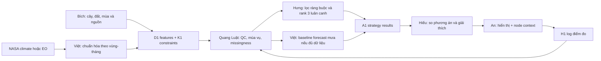

# Field Shift — workflow AgroTwin

> Đề xuất 2026-10-30; chưa có data/model chạy. [Brief](../../challenges/07-field-shift.md) · [Contract chung](../architecture.md) · [Lịch](../event-timeline.md).
> Mục tiêu: người dùng so luân canh hiện tại với hai phương án theo nước/đất/khí hậu và ưu tiên; không hứa tăng năng suất.

## Kiến trúc và owner

**Việt là Technical Lead / DATA + AI:** sở hữu EO pipeline, contract/inference integration và baseline forecast mưa khi đủ điều kiện; cùng Hưng review AI. **Hưng** sở hữu ràng buộc/ranking và ưu tiên khoa học. Forecast không đủ data thì Việt kiểm và tối ưu phần analysis/inference cùng Hưng, không bị giới hạn ở ingestion.



Node là nguồn context riêng. Bích và Việt chỉ quyết định đưa vào model nếu nơi/thời gian/đơn vị tương thích; node bàn demo không thay dữ liệu nông trại trong D1.

## Đầu vào cần tìm

| Nguồn candidate | Dùng để làm gì | Quyết định trước khi dùng |
| --- | --- | --- |
| NASA POWER hoặc nguồn climate/EO phù hợp brief | Chuỗi mưa/nhiệt theo vùng và thời gian | Product/parameter, unit, missing code, resolution và tính đại diện |
| SMAP/GPM hoặc lớp khác, chỉ thêm khi cần | Bổ sung điều kiện nước | Không ghép độ ẩm điểm với pixel hoặc gọi resampling là tăng độ chính xác |
| Bảng crop/soil/season có nguồn | Quy tắc lựa chọn và loại phương án không phù hợp | Bích xác nhận định nghĩa, vùng áp dụng, evidence và điều chưa biết |
| Ưu tiên người dùng | Trọng số water/soil/climate | Chuẩn hóa weights tổng 1; không đưa market/yield vào nếu thiếu căn cứ |

Một nguồn NASA có thể đủ để dựng lát cắt đầu tiên. Danh sách trong brief là lựa chọn, không backlog phải tải hết.

## DATA → AI: D1 và K1 cụ thể

**features.csv: một dòng = một region_id × tháng**, chỉ số ở quy mô vùng, không giả độ phân giải ruộng.

| Cột | Kiểu/unit | Ghi chú |
| --- | --- | --- |
| region_id, period_start, period_end | string, date UTC | Khóa duy nhất, khoảng cuối exclusive |
| precip_sum_mm | float nullable, mm/tháng | Tổng mưa các quan sát hợp lệ; thiếu ngày phải ghi coverage, không tự coi tổng đầy đủ |
| air_temp_mean_c | float nullable, °C | Không thay bằng land-surface temperature mà giữ cùng tên |
| precip_coverage, temp_coverage | float 0–1 | Valid/expected samples, denominator được giải thích |
| qa_status, source_ids | enum/string | Truy sang manifest/provenance |

K1 có ba bảng: crops (crop_id, điều kiện và nguồn), rotations (strategy_id, season_index, crop_id, is_current), constraints (constraint_id, rule, scope, source_id, status). Các điểm số heuristic phải có definition; missing rule = unknown, không tự hiểu cây phù hợp.

Ví dụ D1 **synthetic** để các block thống nhất grain/units:

| region_id | period_start | period_end | precip_sum_mm | air_temp_mean_c | precip_coverage | temp_coverage | qa_status |
| --- | --- | --- | ---: | ---: | ---: | ---: | --- |
| SYN-R1 | 2024-01-01 | 2024-02-01 | 40 | 26 | 1 | 1 | pass |
| SYN-R1 | 2024-02-01 | 2024-03-01 | 28 | 27 | 1 | 1 | pass |
| SYN-R1 | 2024-03-01 | 2024-04-01 | | 28 | 0 | 1 | partial |

Ba dòng chỉ minh họa contract; không đủ train/forecast hoặc đề xuất cây thật. Ví dụ này đánh dấu qa_status=partial ở cấp dòng; Q1 vẫn ghi feature nhiệt pass và mưa unavailable.

**Q1 của Quang Luật:** kiểm unit, duplicate key, số kỳ, missing-by-variable, trend/mùa vụ, biểu đồ mưa/nhiệt; so một tháng aggregate với raw. Bích kiểm mùa/cây và phạm vi spatial. Với tháng thiếu một phần mưa, giữ coverage và quyết định sử dụng theo policy trước; không đánh giá tháng đó như tháng khô chắc chắn.

## Baseline analysis — có thể làm trước ML

1. Hưng nhận chỉ những feature đủ điều kiện và K1 có nguồn.
2. Loại rotation vi phạm hard constraints đã xác nhận. Quy tắc chưa rõ trả unknown/needs_review.
3. Với phương án còn lại, tính utility water/soil/climate theo công thức/ordinal rule Bích rà, mỗi tiêu chí scale 0–1.
4. Score = tổng weight × utility; trả cả score thành phần, source_ids, risks và missing_inputs.
5. So tối thiểu ba chiến lược gồm hiện trạng theo lựa chọn MVP; nếu chưa đủ ba chiến lược có cơ sở, ghi partial, không bịa cho đủ.

Đây là **decision support baseline**, không mô hình năng suất. Có thể áp weighted ranking trước optimizer; chỉ thêm tối ưu tổ hợp khi nhiều phương án đến mức enumeration không còn tiện.

## Prediction — nhánh riêng có gate

Đề xuất rõ target: **tổng mưa tháng tiếp theo cho vùng**, unit mm, horizon một tháng. Baseline seasonal-naive: dùng cùng tháng năm trước; candidate đơn giản chỉ thử khi lịch sử đủ và backtest hợp lệ.

Giả định để thẩm định khả thi: tối thiểu khoảng 5 năm monthly cho thử nghiệm ban đầu, giữ năm cuối test, chọn candidate qua rolling validation trên các năm trước; không coi 5 năm là bảo đảm độ chính xác. Việt triển khai seasonal-naive/candidate; Quang Luật kiểm leakage và MAE mm theo fold; Hưng review logic và hiệu quả so baseline. Không có ít nhất vài chu kỳ mùa và holdout thì forecast=null.

Từ forecast mưa đến thay đổi ranking cây cần response rule có căn cứ riêng. Slider mưa giảm 20% là **scenario**; không gán nó thành dự báo xác suất hoặc khuyến nghị canh tác đã kiểm nghiệm.

## AI → DEPLOY: results trong A1

| Trường payload | Ý nghĩa cho Hiếu/An |
| --- | --- |
| strategy_id, is_current, seasons | Hiển thị phương án và trình tự cây |
| eligibility | eligible / ineligible / needs_review |
| score, criterion_scores, weights | Điểm heuristic và giải thích; null nếu không đủ dữ liệu |
| reasons, evidence_ids | Vì sao xếp hạng; nguồn kiểm được |
| risks, missing_inputs | Giới hạn đi cùng phương án |
| scenario_id | null khi baseline; ID rõ khi what-if |

Ví dụ payload synthetic nằm trong envelope chung:

```json
{
  "strategy_id": "SYN-ROT-A",
  "is_current": true,
  "seasons": [{"season_index": 1, "crop_id": "SYN-CROP-1"}],
  "eligibility": "needs_review",
  "score": null,
  "criterion_scores": {},
  "weights": {"water": 0.5, "soil": 0.3, "climate": 0.2},
  "reasons": ["Minh họa phương án hiện tại"],
  "evidence_ids": ["synthetic-example"],
  "risks": ["Chưa có quy tắc nông học được rà"],
  "missing_inputs": ["verified_crop_constraints"],
  "scenario_id": null
}
```

Hiếu dựng 3 thẻ phương án + chart lịch sử + evidence; không tự đổi needs_review thành recommendation. An hiển thị context điểm đo và trạng thái kết quả, không cần chạy model trên ESP32.

## Cả sáu người làm gì trong các mốc?

| Mốc | Việt / Quang Luật / Bích | Hưng | Hiếu / An |
| --- | --- | --- | --- |
| T+0→2 | Chọn 1 vùng/nguồn; QC sample; quy tắc cây tối thiểu | Chốt tiêu chí/3 chiến lược khả thi hoặc scope giảm | Chốt UI states và H1 |
| T+2→6 | D1 đầu tiên + Q1 + K1 | Baseline score/filter | UI theo A1 mẫu; An log độc lập |
| T+6→12 | Sửa lỗi, Quang Luật kiểm rank/units | A1 thật; chưa làm forecast nếu baseline chưa xong | Ghép dashboard; An kết nối summary |
| Sau T+12, trước D−8h | Quang Luật đánh giá, Bích rà claim, Việt sở hữu forecast nếu đủ data và rà integration | Hưng review forecast, hoàn thiện ranking/giải thích; không viết lại model của Việt | Một phiên test log cùng Quang Luật; polish giới hạn |
| D−8h trở đi | Nguồn, biểu đồ và báo cáo | Khóa scope | Rehearsal/nộp theo lịch |

## Đạt, cắt, đổi bài

Đạt core khi có NASA-derived features truy nguồn, đất/cây có căn cứ, so phương án hợp lệ, giải thích/rủi ro và UI đúng trạng thái. E1 kiểm invariants, sensitivity, source trace; không báo accuracy nếu không có nhãn.

Không có nguồn cây/đất đủ căn cứ ở T+2 → thu hẹp vùng/cây hoặc xét fallback; không chỉ vẽ khí hậu rồi gọi đó là giải bài luân canh. Không có chuỗi forecast → bỏ forecast. Hardware lỗi → snapshot/replay có nhãn. Không có model nâng cao → baseline vẫn phải giải được quyết định của người dùng.

