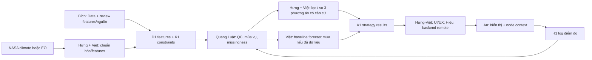

# Field Shift — workflow AgroTwin

> Phân công mới theo người dùng 12/11: [roles 1.2](../my-thanh-team-roles-2026-11-12.md). Hưng-Việt cùng đóng góp chính (features/pipeline/kiến trúc/output demo); Bích Data + review features/src; Hiếu backend remote gián đoạn; An ESP/sensor demo; Luật QA/thống kê/đánh giá từng block và theo dõi workflow. Hưng-Việt cùng UI/UX, hỗ trợ backend khi cần.

> Case hiện hành: [Mỹ Thành](../cases/my-thanh-cai-lay/README.md), [bảng R0/R1/R2](../cases/my-thanh-cai-lay/rotation-evidence-for-bich.md), [START-HERE](../START-HERE.md). Có raw POWER/SoilGrids và QA nghiên cứu; chưa có mô hình, API, dashboard hoặc thiết bị được kiểm end-to-end cho case này. Đức Lập là case audit cũ, không phải nguồn áp cho block Mỹ Thành.
> Field Shift được chọn theo xác nhận 04/11; giữ quyết định đó. R0 là đối chứng lịch sử, không phải hiện trạng xác minh. Việc triển khai dưới đây chỉ sau T0 được BTC cho phép. Forecast/ENSO/sensor là nhánh phụ, không thay core so luân canh.

## Kiến trúc và owner

**Hưng xây workflow chính và chốt scope Data -> AI; Việt làm technical AI và Data Analysis.** Hai người cùng làm features, pipeline, kiến trúc và output demo; cùng làm UI/UX và hỗ trợ backend cho Hiếu khi cần. Bích làm Data/review nguồn và feature; Luật đánh giá từng block và hỏi owner để nắm trạng thái; An phụ trách ESP/sensor demo. Forecast chỉ là phần có gate dữ liệu, không mặc định phải làm.



Node là nguồn context riêng. Bích và Hưng-Việt chỉ quyết định đưa vào model nếu nơi/thời gian/đơn vị tương thích; node bàn demo không thay dữ liệu nông trại trong D1.

## Đầu vào: đã có, còn thiếu

| Nguồn candidate | Dùng để làm gì | Quyết định trước khi dùng |
| --- | --- | --- |
| NASA POWER hoặc nguồn climate/EO phù hợp brief | Chuỗi mưa/nhiệt theo vùng và thời gian | Đã có POWER 2015-2025 tại điểm vùng; technical QA/WARN. Cần feature tháng có provenance và policy cảnh báo trước khi dùng so phương án |
| SMAP/GPM hoặc lớp khác, chỉ thêm khi cần | Bổ sung điều kiện nước | Không ghép độ ẩm điểm với pixel hoặc gọi resampling là tăng độ chính xác |
| Bảng crop/soil/season có nguồn | Quy tắc lựa chọn và loại phương án không phù hợp | Bích xác nhận định nghĩa, vùng áp dụng, evidence và điều chưa biết |
| Ưu tiên người dùng | Trọng số water/soil/climate | Chuẩn hóa weights tổng 1; không đưa market/yield vào nếu thiếu căn cứ |

Một nguồn NASA có thể đủ để dựng lát cắt đầu tiên. Danh sách trong brief là lựa chọn, không backlog phải tải hết.

## DATA → AI: D1 và K1 cụ thể

**features.csv: một dòng = một region_id × tháng**, chỉ số ở quy mô vùng, không giả độ phân giải ruộng.

| Cột | Kiểu/unit | Ghi chú |
| --- | --- | --- |
| region_id, period_start, period_end | string, date UTC | Khóa duy nhất, khoảng cuối exclusive |
| precip_sum_mm | float nullable, mm/tháng | Tổng mưa các quan sát hợp lệ; thiếu ngày phải ghi coverage, không tự coi tổng đầy đủ |
| air_temp_mean_c | float nullable, °C | Không thay bằng land-surface temperature mà giữ cùng tên |
| precip_coverage, temp_coverage | float 0–1 | Valid/expected samples, denominator được giải thích |
| qa_status, source_ids | enum/string | Truy sang manifest/provenance |

K1 có ba bảng: crops (crop_id, điều kiện và nguồn), rotations (strategy_id, season_index, crop_id, is_current nullable, evidence_scope), constraints (constraint_id, rule, scope, source_id, status). Các điểm số heuristic phải có definition; missing rule = unknown, không tự hiểu cây phù hợp.

Ví dụ D1 **synthetic** để các block thống nhất grain/units:

| region_id | period_start | period_end | precip_sum_mm | air_temp_mean_c | precip_coverage | temp_coverage | qa_status |
| --- | --- | --- | ---: | ---: | ---: | ---: | --- |
| SYN-R1 | 2024-01-01 | 2024-02-01 | 40 | 26 | 1 | 1 | pass |
| SYN-R1 | 2024-02-01 | 2024-03-01 | 28 | 27 | 1 | 1 | pass |
| SYN-R1 | 2024-03-01 | 2024-04-01 | | 28 | 0 | 1 | partial |

Ba dòng chỉ minh họa contract; không đủ train/forecast hoặc đề xuất cây thật. Ví dụ này đánh dấu qa_status=partial ở cấp dòng; Q1 vẫn ghi feature nhiệt pass và mưa unavailable.

**Q1 của Quang Luật:** kiểm unit, duplicate key, số kỳ, missing-by-variable, trend/mùa vụ, biểu đồ mưa/nhiệt; so một tháng aggregate với raw. Bích kiểm mùa/cây và phạm vi spatial. Với tháng thiếu một phần mưa, giữ coverage và quyết định sử dụng theo policy trước; không đánh giá tháng đó như tháng khô chắc chắn.

## Baseline analysis — có thể làm trước ML

1. Hưng-Việt nhận những feature đủ điều kiện và K1 có nguồn, Bích review ý nghĩa và Luật kiểm từng block.
2. Loại rotation vi phạm hard constraints đã xác nhận. Quy tắc chưa rõ trả unknown/needs_review.
3. Với phương án còn lại, tính utility water/soil/climate theo công thức/ordinal rule Bích rà, mỗi tiêu chí scale 0–1.
4. Score = tổng weight × utility; trả cả score thành phần, source_ids, risks và missing_inputs.
5. So R0/R1/R2 theo nguồn lịch sử; is_current=null nếu chưa xác nhận baseline tại block. Không hiển thị reference R0 thành hiện trạng nông dân. Thiếu utility/rule thì score=null, eligibility=needs_review, không suy unknown=0 hoặc phù hợp.

Đây là **decision support baseline**, không mô hình năng suất. Có thể áp weighted ranking trước optimizer; chỉ thêm tối ưu tổ hợp khi nhiều phương án đến mức enumeration không còn tiện.

## Prediction — nhánh riêng có gate

Đề xuất rõ target: **tổng mưa tháng tiếp theo cho vùng**, unit mm, horizon một tháng. Baseline seasonal-naive: dùng cùng tháng năm trước; candidate đơn giản chỉ thử khi lịch sử đủ và backtest hợp lệ.

Giả định để thẩm định khả thi: tối thiểu khoảng 5 năm monthly cho thử nghiệm ban đầu, giữ năm cuối test, chọn candidate qua rolling validation trên các năm trước; không coi 5 năm là bảo đảm độ chính xác. Việt triển khai seasonal-naive/candidate; Quang Luật kiểm leakage và MAE mm theo fold; Hưng review logic và hiệu quả so baseline. Không có ít nhất vài chu kỳ mùa và holdout thì forecast=null.

Từ forecast mưa đến thay đổi ranking cây cần response rule có căn cứ riêng. Slider mưa giảm 20% là **scenario**; không gán nó thành dự báo xác suất hoặc khuyến nghị canh tác đã kiểm nghiệm.

## AI → DEPLOY: results trong A1

| Trường payload | Ý nghĩa cho Hiếu/An |
| --- | --- |
| strategy_id, is_current, seasons | Hiển thị phương án và trình tự cây |
| eligibility | eligible / ineligible / needs_review |
| score, criterion_scores, weights | Điểm heuristic và giải thích; null nếu không đủ dữ liệu |
| reasons, evidence_ids | Vì sao xếp hạng; nguồn kiểm được |
| risks, missing_inputs | Giới hạn đi cùng phương án |
| scenario_id | null khi baseline; ID rõ khi what-if |

Ví dụ payload synthetic nằm trong envelope chung:

```json
{
  "strategy_id": "SYN-ROT-A",
  "is_current": null,
  "seasons": [{"season_index": 1, "crop_id": "SYN-CROP-1"}],
  "eligibility": "needs_review",
  "score": null,
  "criterion_scores": {},
  "weights": {"water": 0.5, "soil": 0.3, "climate": 0.2},
  "reasons": ["Minh họa phương án tham khảo; hiện trạng chưa biết"],
  "evidence_ids": ["synthetic-example"],
  "risks": ["Chưa có quy tắc nông học được rà"],
  "missing_inputs": ["verified_crop_constraints"],
  "scenario_id": null
}
```

Hưng-Việt cùng dựng 3 thẻ phương án + chart lịch sử + evidence; Hiếu phụ trách backend remote; không tự đổi needs_review thành recommendation. An hiển thị context điểm đo và trạng thái kết quả, không cần chạy model trên ESP32.

## Luồng ưu tiên và gate chấp nhận sau T0

Hưng-Việt + Bích thống nhất dictionary/evidence -> Luật kiểm Q1 -> Hưng-Việt làm features và so phương án -> Hiếu backend (Hưng-Việt hỗ trợ khi offline) -> Hưng-Việt UI/UX/output demo. An log lab riêng; Luật đánh giá từng block và hỏi owner về trạng thái/input-output/blocker. Không yêu cầu chờ hardware hoặc Hiếu online mới có thể nối core.

1. Core chỉ đạt khi có data NASA truy nguồn, feature hợp lệ và ít nhất một liên hệ có căn cứ giữa điều kiện/feature với phép so hoặc giải thích phương án. Chỉ vẽ chart mưa cạnh ba thẻ tĩnh chưa chứng minh NASA được dùng cho quyết định.
2. Chưa có response rule địa phương thì hiện khí hậu như context, giữ score=null/needs_review. Đây là trạng thái chưa hoàn tất core, không được gọi là ranking đã kiểm.
3. Thay ưu tiên chỉ làm đổi kết quả khi utility có nguồn và trọng số được công bố. Thiếu một criterion thì không tự renormalize hoặc gán 0 rồi tuyên bố thứ hạng chắc chắn; giữ unavailable/partial theo policy rõ.
4. Loại phương án chỉ khi có rule và input đủ chứng minh vi phạm. R1/R2 còn thiếu nước/thoát nước/thời gian giống thì giữ unknown; không dùng pH model mean làm chứng nhận.
5. Forecast chưa có đánh giá ngoài mẫu -> forecast=null. Hardware lỗi -> bỏ nhánh hoặc replay đúng nhãn. Không đổi challenge/địa bàn chỉ vì thiếu một rule; trước hết thu hẹp claim và báo phần core còn thiếu.

Các mốc T+2/T+6/T+12 nếu dùng là review nội bộ sau giờ mở chính thức, không phải agenda BTC. Deadline local/global và remote eligibility còn phải xác nhận. [Roles](../my-thanh-team-roles-2026-11-12.md) là nguồn phân công duy nhất.
