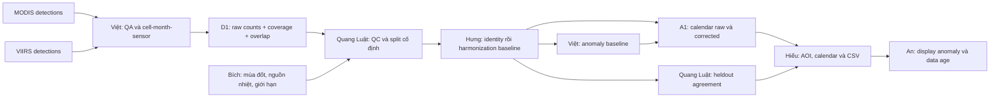

# MODIS/VIIRS — workflow FireSense

> Đề xuất 2026-10-30; chưa tải overlap hoặc fit model. [Brief](../../challenges/09-modis-viirs-hot-spots.md) · [Contract](../architecture.md) · [Lịch](../event-timeline.md).
> Core: chuỗi hotspot hài hòa và calendar. Mọi chỉ số hiệu chỉnh cần đơn vị riêng; hotspot không phải số vụ cháy hoặc diện tích cháy.

## Kiến trúc

**Việt — Technical Lead / DATA + AI:** sở hữu data pipeline, anomaly baseline, contract/integration và forecast extension nếu có điều kiện. **Hưng:** sở hữu harmonization B0/B1 và lựa chọn reference/policy cùng Bích. Quang Luật đánh giá độc lập cả hai nhánh; không chỉ giao Việt dọn dữ liệu.



Không bắt buộc gắn sensor nhiệt/khói; thiết bị của An trình bày kết quả và trạng thái dữ liệu. Quang Luật ưu tiên kiểm thống kê, chỉ hỗ trợ kiểm log display.

## Đầu vào và quyết định data

[FIRMS](https://firms.modaps.eosdis.nasa.gov/) là nguồn candidate được brief nhắc. Cần series MODIS/VIIRS trong cùng AOI và giai đoạn chồng lấn, sensor/platform, thời gian, vị trí, QA/confidence và product version. Chưa xác nhận cụ thể mẫu/coverage của team.

Quyết định trước: sensor/platform nào làm reference; cùng AOI/grid/time bins; cách giữ sensor/platform khi nhiều vệ tinh; policy lọc confidence theo định nghĩa từng product. Không dùng một numeric confidence cutoff cho các encoding khác nhau.

Giữ raw không sửa; loại duplicate bản ghi theo identity nguồn/metadata. Đừng xóa hai detection từ hai sensor như thể bản ghi trùng file. Đừng cộng mọi platform rồi so số đếm mà bỏ thay đổi sampling.

## DATA → AI: D1

**detections.csv:** record_id, sensor, platform, observed_at UTC, lon, lat, confidence_raw, qa_status, source_id. Các trường khác chỉ thêm nếu được xác nhận.

**features.csv: một dòng = cell_id × tháng × sensor_group**:

| Cột | Ý nghĩa |
| --- | --- |
| cell_id, month_start, sensor_group | Khóa; sensor_group có danh sách platform ổn định/version |
| raw_detection_count | Integer nullable; số detection sau policy; không là số sự kiện |
| source_record_count, filtered_count | Đối chiếu QC với raw |
| coverage_status | known_valid / partial / unknown / unavailable |
| observation_opportunities | Nullable; chỉ dùng khi có nguồn coverage đủ cơ sở |
| qa_policy_version, source_ids | Truy được quy tắc và nguồn |

Số ngày có hotspot **không phải** số ngày vệ tinh quan sát. Download thành công file hotspots cũng không chứng minh coverage đầy đủ. Không tự lấp tháng không có records bằng 0 trừ khi có căn cứ đã quan sát hợp lệ và không phát hiện.

Quang Luật kiểm tổng theo source, frequency, missing-month map, overlap, confidence encoding và sampling change. Bích rà nguồn nhiệt cố định/đốt nông nghiệp và giới hạn diễn giải; thiếu căn cứ thì ghi chưa phân loại.

## Baseline trước model nâng cao

**B0 — identity/no-adjustment:** raw MODIS và VIIRS song song cùng grid/tháng. Đây là baseline so, chưa phải hoàn thành harmonization.

**B1 — hiệu chỉnh tỷ lệ minh bạch trong một vùng hẹp:** chọn MODIS làm reference-scale cho ví dụ; trên **train overlap có coverage đủ điều kiện**, với VIIRS > 0:
alpha = median(MODIS_count / VIIRS_count).
VIIRS_corrected = alpha × VIIRS_count; MODIS_reference = MODIS_count.

- Output là **MODIS-reference detection index**, có thể là số thập phân; không gọi số vụ cháy thực hoặc xóa dấu vết sensor.
- Đây là baseline để kiểm tính khả thi, không đảm bảo bỏ được mọi khác biệt resolution/sensitivity.
- VIIRS=0, thiếu overlap hoặc coverage không đủ → không dùng cặp đó fit ratio; báo số cặp bị loại. Không thêm epsilon tùy tiện để tạo alpha.
- Fit alpha chỉ trên train; kiểm trên validation và test theo năm/khối thời gian. Không fit trên toàn overlap rồi báo MAE trên chính dữ liệu đó.
- Nhiều platform/miền khác nhau: một alpha có thể không ổn; xem residual theo mùa/platform trước khi dùng xuyên thời gian.
- Khi hai sensor cùng hiện diện, chọn reference có QA hoặc corrected theo policy cố định; không cộng hai series thành gấp đôi hoạt động.

Ví dụ synthetic cho công thức, giả định coverage hợp lệ:

| month | MODIS | VIIRS | split |
| --- | ---: | ---: | --- |
| SYN-M1 | 10 | 20 | train |
| SYN-M2 | 12 | 24 | train |
| SYN-M3 | 20 | 50 | test |

alpha=0.5 từ hai train pairs. Test: raw discrepancy abs(50−20)=30; corrected discrepancy abs(25−20)=5. Đây chỉ là kiểm arithmetic, **không là benchmark thật**. Hai cặp train không đủ chứng minh phương pháp dùng được ở vùng thật.

Candidate sau B1: constrained regression/season-specific correction khi đủ overlap và evaluation. Không đào sâu forecast trước khi B1 + calendar đúng core.

## Anomaly và prediction

Anomaly: so chỉ số tháng với median cùng tháng qua các năm reference; ghi reference window và coverage, không gán mọi khác biệt là thiên tai. Nếu lịch sử ít, hiển thị raw và không kết luận bất thường chắc chắn.

Forecast là extension: target chỉ số hoạt động tháng sau, baseline seasonal-naive, MAE cùng reference units; fit mọi correction/normalizer bằng training data để tránh leakage. Thiếu lịch sử dài/coverage → forecast=null. Không biến index thành xác suất cháy một nơi hoặc cảnh báo tác nghiệp.

## AI → DEPLOY: results trong A1

| Trường | Hiếu dùng để |
| --- | --- |
| cell_id, month_start | Liên kết AOI và calendar |
| raw_modis_count, raw_viirs_count | Chart raw, nullable |
| harmonized_value, harmonized_unit | Chart corrected, không đổi label thành fire_count |
| chosen_source, correction_version | Giải thích continuity policy |
| coverage_status, status | Hatching/empty khi thiếu; không tô như zero |
| anomaly, reference_period | So lịch sử đúng scope; nullable |
| evidence_ids | Xem nguồn và QA |

Payload synthetic từ ví dụ tính:

```json
{
  "cell_id": "SYN-C1",
  "month_start": "2024-03-01",
  "raw_modis_count": 20,
  "raw_viirs_count": 50,
  "harmonized_value": 20,
  "harmonized_unit": "MODIS-reference detection index",
  "chosen_source": "MODIS",
  "viirs_corrected_for_comparison": 25,
  "correction_version": "synthetic-alpha-0.5",
  "coverage_status": "known_valid",
  "status": "ok",
  "anomaly": null,
  "reference_period": null,
  "evidence_ids": ["synthetic-example"]
}
```

Ở overlap, policy chọn MODIS làm calendar reference; số 25 là corrected VIIRS để kiểm agreement. Khi chỉ có VIIRS hợp lệ, harmonized_value mới lấy corrected. UI vẫn cho xem cả raw lẫn corrected, không giấu sai khác.

## Cả team và tiêu chí bàn giao

| Mốc | Đầu ra / người phụ trách |
| --- | --- |
| T+0→2 | Việt sample overlap; Quang Luật kiểm keys/coverage; Bích AOI/context; Hưng chốt target scale; Hiếu/An đọc A1 mẫu |
| T+2→6 | Việt D1; Quang Luật Q1 + split; Hưng B0/B1; Hiếu calendar raw; An display độc lập |
| T+6→12 | Hưng harmonization A1, Việt anomaly A1 và rà contract tích hợp; Quang Luật so heldout bias/MAE, Bích kiểm seasonality; Hiếu ghép CSV; An summary |
| Sau T+12 | Nếu B1 ổn, một candidate; Quang Luật E1/report; Bích limitations; Hiếu/An rehearsal |
| D−8h | Đóng correction version, policy, plots; chỉ sửa lỗi |

E1 của Quang Luật: bias = mean(corrected−reference), MAE, n/cell/month coverage, residual theo mùa/platform, so B0 trên cùng holdout; bản đồ/calendar trước-sau. Nếu không cải thiện hoặc xóa mùa vụ thật, báo B1 chưa đạt; không tuyên bố harmonized đáng tin chỉ vì chart mượt.

## Cắt scope

Một AOI, một grid, monthly, platform groups rõ; dữ liệu lịch sử dài đến mức lấy được. Brief muốn chuỗi dài từ đầu 2000s đến nay; mẫu vài năm chỉ là prototype chưa đủ coverage đầy đủ. Không có overlap dùng được → không giải được core harmonization, cần đổi scope/bài ở gate đầu. Không có hardware → dashboard vẫn làm được, An có thể kiểm device/display contract và replay đúng nhãn.

