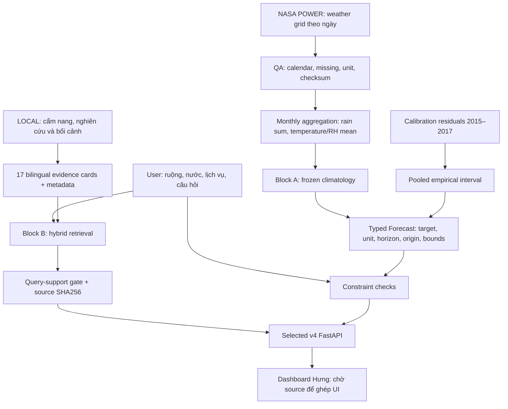

# Kiến trúc AI v4: dữ liệu đi qua những gì?

Hệ thống có hai block độc lập. **Block A — Machine Learning (ML)** tạo ước tính khí hậu theo tháng. **Block B — Retrieval-Augmented Generation (RAG)** tìm bằng chứng và tạo câu trả lời có nguồn, kết hợp kiểm tra điều kiện ruộng. Dự báo mưa không tự biến thành lời khẳng định cây nào tốt nhất.

**Climatology** là thống kê các tháng cùng mùa trong lịch sử: chẳng hạn ước tính một tháng12 dựa trên các tháng12 đã biết ở train. V3 đã thử model phức tạp hơn, nhưng chưa vượt đủ tiêu chí chọn thận trọng; vì thế selected v4 giữ mean climatology ở cả sáu task. “Model artifact” ở đây vẫn chứa thống kê đã fit, thông tin target/horizon/calibration và provenance, không phải neural network.

**Horizon** là khoảng từ forecast origin tới tháng mục tiêu, hiện1 và3 tháng. Có thêm một tháng buffer cho availability: dự báo target t ở origin t-h chỉ dùng quan trắc đến t-h-1. Tháng phải đủ lịch và đơn vị nhất quán. Đây là retrospective hindcast trên ước lượng lưới NASA, chưa chứng minh operational forecast skill tại ruộng.

**Prediction interval** gồm lower/upper, như một dải để nhìn rủi ro thay vì một số chắc chắn. Pooled calibration gom sai số từ giai đoạn calibration riêng rồi lấy empirical quantile cho mục tiêu80%. Nominal80% là mức mong muốn; `coverage_guaranteed=false`, không đồng nghĩa80% thực tế. Coverage mưa final chỉ67,7%.

**Hybrid retrieval** kết hợp BM25 ở mức từ và character TF-IDF ở mức cụm ký tự. Cách này hỗ trợ câu hỏi tiếng Việt/Anh, khác biệt dấu và cách viết. V4 giữ retriever v2; điểm mới nằm ở gate sau retrieval và kiểm tính toàn vẹn nguồn.

**Query-support gate** hỏi: các từ mang thông tin trong câu hỏi có được card đang chọn hỗ trợ đủ không? Nó giảm việc thấy chữ “lúa” rồi trả một card về lúa cho câu hỏi thị trường hoặc dinh dưỡng. Đây là lexical heuristic, chưa phải semantic entailment hoàn chỉnh.

**SHA256** là dấu vân tay của file. Citation phải có source ID, URL, locator và hash; v4 kiểm bytes nguồn lúc trả lời. Hash đúng chứng minh đúng bản file đã pin, không chứng minh mọi diễn giải nông học đúng.

**Constrained extractive generation** xuất nguyên nội dung card song ngữ do analyst biên soạn. Không có LLM tự viết con số nông học mới; không gọi đây là LLM fine-tuning. Card là paraphrase có nguồn, không phải nguyên văn PDF. Thiếu nguồn/bằng chứng thì **abstention**: trả insufficient_evidence.

**Constraint checks** dùng điều kiện do người dùng khai báo, như thoát nước kém hoặc mặn/phèn, để block hoặc hỏi thêm. Kết quả là conditional_reference / needs_information / blocked; rank, score, probability vẫn null và domain_approved=false. Forecast chỉ là context tưới–tiêu; không suy ra tăng năng suất, tiết kiệm nước hoặc lợi nhuận.

**Interface contract** khóa tên target, units, region, origin, tháng mục tiêu, bounds; chặn NaN/Infinity, sai đơn vị/vùng, horizon không khớp, bounds sai và input tương lai. Nhờ vậy có thể kiểm ML riêng, RAG riêng và truy lỗi DATA/ML/retrieval/API thay vì chỉ nhìn UI.
